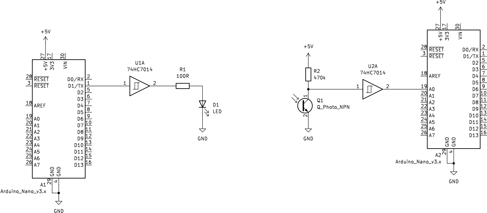

## Optične komunikacije

Optične komunikacije omogočajo prenos informacije s svetlobo. Uporabljamo jih
na primer pri infrardečih daljinskih upravljalnikih, optičnih vlaknih,
svetlobnih vratih, optičnih tipalih in optičnih spojnikih.

Optični komunikacijski sistem obravnavamo kot celoto:

1. električni signal krmili svetlobni vir,
2. svetloba potuje po optičnem kanalu – po prostem prostoru ali optičnem vodniku,
3. svetlobni sprejemnik pretvori svetlobo v električni signal,
4. obdelovalno vezje signal po potrebi ojači, filtrira ali pretvori v logični
   signal za nadaljnjo elektroniko.

<!-- KIČAD RISBA: Blokovni diagram celotnega optičnega komunikacijskega sistema:
     oddajnik (krmilnik + upor + LED), optični kanal (prostor ali vlakno),
     sprejemnik (fotodioda/fototranzistor + pretvornik) in izhod (komparator ali
     mikrokrmilnik). Puščice naj kažejo smer prenosa informacije. -->

{#fig:blokovni-diagram-opticne-komunikacije}

V nadaljevanju najprej obravnavamo digitalni optični prenos, nato svetlobne
oddajnike in sprejemnike ter vezja za oblikovanje digitalnega signala. Na koncu
so predstavljene optične povezave in praktične naloge. Analogni optični prenos
je obravnavan v ločenem podpoglavju.
