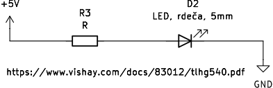
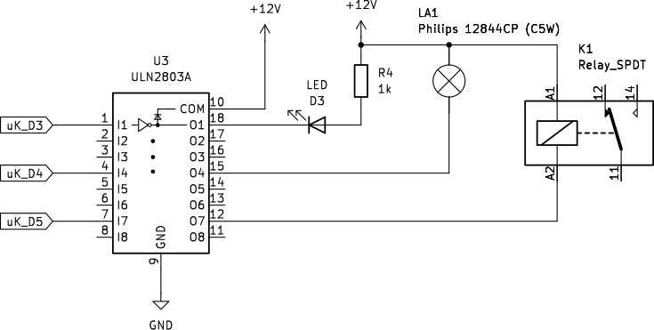
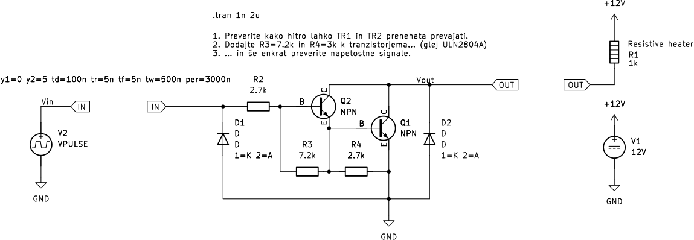

## Svetlobni oddajnik

### Svetleča dioda

Svetleča dioda (LED) je polprevodniška dioda, ki pri prevajanju oddaja svetlobo.
Elektroni in vrzeli se v območju p-n-spoja rekombinirajo; pri tem nastanejo fotoni.
LED je treba priključiti v prevodni smeri in tok skozi njo omejiti. Sama LED ni
omejevalnik toka: že majhno povečanje napetosti $U$ lahko povzroči veliko povečanje
toka in poškoduje diodo.

Za zaporedni upor velja:

$$
R_\mathrm{LED}=\frac{U_\mathrm{nap}-U_F}{I_F},
$$

kjer so $U_\mathrm{nap}$ napajalna napetost, $U_F$ napetost na LED in $I_F$
izbrani tok. Pri izbiri upora preverimo še njegovo moč:

$$
P_R=I_F^2R_\mathrm{LED}.
$$

Primer: pri napajanju $5\,\mathrm{V}$, rdeči LED z $U_F=2\,\mathrm{V}$ in toku
$10\,\mathrm{mA}$ dobimo $R_\mathrm{LED}=300\,\Omega$. Izberemo lahko standardno
vrednost $330\,\Omega$; tok bo nekoliko manjši, kar je varnejša izbira.

Barva LED je povezana z valovno dolžino $\lambda$. Zelo poenostavljen približek
za energijo fotona je:

$$
e_0 U_F \approx \frac{hc}{\lambda},
$$

kjer je $e_0=1{,}602\cdot10^{-19}\,\mathrm{C}$ osnovni naboj, $h$ Planckova
konstanta in $c$ hitrost svetlobe v vakuumu. Enačba je le približek: $U_F$ ni
točno določena konstanta, nanjo vplivajo tok, temperatura in tehnologija LED.

Pri optičnem prenosu sta pomembnejša od same barve predvsem spekter oddane
svetlobe in ujemanje s sprejemnikom, sevalna moč in sevalni kot, hitrost vklopa in
izklopa ter dovoljeno območje toka.

Električna vhodna moč LED je $P_\mathrm{el}=U_FI_F$, vendar ta ni enaka svetlobni
moči. Del energije se pretvori v toploto. Svetlost oziroma zaznana svetilnost je
odvisna tudi od valovne dolžine, smeri sevanja in značilnosti človeškega očesa.

V nadaljevanju uporabimo rdečo LED **Vishay TLHR5400**, ki je nameščena v
standardnem 5-mm difuznem ohišju. Pri toku približno $10\,\mathrm{mA}$ je njena
tipična napetost $U_F$ okoli $2\,\mathrm{V}$. Pri napajanju $5\,\mathrm{V}$ zato
izračunamo $R_\mathrm{LED}=300\,\Omega$; v praktičnem vezju izberemo standardni
upor $330\,\Omega$, s katerim bo tok približno $9\,\mathrm{mA}$. Pred uporabo
preverimo še dejanske mejne vrednosti in priključke v [podatkovnem listu LED
TLHR5400 proizvajalca Vishay](https://www.vishay.com/docs/83012/tlhg540.pdf).

<!-- KIČAD RISBA: Osnovno vezje LED z zaporednim uporom. Označi +5 V, upor,
     anodo in katodo LED, smer toka, U_F in I_F. Dodaj merilni točki za merjenje
     napetosti na LED in toka skozi LED. -->
{#fig:led-zaporedni-upor}

### Krmiljenje LED z izhodom krmilnika

Izhod mikrokrmilnika lahko LED krmili neposredno samo takrat, ko tok LED ne presega
dovoljenega toka izhoda. Če potrebujemo večji tok ali želimo izhod mikrokrmilnika
zaščititi pred obremenitvijo, uporabimo tranzistor kot stikalo.

#### NPN-tranzistor kot stikalo

Pri običajni vezavi "tranzistorja kot stikala" je LED z zaporednim uporom priključena med pozitivno napajanje in kolektor NPN-tranzistorja, emitor pa je priključen na ničelni napetostni potencial $V=0$. Majhen tok v bazo tako krmili večji tok skozi kolektor. Tranzistor deluje kot stikalo: pri nizki vhodni napetosti je zaprt, pri dovolj visoki pa ga krmilimo v nasičenje.

Za osnovni izračun baznega upora uporabimo:

$$
R_B=\frac{U_\mathrm{izh}-U_{BE}}{I_B},
\qquad
I_B\geq\frac{I_C}{\beta_\mathrm{min}}.
$$

Pri načrtovanju stikala uporabimo minimalni tokovni ojačevalni faktor, na primer $\beta_\mathrm{min}=10$, in ne največjega $\beta$ iz podatkovnega lista. S tem zagotovimo nasičenje tudi pri različnih pogojih delovanja tranzistorja. Za vhod $5\,\mathrm{V}$, $U_{BE}\approx0{,}7\,\mathrm{V}$ in bazni tok $1\,\mathrm{mA}$ dobimo približno $R_B=4{,}3\,\mathrm{k}\Omega$; uporabimo lahko standardni upor $4{,}7\,\mathrm{k}\Omega$.

Pri tej rešitvi se pojavijo tri praktične težave:

- izhod krmilnika mora zagotavljati bazni tok,
- pri večjem kolektorskem toku mora biti bazni tok sorazmerno večji,
- napetost $U_{CE}$ in moč tranzistorja lahko postaneta pomembna.

<!-- KIČAD RISBA: Nizkostransko stikalo z enim NPN-tranzistorjem. Prikaži
     mikrokrmilnik, bazni upor R_B, tranzistor Q1, LED z uporom R_LED, napajanje
     +5 V in maso. Poleg LED prikaži še različico z relejem in povratno diodo. -->
{#fig:npn-stikalo-led-rele}

Predstavljajmo si breme, ki potrebuje $I_C=200\,\mathrm{mA}$. Če za zanesljivo
nasičenje izberemo minimalni tokovni ojačevalni faktor $\beta_\mathrm{min}=10$,
bi moral bazni tok znašati najmanj $I_B=20\,\mathrm{mA}$. Tak tok je za številne
izhode mikrokrmilnikov že prevelik oziroma bi močno obremenil izhodni priključek.
Če bazni tok zmanjšamo, tranzistor morda ne bo več v nasičenju, napetost $U_{CE}$
na njem se poveča, s tem pa tudi njegova moč in segrevanje. Z izbiro drugega
posameznega tranzistorja lahko težavo včasih zmanjšamo, vendar smo še vedno
omejeni z razpoložljivim baznim tokom krmilnika. V takem primeru potrebujemo
vezje z večjim skupnim tokovnim ojačanjem.

Še bolj nazoren primer je avtomobilska žarnica **Philips 12844CP (C5W)**, ki se
uporablja tudi za osvetlitev registrske tablice. Nazivni podatki so $12\,\mathrm{V}$
in $5\,\mathrm{W}$, zato je njen nazivni tok približno

$$
I_\mathrm{žarnice}=\frac{P}{U}=\frac{5\,\mathrm{W}}{12\,\mathrm{V}}
\approx0{,}42\,\mathrm{A}.
$$

Če bi za zanesljivo nasičenje tranzistorja uporabili $\beta_\mathrm{min}=10$,
bi potrebovali bazni tok približno $42\,\mathrm{mA}$. To je za izhod
mikrokrmilnika prevelika obremenitev. Poleg tega ima žarnica pri vklopu zaradi
hladne žarilne nitke večji kratkotrajni zagonski tok od nazivnega. Zato potrebujemo
zmogljivejši gonilnik ali več tranzistorjev. Podatki za žarnico so navedeni v
[podatkovnem listu Philips 12844CP](https://www.documents.philips.com/assets/20230213/a000b00145024171b9f7afa80125919e.pdf).

#### Darlingtonov spoj kot izboljšava

Če en tranzistor zahteva prevelik bazni tok, uporabimo Darlingtonov spoj. Sestavljata
ga dva tranzistorja, pri katerih prvi krmili bazo drugega. Skupni tokovni ojačevalni
faktor je približno:

$$
\beta_D\approx\beta_1\beta_2.
$$

Zato lahko enak kolektorski tok krmilimo z bistveno manjšim vhodnim tokom. Slabosti Darlingtonovega spoja je večja napetost $U_{CE}$ na vključnem tranzistorju v vključenem stanju, nekoliko počasnejši izklop in večja toplotna izguba kot pri dobro izbranem posameznem tranzistorju.

V praksi pogosto uporabimo integrirano vezje z več Darlingtonovimi izhodi, na primer [ULN2803A](https://www.farnell.com/datasheets/1690352.pdf) ali ULN2804A. Njegov izhod z odprtim kolektorjem deluje kot stikalo proti ničelnemu napetostnemu potencialu $V=0$: ko je vključen, breme poveže z ničelnim napetostnim potencialom $V=0$; ko je izključen, je kolektorski izhod odprt. Breme mora biti zato priključeno med pozitivno napajanje in izhod gonilnika. Pri LED še vedno uporabimo ustrezen zaporedni upor, razen če ga vsebuje že modul, ki ga uporabljamo.

Pri induktivnem bremenu so zaščitne diode v ULN2803A običajno že vgrajene, vendar
mora biti skupni priključek za te diode pravilno povezan na pozitivno napajanje
bremena.

<!-- KIČAD RISBA: En kanal ULN2803A kot stikalo za LED in drugi kanal kot stikalo
     za rele. Označi vhod iz mikrokrmilnika, skupno maso, napajanje bremena,
     zaporedni upor LED in povratno diodo pri releju. -->
{#fig:uln2803-led-rele}

V [KiCadovem simulacijskem projektu Darlingtonovega gonilnika](./circ/1.2_Svetlobni_oddajnik/110_Darlington_open_collector/110_Darlingtom_open_collector.kicad_pro) sta predvidena tudi upora med bazo in emitorjem tranzistorjev Q1 in Q2, tako kot predvideva podatkovni list [ULN2803A](https://www.farnell.com/datasheets/1690352.pdf). Glavna shema je v datoteki [110_Darlingtom_open_collector.kicad_sch](./circ/1.2_Svetlobni_oddajnik/110_Darlington_open_collector/110_Darlingtom_open_collector.kicad_sch).

{#fig:shema_prikljucka_uln2803A}

Njuna naloga je odvajanje naboja iz baz, zagotavljanje zanesljivega izklopa in skrajšanje časa prehoda v zaporno stanje. Pri vklopu pa odvzemata del baznega toka, zato morata biti izbrana kot kompromis med hitrim izklopom in majhno obremenitvijo krmilnega vira. V pripravljeni simulaciji sta R3 in R4 pripravljena za primerjavo, vendar trenutno nista električno povezana; vpliv njune pravilne vezave lahko preskusite v simulaciji vezja. Preučite razliko v časovnem odzivu za vhodno in izhodno napetost ter tok skozi porabnik.
