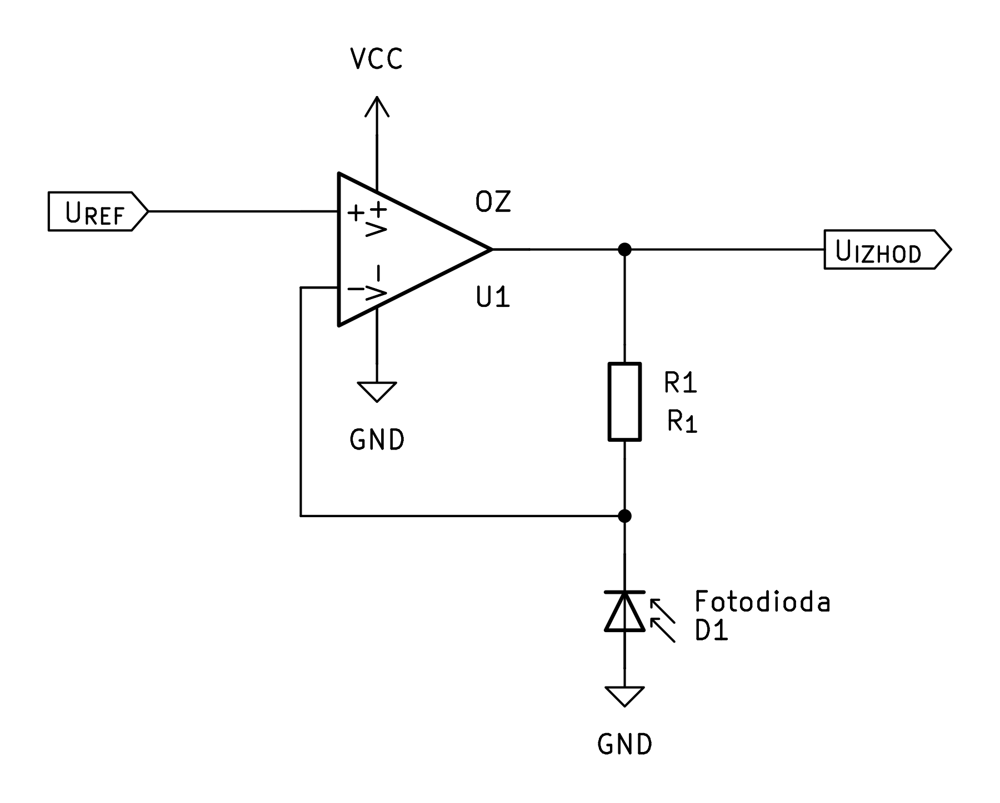

## Analogni optični prenos

Praktičen primer prenosa signala prek galvansko ločilne meje je regulacijska zanka izoliranega stikalnega napajalnika, na primer napajalnika za prenosni računalnik. Transformator loči primarno in sekundarno stran močnostnega vezja, optični spojnik pa brez električne povezave prenese povratni signal med njima. Na sekundarni strani vezje s TL431 zazna odstopanje izhodne napetosti in uravnava tok skozi svetlečo diodo optičnega spojnika; fototranzistor na primarni strani prenese informacijo do krmilnika, ki prilagodi delovanje pretvornika. Uradno poročilo Texas Instruments prikazuje celotno izvedbo z UCC28740 in TL431: [slika 1 na 2. strani poročila](https://www.ti.com/lit/an/sluaa66/sluaa66.pdf) [@TexasInstruments2020UCC28740OptoFeedback]. To je zelo pogost primer uporabe optičnega prenosa informacij, kjer izkoriščamo linearno odvisnost izsevane svetlobe od toka, ki teče skozi svetlečo diodo.

V svetleči diodi se lahko pri rekombinaciji elektrona in vrzeli energija sprosti z izsevanjem fotona. V ustreznem delovnem območju se svetlobni izhod LED približno sorazmerno spreminja s tokom skozi diodo; primer je naveden v podatkovnem listu proizvajalca [@Everlight6711UB0200HAM]. Če vhodni signal pretvorimo v ustrezno spreminjajoč se tok, lahko njegove spremembe prenesemo s svetlobo. Ta približna linearnost je odvisna od delovne točke, vrste LED in temperature.

Pri opisu optičnega prenosa je treba razlikovati med fotometričnimi veličinami, ki upoštevajo občutljivost človeškega vida, in sevalnim tokom oziroma izsevano optično močjo $\Phi_\mathrm{e}$, merjeno v vatih. Ker fotodioda zaznava optično sevanje, bomo v nadaljnji obravnavi uporabljali sevalni tok [@NISTSP25095PhotometricCalibrations].

### Napetostno-tokovni pretvornik

Če želimo, da vhodna napetost določa tok skozi breme, lahko uporabimo operacijski ojačevalnik. Referenčni upor $R_\mathrm{ref}$ priključimo v povratno vezavo tako, da operacijski ojačevalnik uravnava napetost na njem. Ker je tok skozi upor določen z napetostjo na njem, z izbiro $R_\mathrm{ref}$ določimo pretvorbeni koeficient.

V osnovni vezavi je neinvertirajoči vhod priključen na vhodno napetost $U_\mathrm{vh}$. Breme je vezano med izhod operacijskega ojačevalnika in vozlišče A, ki je povezano z invertirajočim vhodom ter z uporom $R_\mathrm{ref}$ proti ničelnemu napetostnemu potencialu.

{#fig:napetostno-tokovni-pretvornik}

Vezje deluje v negativni povratni vezavi. Idealen operacijski ojačevalnik uravna napetost na vozlišču A tako, da velja $U_A\approx U_\mathrm{vh}$. Tok v vhod operacijskega ojačevalnika je zanemarljiv, zato je tok skozi breme približno enak toku skozi referenčni upor:

$$
I_\mathrm{breme}\approx I_\mathrm{ref}=\frac{U_A}{R_\mathrm{ref}}\approx\frac{U_\mathrm{vh}}{R_\mathrm{ref}}.
$$

Pretvorbeni koeficient oziroma transkonduktanca vezja je tako:

$$
G_m=\frac{I_\mathrm{breme}}{U_\mathrm{vh}}\approx\frac{1}{R_\mathrm{ref}}.
$$

Če želimo pri največji vhodni napetosti $U_{\mathrm{vh,max}}$ doseči največji tok $I_{\mathrm{breme,max}}$, izberemo:

$$
R_\mathrm{ref}\approx\frac{U_{\mathrm{vh,max}}}{I_{\mathrm{breme,max}}}.
$$

Pri načrtovanju preverimo še moč na referenčnem uporu, ki je približno $P_\mathrm{ref}=U_\mathrm{vh}^2/R_\mathrm{ref}$, ter območje izhodne napetosti in največji izhodni tok operacijskega ojačevalnika. Za uporovno breme velja približno $U_\mathrm{iz}=U_\mathrm{vh}+I_\mathrm{breme}R_\mathrm{breme}$. Če zahtevana izhodna napetost ali tok preseže zmožnosti operacijskega ojačevalnika, tok ne bo več sledil zgornji enačbi.

Za krmiljenje večjih tokov lahko operacijski ojačevalnik uporabimo za krmiljenje NPN-tranzistorja. Tranzistor prevzame tok bremena, operacijski ojačevalnik pa prek upora $R_S$ meri tok na emitorju in uravnava bazni tok. Tako lahko ohranimo enak princip povratne vezave, ne da bi celoten tok bremena tekel skozi izhod operacijskega ojačevalnika.

<!-- KiCAD SHEMA: Napetostno-tokovni pretvornik za večji tok z NPN-tranzistorjem. Pozitivni priključek napajanja +U_C poveži prek bremena R_breme s kolektorjem NPN-tranzistorja Q1. Emitor Q1 poveži z zgornjim priključkom merilnega upora R_S, spodnji priključek R_S pa z V=0. Neinvertirajoči vhod OZ priključi na U_vh, invertirajoči vhod pa na emitor Q1 (vozlišče med emitorjem in R_S). Izhod OZ poveži z bazo Q1, po želji prek baznega upora R_B. Označi tok skozi breme in tranzistor. -->
{#fig:napetostno-tokovni-pretvornik-npn}

Povratna vezava uravnava emitorsko napetost na približno $U_E\approx U_\mathrm{vh}$, zato sta emitorski tok in tok bremena približno:

$$
I_E\approx\frac{U_\mathrm{vh}}{R_S},\qquad
I_\mathrm{breme}=I_C\approx\frac{\beta}{\beta+1}I_E\approx\frac{U_\mathrm{vh}}{R_S},
$$

kjer je $\beta$ tokovno ojačenje tranzistorja. Za natančnejši izračun upoštevamo razliko med emitorskim in kolektorskim tokom. Tranzistor mora ostati v aktivnem območju, operacijski ojačevalnik pa mora imeti dovolj napetostnega območja za krmiljenje baze. Preverimo tudi disipacijo tranzistorja in dovoljeno moč upora $R_S$.

### Tokovno-napetostni pretvornik

Za načrtovanje izberimo konkretno fotodiodo OSRAM SFH 2770 A01. Njen [podatkovni list](https://look.ams-osram.com/m/252e1ca1172030b9/original/SFH-2770-A01.pdf) navaja fototok pri zaporni napetosti $1\,\mathrm{V}$ in določa največjo zaporno napetost $2\,\mathrm{V}$ [@OSRAM_SFH2770A01_2024]. Zato v tem primeru za delovno točko izberemo zaporno napetost $U_D=1\,\mathrm{V}$. To vzpostavimo tako, da na neinvertirajoči vhod operacijskega ojačevalnika priključimo referenčno napetost $U_\mathrm{ref}=1\,\mathrm{V}$. Anoda fotodiode je priključena na GND, katoda pa na invertirajoči vhod.

<!-- KiCAD SHEMA: Tokovno-napetostni pretvornik s fotodiodo. Neinvertirajoči vhod operacijskega ojačevalnika priključi na referenčno napetost U_REF. Katodo fotodiode poveži z invertirajočim vhodom, anodo pa z GND. Upor R_1 veži med invertirajoči vhod in izhod U_IZHOD. Napajalni priključek VEE poveži z GND. Označi zaporno polarizacijo fotodiode. -->
{#fig:transimpedancni-ojačevalnik}

Slika @fig:transimpedancni-ojačevalnik prikazuje opisano vezavo. Negativna povratna vezava povzroči, da operacijski ojačevalnik uravnava izhod tako, da sta napetostna potenciala na vhodih približno enaka, $V_+\approx V_-$. Ker je neinvertirajoči vhod na potencialu, ki ustreza referenčni napetosti $U_\mathrm{ref}$ glede na GND, je tudi potencial invertirajočega vhoda približno enak. Zato je fotodioda zaporno polarizirana z napetostjo približno $U_D=U_\mathrm{ref}$. To velja, dokler operacijski ojačevalnik deluje v linearnem območju in njegov izhod ni nasičen.

Fototok $I_\mathrm{foto}$ teče skozi povratni upor $R_1$. Če zanemarimo vhodni tok operacijskega ojačevalnika, je tok skozi upor približno enak fototoku, $I_{R_1}\approx I_\mathrm{foto}$. Napetost $U_{R_1}$ definiramo od izhoda proti invertirajočemu vhodu, zato za prikazano orientacijo fotodiode velja:

$$
U_\mathrm{izh}=U_\mathrm{ref}+U_{R_1}
=U_\mathrm{ref}+R_1 I_{R_1}
\approx U_\mathrm{ref}+R_1 I_\mathrm{foto}.
$$

Pri nespremenjenih pogojih, zlasti pri nespremenjenem spektru svetlobe, je fototok približno sorazmeren vpadnemu svetlobnemu toku. Zato je tudi izhodna napetost od njega linearno odvisna. Z uporom $R_1$ določimo koeficient pretvorbe: večji $R_1$ pomeni večjo spremembo izhodne napetosti pri enaki spremembi fototoka. Pri nasprotni orientaciji fotodiode se predznak spremembe izhodne napetosti obrne.

Pri izbiri $R_1$ uporabimo približek $R_1=\Delta U_\mathrm{izh}/\Delta I_\mathrm{foto}$. Preverimo še največji fototok, zahtevano zaporno napetost fotodiode ter dovoljeno vhodno in izhodno območje operacijskega ojačevalnika. Vzporedni kondenzator $C_F$ lahko izboljša stabilnost in omeji visokofrekvenčni šum, vendar zmanjša pasovno širino.

