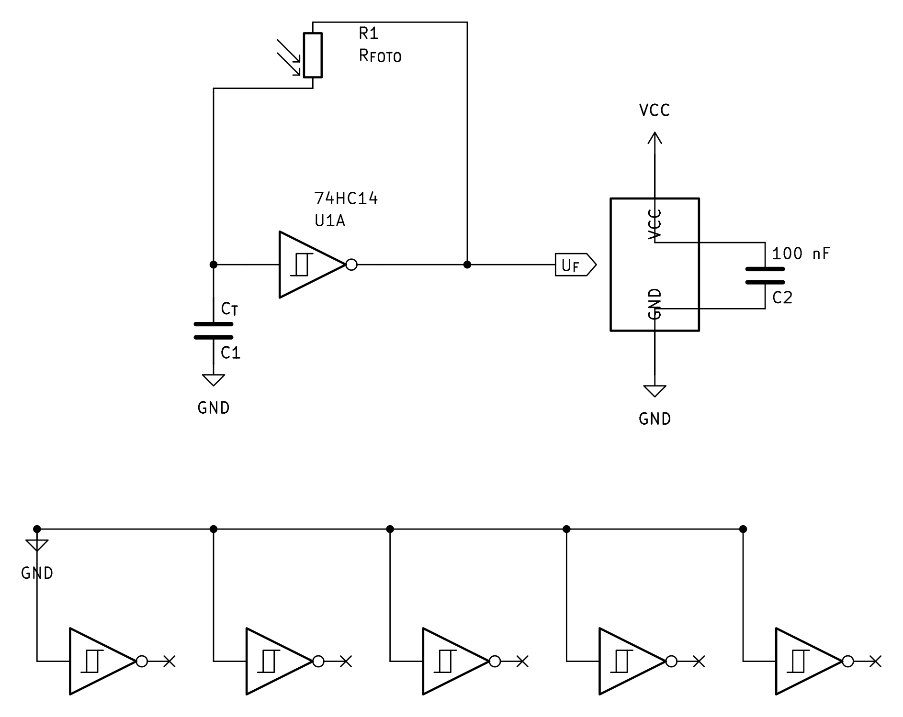

FREKVENČNA MODULACIJA
--------------------------------------------------------------------------------

Pri frekvenčni modulaciji informacijo prenesemo tako, da se frekvenca izhodnega signala spreminja glede na modulirajoči signal, njegova amplituda pa ostaja približno stalna. V prejšnjih poglavjih smo spoznali Schmittov sprožilnik in integrirano vezje 74HC14, ki vsebuje šest invertirajočih Schmittovih sprožilnikov. Njegovo histerezo lahko uporabimo za preprosto oscilatorsko vezje: kondenzator se prek upora izmenično polni in prazni, izhod 74HC14 pa preklopi, ko napetost na kondenzatorju doseže enega od vhodnih pragov.

Če je časovni upor fotoupor, se njegova upornost spreminja z osvetljenostjo, s tem pa tudi frekvenca oscilatorja. Tako lahko spremembo svetlobnega signala predstavimo s spremembo frekvence pravokotnega izhodnega signala. Vezje je zato nazoren primer pretvorbe svetlobnega signala v frekvenčni signal in navezava na obravnavo senzorjev ter Schmittovega sprožilnika.

## Oscilator s Schmittovim sprožilnikom 74HC14

Osnovno vezje sestavljajo en Schmittov sprožilnik iz 74HC14, upor $R_T$ med izhodom in vhodom ter kondenzator $C_T$ med vhodnim vozliščem in GND. Ko je izhod na visokem napetostnem nivoju, se kondenzator polni prek $R_T$. Ko napetost na vhodu doseže zgornji prag sprožilnika, izhod preklopi na nizek nivo in kondenzator se začne prazniti. Ko napetost pade pod spodnji prag, izhod preklopi nazaj na visok nivo. Cikel se ponavlja.

Sprožilnik torej določa meji preklopa, časovna konstanta upora in kondenzatorja pa določa, kako hitro ju kondenzator doseže. Za orientacijsko oceno frekvence lahko uporabimo zvezo

$$
f \approx \frac{1}{K R_T C_T},
$$

kjer je $K$ faktor, odvisen od napajalne napetosti in pragov konkretnega 74HC14. Zato zveza ni univerzalna natančna enačba za vse izvedbe. Podatkovni list Nexperie prikaže oscilatorsko vezavo in podaja tipično odvisnost faktorja $K$ od napajanja [@Nexperia2024_74HCHCT14]. Uporabljeni napetostni nivoji izhoda so omejeni z napajanjem vezja; 74HC14 je predviden za napajanje v območju od 2 V do 6 V.

Vezje z uporom oziroma fotouporom v časovni veji je prikazano na [sliki @fig:oscilator-74hc14]. Za zaznavanje osvetljenosti lahko $R_T$ nadomestimo s fotouporom ali ga sestavimo iz fotoupora in stalnega upora. Ko se osvetljenost poveča, se upornost fotoupora praviloma zmanjša, zato se kondenzator polni in prazni hitreje, frekvenca pa se poveča. Stalni upor lahko omeji območje upornosti in s tem tudi območje frekvenc. V praksi je treba izbrati elemente tako, da vhod kondenzatorja pri vseh pričakovanih osvetljenostih doseže oba praga preklopa.

<!-- KiCAD SHEMA: Osnovni RC-oscilator z enim invertirajočim Schmittovim sprožilnikom iz 74HC14. Fotoupor R_{FOTO} poveži med izhodom izbranega sprožilnika in njegovim vhodnim vozliščem. Kondenzator C_{T} poveži med vhodno vozlišče in GND. Vhodno vozlišče je skupna točka fotoupora, kondenzatorja in vhoda Schmittovega sprožilnika. Napajalni priključek vezja poveži na VCC in GND, ob napajalnem delu prikaži kondenzator za razklop 100 nF. Izhodni pravokotni signal označi z globalno oznako Output z imenom U_{F}. Ne dodajaj ločenega analognega krmilnega vhoda. Preostale vhode neuporabljenih sprožilnikov veži na GND, njihove izhode označi kot nepovezane. Številk priključkov na končni sliki ne prikazuj. -->
{#fig:oscilator-74hc14}

Za preizkus v ngspice sta pripravljena [simulacijski model 74HC14](./circ/2.1_Frekvenčna_modulacija/74HC14_idealiziran.lib) in [simulacijska datoteka oscilatorja](./circ/2.1_Frekvenčna_modulacija/210_Oscilator_74HC14.cir). Model je poenostavljen: pri napajanju 5 V predpostavi spodnji prag 2 V in zgornji prag 3 V, zato ponazori osciliranje in vpliv časovne konstante, ne pa natančnih lastnosti določenega proizvajalčevega vezja. Za primerjavo z dejanskimi vrednostmi pragov uporabite [podatkovni list 74HC14/74HCT14 (PDF, Nexperia)](https://assets.nexperia.com/documents/data-sheet/74HC_HCT14.pdf), zlasti tabelo električnih lastnosti. V njej so navedene mejne vrednosti za konkretno družino vezij; te se lahko razlikujejo od poenostavljenih pragov v simulaciji. Simulacijski primer po 20 ms preklopi časovni upor s $100\,\mathrm{k}\Omega$ na $200\,\mathrm{k}\Omega$. Spremenite parametre `RPHOTO1`, `RPHOTO2` ali `TSTEP` v datoteki `.cir`, da preizkusite druge upornosti ali čas preklopa. Pri uporabljenem kondenzatorju $C_T=100\,\mathrm{nF}$ simulacija izpiše frekvenci približno 120 Hz in 60 Hz. Datoteko zaženemo z ukazom `ngspice -b 210_Oscilator_74HC14.cir` iz mape `circ/2.1_Frekvenčna_modulacija`.

V tem primeru fotoupor neposredno spreminja časovno konstanto oscilatorja. To je preprosta pretvorba osvetljenosti v frekvenco, ne pa splošen napetostno-frekvenčni pretvornik: 74HC14 nima analognega krmilnega vhoda, s katerim bi vhodna napetost neposredno nastavljala frekvenco. Za prenos že oblikovanega analognega napetostnega signala v frekvenco potrebujemo dodatno vezje, ki napetost pretvori v polnilni tok ali v spremenljivo časovno upornost. V splošnem lahko takšno idealizirano odvisnost zapišemo kot

$$
f(t)=f_0+k_f U_\mathrm{m}(t),
$$

kjer je $f_0$ frekvenca pri ničelnem modulirajočem signalu, $U_\mathrm{m}(t)$ modulirajoča napetost, $k_f$ pa občutljivost pretvorbe v hercih na volt.

## Povzetek

- Pri frekvenčni modulaciji se informacija kaže v spremembi frekvence izhodnega signala.
- Schmittova histereza v 74HC14 omogoča preprosto izvedbo oscilatorja z uporom in kondenzatorjem.
- Če je časovni upor fotoupor, osvetljenost spreminja frekvenco; to je pretvorba svetlobnega signala v frekvenco.
- Za napetostno krmiljenje frekvence potrebujemo dodatno vezje, saj vhod 74HC14 ni analogni krmilni vhod.

## Vprašanja za preverjanje

1. Kako Schmittov sprožilnik in časovni člen $R_T C_T$ skupaj ustvarita nihanje?
2. Kaj se zgodi s frekvenco, če se upornost fotoupora zmanjša?
3. Zakaj oscilator s fotouporom ni isto kot splošen napetostno-frekvenčni pretvornik?
4. Zakaj je treba dejansko frekvenco preveriti pri izbranem 74HC14 in napajalni napetosti?
