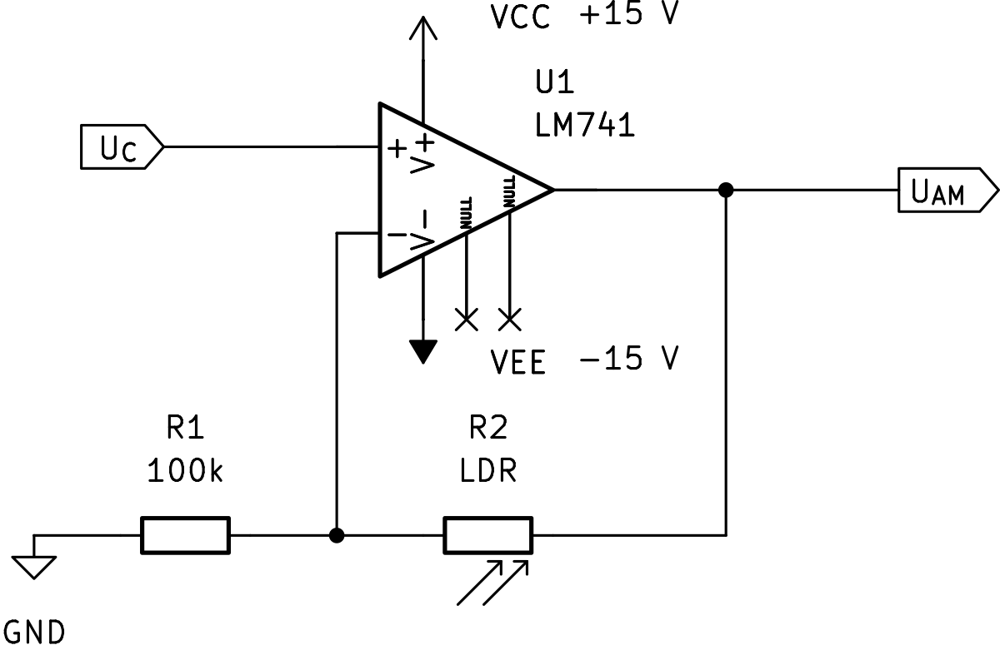
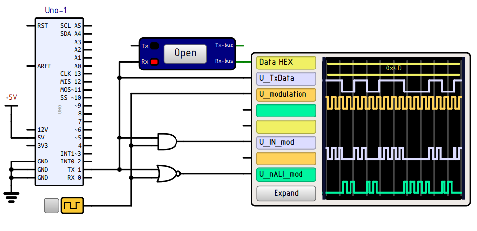

AMPLITUDNA MODULACIJA
--------------------------------------------------------------------------------

Pri amplitudni modulaciji se amplituda nosilnega signala spreminja skladno z modulirajočim signalom. Frekvenca nosilca ostaja približno stalna. Pri analogni amplitudni modulaciji se zato ovojnica izhodnega signala spreminja v skladu z informacijo.

## Analogna izvedba z ojačevalnikom in LDR

Amplitudo nosilnega signala lahko spreminjamo tudi s spreminjanjem ojačenja. V vezju na [sliki @fig:analogna-amplitudna-modulacija] je LM741 vezan kot neinvertirajoči ojačevalnik. Nosilni signal $U_\mathrm{c}(t)$ priključimo na neinvertirajoči vhod. Upor $R_1$ povezuje invertirajoči vhod z maso, svetlobno odvisni upor LDR pa je v povratni zvezi med izhodom in invertirajočim vhodom. Osvetljenost LDR tako spreminja ojačenje in s tem amplitudo izhodnega nosilca.

Za idealni operacijski ojačevalnik velja:

$$
U_\mathrm{AM}(t)=\left(1+\frac{R_\mathrm{LDR}}{R_1}\right)U_\mathrm{c}(t).
$$

Ko se osvetljenost poveča, se upornost LDR praviloma zmanjša, zato se zmanjša tudi ojačenje; pri manjši osvetljenosti se ojačenje poveča. Če osvetljenost spreminjamo dovolj počasi glede na nosilni signal, se spreminja ovojnica izhodnega signala. To je preprosta ponazoritev amplitudne modulacije s svetlobno krmiljenim ojačenjem, ne pa splošni hitri elektronski množilnik. LDR je počasen in nelinearen element, LM741 pa ima omejeno pasovno širino ter izhodni razpon; zato vezje ni primerno za hitro komunikacijsko modulacijo. LM741 v prikazani izvedbi napajamo z dvopolarnim napajanjem, na primer $V_\mathrm{CC}=+15\,\mathrm{V}$ in $V_\mathrm{EE}=-15\,\mathrm{V}$. Podrobnosti o priključkih in omejitvah so v [podatkovnem listu LM741 (TI, PDF)](https://www.ti.com/lit/ds/symlink/lm741.pdf).

<!-- KiCAD SHEMA: Neinvertirajoči ojačevalnik z operacijskim ojačevalnikom LM741 za ponazoritev amplitudne modulacije s svetlobno krmiljenim ojačenjem. Nosilni signal U_C priključi na neinvertirajoči vhod LM741. Upor R1 = 100 kΩ poveži med invertirajoči vhod in GND. En fotoupor LDR poveži v povratni zvezi med izhodom LM741 in invertirajočim vhodom. Izhod označi z globalno oznako Output U_AM. LM741 napajaj z VCC = +15 V in VEE = −15 V; skupna referenca signalov je GND. Priključka NULL pusti neuporabljena in jih označi kot take, NC priključek pusti odprt. Na shemi naj bodo vidne reference in vrednosti elementov, številk priključkov pa ne prikazuj. -->
{#fig:analogna-amplitudna-modulacija}

Pri načrtovanju preverimo, da vhodni in izhodni signali ostanejo v dovoljenem območju ojačevalnika ter da izhod ne preide v nasičenje. Pri prenosu z LED lahko informacija prav tako spreminja amplitudo oddane svetlobe, če spreminja tok LED v ustreznem delovnem območju; to je povezano z analognim optičnim prenosom iz prejšnjega poglavja.

## Digitalno preklapljanje amplitude

Amplitudo nosilnega signala lahko preklapljamo tudi z digitalnim vezjem. Če na ena vhodna vrata IN priključimo pravokotni nosilni signal, na druga pa podatkovni signal $D$, dobimo:

$$
b_\mathrm{izh}(t)=b_\mathrm{c}(t)\land D(t),
$$

kjer $b_\mathrm{c}(t)$ in $D(t)$ predstavljata logični stanji nosilca in podatkovnega signala, znak $\land$ pa logično operacijo IN.

Pri $D=1$ se na izhod prenese pravokotni nosilni signal, pri $D=0$ pa je izhodna amplituda nič. Gre za vklopno-izklopno kodiranje (OOK), ki je posebna oblika digitalne amplitudne modulacije ASK. Vrata IN ne spreminjajo frekvence nosilca, temveč ga glede na podatkovni bit prepuščajo ali zatrejo. Ta razlaga velja za digitalni, pravokotni nosilni signal; za sinusni nosilec bi potrebovali analogno preklopno ali množilno vezje.

### Primer: prenos znaka M iz Arduina do sprejemnika TSOP1738

Podatkovni signal lahko zagotovimo z UART-om krmilnika Arduino Uno. Na priključku TX je v mirovanju logična 1, začetni bit pa je 0. Na [sliki @fig:simulide-uart-tsop1738] sta prikazana dva načina, kako UART-signal in nosilec s frekvenco 38 kHz povežemo z logičnimi vrati. Zgornji primer uporablja vrata IN in je namenjen predvsem razlagi delovanja amplitudnega preklopa. Spodnji primer uporablja vrata NE-ALI (NOR) in je primernejši za oddajanje proti sprejemniku TSOP1738.

$$
b_\mathrm{IN}(t)=b_\mathrm{TX}(t)\land b_\mathrm{c}(t),
\qquad
b_\mathrm{NOR}(t)=\neg\left(b_\mathrm{TX}(t)\lor b_\mathrm{c}(t)\right).
$$

Pri prikazanih vratih IN se nosilec prenese na izhod, kadar je TX na 1. To jasno pokaže logično operacijo IN, vendar bi se pri mirovnem stanju UART-a nosilec oddajal neprekinjeno. Za TSOP1738 so primerna tudi vrata IN, če pred njimi invertiramo signal TX:

$$
b_\mathrm{IR}(t)=b_{38\,\mathrm{kHz}}(t)\land\neg b_\mathrm{TX}(t).
$$

Druga ustrezna možnost so prikazana vrata NE-ALI. Po De Morganovem pravilu njihov izhod zapišemo tudi kot $b_\mathrm{NOR}=\neg b_\mathrm{TX}\land\neg b_\mathrm{c}$. Obe izvedbi oddajata izbruhe med stanjem TX = 0, med mirovnim stanjem UART-a in biti 1 pa je izhod nizek in oddajna LED ne sveti. Razlikujeta se v fazi nosilca znotraj izbruhov: pri vratih NE-ALI je nosilec invertiran. Ker TSOP1738 zaznava ovojnico izbruhov nosilca s frekvenco 38 kHz, sta zanj primerni obe možnosti.

Na logičnem analizatorju na sliki so prikazani signal TX mikrokrmilnika ($U_\mathrm{TxData}$), nosilni signal ($U_\mathrm{modulation}$), oba modulirana izhoda ($U_\mathrm{IN\_mod}$ in $U_\mathrm{NALI\_mod}$) ter vrednost prenesenega podatka v šestnajstiškem zapisu: `0x4D`, kar je znak `M`.

{#fig:simulide-uart-tsop1738}

Za znak `M` (ASCII 77, $01001101_2$) UART pošlje začetni bit 0, podatkovne bite v vrstnem redu od najmanj pomembnega: $1,0,1,1,0,0,1,0$, in nato zaključni bit 1. Pri obeh izvedbah za TSOP1738 se nosilni izbruhi zato oddajajo med začetnim bitom in podatkovnimi biti z vrednostjo 0. Sprejemnik iz teh izbruhov obnovi logični signal: njegov izhod je med sprejetim nosilcem nizek, v presledkih pa visok, zato se ujema z običajno UART-logiko.

Za ta preprost prikaz nastavimo UART na 1200 bit/s, na primer z `Serial.begin(1200);`, nato pa pošljemo znak z `Serial.write('M');`. Pri 1200 bit/s traja en bit približno $0,833\,\mathrm{ms}$, kar pri 38 kHz ustreza približno 32 periodam nosilca. Podatkovni list navaja, da naj izbruh vsebuje vsaj 10 period nosilca, po izbruhu, dolgem od 10 do 70 period, pa naj sledi presledek vsaj 14 period. Za prikazani znak M so najdaljši neprekinjeni izbruhi dolgi dve bitni mesti, zato ta primer upošteva navedene omejitve. Običajna hitrost 9600 bit/s za tak neposredni način ni primerna: en bit bi obsegal le približno štiri periode nosilca. TSOP1738 podpira zvezni prenos do 2400 bit/s, vendar je treba pri višji hitrosti upoštevati tudi zakasnitve in raztezanje izhodnih impulzov ter sprejem praktično preizkusiti. Poljubno zaporedje bajtov lahko ustvari daljši neprekinjeni izbruh, zato bi za zanesljiv splošni prenos potrebovali kodiranje, ki zagotavlja dovolj dolge presledke.

```cpp
void setup() {
  pinMode(LED_BUILTIN, OUTPUT);
  Serial.begin(1200);
}

void loop() {
  delay(100);
  Serial.print("M");
}
```
: AMuK UART TSOP1738. {#lst:241_AMuK_UART_TSOP1738}

TSOP1738 vsebuje fotodiodo, ojačevalnik in demodulator z ozkopasovnim filtrom za nosilec 38 kHz. Napaja se z napetostjo $4,5$–$5,5\,\mathrm{V}$; tipični napajalni tok je približno $0,6\,\mathrm{mA}$. Priključek 1 je GND, priključek 2 napajanje $V_S$, priključek 3 pa izhod OUT. Izhod je združljiv s TTL in CMOS ter aktiven na nizkem nivoju. Proizvajalec priporoča razklop napajanja in opozarja na vpliv dolžine izbruhov, presledkov ter motilne svetlobe. Več podatkov je v [podatkovnem listu TSOP17.. proizvajalca Vishay (PDF)](https://www.engineersgarage.com/sites/default/files/TSOP1738.pdf).

Vrata IN oziroma NE-ALI naj krmilijo tranzistor, ki zagotovi potreben tok skozi infrardečo LED; LED naj ima ustrezen zaporedni upor. Izhoda logičnih vrat ne obremenimo neposredno z velikim tokom LED. Pri sestavi moramo upoštevati še pravilno razporeditev priključkov izbranega ohišja TSOP1738.

<!-- KiCAD SHEMA: Digitalni amplitudni modulator OOK z dvovhodnimi logičnimi vrati IN. Na prvi vhod vrat pripelji pravokotni nosilni signal U_C, na drugi pa podatkovni signal D z logičnima ravnema 0 in VCC; oba označi z globalnima oznakama Input. Izhod vrat označi z globalno oznako Output U_OOK. Napajaj vrata z VCC in GND ter poskrbi za skupno referenco vhodnih signalov. Shema naj pokaže, da pri D=1 izhod sledi U_C, pri D=0 pa ostane na logični ničli. Ne uporabi sinusnega nosilca. Številk priključkov na končni sliki ne prikazuj. -->
{#fig:digitalna-amplitudna-modulacija}

## Povzetek

- Pri analogni amplitudni modulaciji informacija spreminja ovojnico nosilnega signala.
- Pri ojačevalniku z LDR osvetljenost spreminja ojačenje in s tem amplitudo nosilca.
- Digitalna vrata IN lahko pravokotni nosilec preklapljajo med polno amplitudo in ničlo; tako nastane OOK oziroma posebna oblika ASK.
- Pri UART-prenosu do TSOP1738 je treba upoštevati mirovni nivo UART-a, aktivno-nizek izhod sprejemnika ter najmanjše dolžine izbruhov in presledkov.

## Vprašanja za preverjanje

1. Katera lastnost nosilca se spreminja pri amplitudni modulaciji?
2. Kako osvetljenost LDR vpliva na ojačenje vezja z LM741?
3. Zakaj pred vrati IN invertiramo signal TX iz UART-a?
4. Zakaj pri neposrednem prenosu z nosilcem 38 kHz izberemo dovolj nizko hitrost UART-a?
