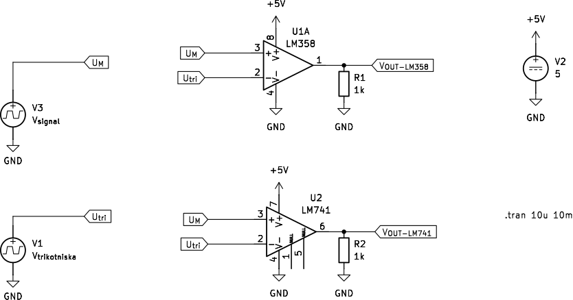
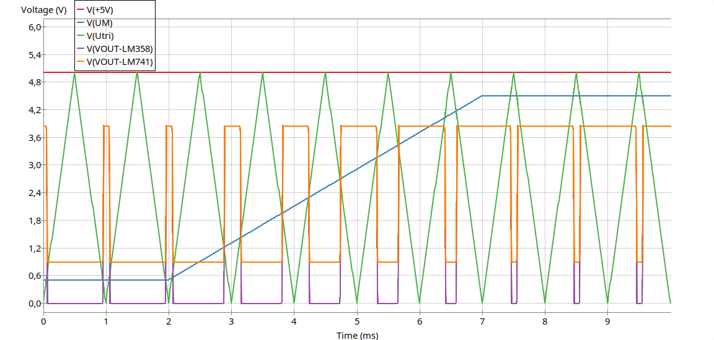
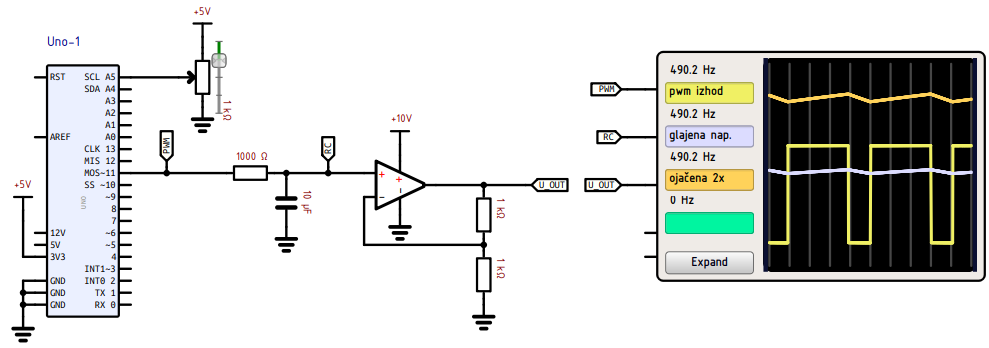

PULZNO-ŠIRINSKA MODULACIJA
--------------------------------------------------------------------------------

Pri pulzno-širinski modulaciji (PWM) impulzno zaporedje ohrani približno stalno amplitudo in ponavljalno periodo, spreminja pa se trajanje visoke ravni posameznega impulza. Tako je širina impulzov odvisna od modulirajočega signala. Tak signal uporabljamo predvsem pri krmiljenju moči, na primer svetleče diode ali enosmernega motorja, ter pri krmiljenju servomotorjev. Pri modelarskem servomotorju širina krmilnega impulza določa želeni položaj, moč motorja pa uravnava njegova vgrajena elektronika. Primer ustvarjanja PWM in krmiljenja enosmernega motorja prikazuje [slika @fig:pwm-s-primerjalnikom].

{#fig:pwm-s-primerjalnikom}

Periodo ponavljanja označimo s $T$, trajanje visoke ravni z $t_\mathrm{v}$, trajanje nizke ravni pa s $t_\mathrm{n}$. Delovni cikel je:

$$
D=\frac{t_\mathrm{v}}{T},\qquad 0\leq D\leq 1.
$$

Delovni cikel lahko izrazimo tudi v odstotkih. Pri $D=0$ je signal ves čas na nizki ravni, pri $D=1$ pa je ves čas na visoki ravni.

### Ustvarjanje PWM s primerjalnikom

PWM lahko ustvarimo tako, da primerjalnik primerja modulirajočo napetost $U_\mathrm{m}$ s periodično trikotniško napetostjo $U_\mathrm{tri}$. Ko velja $U_\mathrm{m}>U_\mathrm{tri}$, je izhodna napetost visoka; ko je $U_\mathrm{m}<U_\mathrm{tri}$, je nizka. S spreminjanjem $U_\mathrm{m}$ se zato spreminja delež periode, v katerem je izhod visok. Za preprost prikaz pri nizkih frekvencah uporabimo operacijski ojačevalnik LM358, vezan kot primerjalnik, kot prikazuje [slika @fig:pwm-s-primerjalnikom].

Če se trikotniška napetost enakomerno spreminja med $U_\mathrm{min}$ in $U_\mathrm{max}$, modulirajoča napetost pa je znotraj tega območja, je v idealiziranem primeru:

$$
D\approx\frac{U_\mathrm{m}-U_\mathrm{min}}{U_\mathrm{max}-U_\mathrm{min}}.
$$

V prikazanem vezju s potenciometrom nastavljamo modulirajočo napetost in s tem delovni cikel. Izhod primerjalnika prek baznega upora krmili tranzistor NPN, ki vklaplja in izklaplja tok skozi motor. Zaščitna dioda ob izklopu tranzistorja omogoči nadaljevanje toka skozi navitje motorja.

Primerjavo LM358 in LM741 prikazuje [slika @fig:pwm-lm358-lm741-vezje]. Oba operacijska ojačevalnika uporabimo kot primerjalnika z enakima vhodnima signaloma in enopolarnim napajanjem 5 V, nato primerjamo njuna izhoda.

{#fig:pwm-lm358-lm741-vezje}

Pri izbiri operacijskega ojačevalnika je pomembno, kako nizka je njegova izhodna napetost v spodnjem nasičenju. LM358 lahko napajamo enopolarno, med $V_\mathrm{CC}$ in GND, njegov izhod pa se lahko približa 0 V. Tako lahko prek baznega upora izklopimo tranzistor NPN z emitorjem na GND. Dejanska napetost spodnjega nasičenja $U_\mathrm{SN}$ je odvisna od obremenitve. Preverimo tudi dovoljeno območje vhodnih napetosti in zgornje nasičenje $U_\mathrm{ZN}$, saj LM358 na izhodu ne doseže pozitivnega napajalnega potenciala. Za prikaz pri nizkih frekvencah je uporaben, za hitro PWM pa izberemo ustrezno hiter namenski komparator. Te lastnosti opisuje [podatkovni list LM358 (Texas Instruments, PDF)](https://www.ti.com/lit/ds/symlink/lm358.pdf).

Pri takšnem enopolarnem napajanju LM741 ni primerna izbira. Njegov izhod v spodnjem nasičenju ostane precej nad 0 V, zato lahko skozi bazni upor še vedno teče tok in se tranzistor ne zapre povsem. Tudi njegovo dovoljeno območje vhodnih napetosti ne sega do GND. Za zanesljiv izklop zato preverimo, da je $U_\mathrm{SN}$ dovolj nizka za uporabljeni tranzistor in njegovo vezavo; oznaka »nizka raven« sama tega še ne zagotavlja. Omejitve izhoda in vhodov so navedene v [podatkovnem listu LM741 (Texas Instruments, PDF)](https://www.ti.com/lit/ds/symlink/lm741.pdf).

Rezultate simulacije prikazuje [slika @fig:pwm-lm358-lm741-signali]. Modulirajoča napetost je modra, trikotniška zelena, izhod LM358 vijoličen, izhod LM741 pa oranžen. LM358 ustvari impulze s spreminjajočo se širino in nizko ravnjo blizu 0 V. Izhod LM741 v tej simulaciji ostaja pri približno 1 V; tako visoka napetost lahko skozi bazni upor še vedno povzroča bazni tok in ne zagotavlja popolnega izklopa tranzistorja NPN. S tem ne moremo učinkovito preklapljati moči motorja.

{#fig:pwm-lm358-lm741-signali}

Odčitane vrednosti veljajo za uporabljena simulacijska modela. LM741 ni predviden za prikazano napajanje 0–5 V; pri dejanski izvedbi moramo pri obeh ojačevalnikih upoštevati tudi dovoljeno območje vhodnih napetosti in temu prilagoditi trikotniški ter modulirajoči signal.

### Povprečna napetost in uporaba

Če izhodni impulzi preklapljajo med $0$ in $U_\mathrm{H}$, je njihova povprečna napetost v eni periodi približno:

$$
U_\mathrm{povp}=D U_\mathrm{H}.
$$

Zato lahko z delovnim ciklom uravnavamo povprečno napetost oziroma moč na bremenu. Signal PWM pa ni enak gladki analogni napetosti: njegova trenutna vrednost še vedno preklaplja med nizko in visoko ravnjo. Če potrebujemo približno zvezno napetost, lahko uporabimo nizkoprepustni filter, ki povpreči impulze.

### Ustvarjanje PWM z mikrokrmilnikom in glajenje signala

Mikrokrmilnik lahko PWM ustvari s časovnikom. Na [sliki @fig:pwm-uk-glajenje] Arduino Uno bere napetost potenciometra na vhodu A5 in glede nanjo nastavlja delovni cikel na izhodu D11. Signal nato potuje skozi nizkoprepustno sito RC in elektrometrski ojačevalni sistem v neinvertirajoči vezavi z napetostnim ojačenjem $A'=2$.

{#fig:pwm-uk-glajenje}

Program za prikazano vezje je podan v [programu @lst:pwm-uk-glajenje] in shranjen v [datoteki 2.3_PWM.ino](./circ/2.3_PWM/2.3_PWM.ino). Funkcija `analogRead(A5)` vrne vrednost med 0 in 1023; z deljenjem s 4 jo pretvorimo v območje od 0 do 255 za nastavitev PWM.

```{.cpp #lst:pwm-uk-glajenje caption="Ustvarjanje PWM glede na položaj potenciometra."}
void setup() {
  pinMode(11, OUTPUT);
}

void loop() {
  int pot_value = analogRead(A5);
  analogWrite(11, pot_value / 4);

  delay(500);
}
```

Ime funkcije `analogWrite()` je pri Arduinu Uno z ATmega328P nekoliko zavajajoče: na izhodu dobimo digitalen signal PWM, ki preklaplja med nizko in visoko ravnjo. Funkcija nastavi delovni cikel, ne neposredno analogne napetosti. Vrednost 0 pomeni stalno nizko raven, 255 pa stalno visoko raven. To delovanje opisuje tudi [Arduinova razlaga PWM](https://docs.arduino.cc/tutorials/generic/secrets-of-arduino-pwm/). Ukaz `delay(500)` določa presledek med odčitavanji potenciometra; časovnik medtem samostojno ustvarja PWM.

Šele z nizkoprepustnim sitom dobimo približno zvezno analogno napetost, sorazmerno delovnemu ciklu. Na sliki sta uporabljena upor $R=1\,\mathrm{k\Omega}$ in kondenzator $C=10\,\mathrm{\mu F}$, zato je časovna konstanta $\tau=RC=10\,\mathrm{ms}$. Kondenzator se med impulzi polni in prazni, sito pa zmanjša nihanje napetosti zaradi preklapljanja. Na glajenem signalu ostane nekaj valovitosti. Močnejše glajenje jo zmanjša, vendar se napetost počasneje odziva na spremembo delovnega cikla.

Ojačevalni sistem ima tudi vlogo impedančne pretvorbe. Zaradi velike vhodne upornosti le malo obremenjuje sito, njegova majhna izhodna upornost pa omogoča priključitev bremena. Če bi breme priključili neposredno na sito, bi lahko spremenilo njegovo izhodno napetost in potek glajenja. Tako ojačevalnik pomaga ohraniti nastavljeno analogno napetost tudi ob spremembah obremenitve, znotraj svojih izhodnih zmogljivosti.

V povratni vezavi sta dva enaka upora po $1\,\mathrm{k\Omega}$, zato velja:

$$
A'=1+\frac{R_\mathrm{povratni}}{R_\mathrm{proti\ masi}}=2,
\qquad
U_\mathrm{izh}\approx 2U_\mathrm{RC}.
$$

Pri tem moramo ostati znotraj dovoljenega izhodnega razpona ojačevalnika. Ojačevalnik ojači tudi preostalo valovitost, zato je za glajenje še vedno odgovorno sito.

### Povzetek

- Pri PWM se spreminja trajanje oziroma širina impulzov, ponavljalna perioda in amplituda pa sta približno stalni.
- Delovni cikel $D$ določa delež periode, ko je izhod na visoki ravni.
- Primerjalnik lahko PWM ustvari s primerjavo modulirajočega signala s trikotniško napetostjo.
- Povprečna napetost unipolarnega impulznega signala je približno sorazmerna delovnemu ciklu.
- `analogWrite()` na Arduinu Uno ustvari digitalen PWM; z nizkoprepustnim sitom iz njega pridobimo približno zvezno analogno napetost.
- Ojačevalnik z veliko vhodno upornostjo preprečuje, da bi breme neposredno obremenjevalo sito.

### Vprašanja za preverjanje

1. Kaj pomeni delovni cikel $D=0{,}25$?
2. Kako se spremeni PWM, če povečamo modulirajočo napetost $U_\mathrm{m}$?
3. Zakaj pri krmiljenju tranzistorja preverimo napetost spodnjega nasičenja ojačevalnika?
4. Zakaj signal PWM ni enak gladki analogni napetosti?
5. Kaj na Arduinu Uno dejansko nastavi funkcija `analogWrite()`?
6. Zakaj med nizkoprepustno sito in breme vključimo ojačevalnik z veliko vhodno upornostjo?
