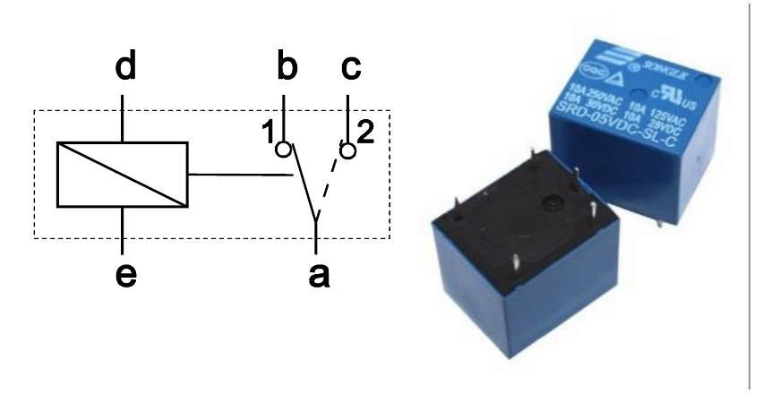
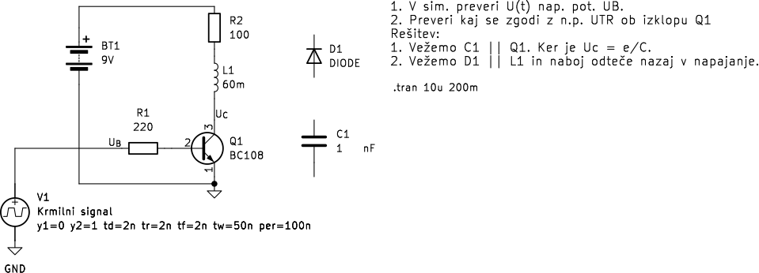

DVOPOLOŽAJNA (NEZVEZNA) REGULACIJA TEMPERATURE VODE
--------------------------------------------------------------------------------

Pri dvopoložajni regulaciji ima grelec dve stanji: vključen je s približno stalno močjo $P_0$ ali pa je izključen. Temperatura vode se kljub temu spreminja zvezno. Izraz »nezvezna regulacija« se torej nanaša na preklapljanje moči grelca, ne na skokovito spreminjanje temperature.

Najprej bi lahko zahtevali, da se grelec vključi pri $T<T_\mathrm{r}$ in izključi pri $T>T_\mathrm{r}$. Takšno odločitev lahko izvedemo s komparatorjem. Spoznali bomo, zakaj v praksi dodamo še histerezo in kako krmilni signal prek tranzistorja ter releja vpliva na grelec.

### Od temperature do merilne napetosti

Temperaturo najprej pretvorimo v električni signal. V izvornih shemah je uporabljen termistor NTC, katerega upornost se z višanjem temperature zmanjšuje. Vezan je med pozitivno napajalno točko in merilno vozlišče, upor $R_0$ pa med to vozlišče in GND. Napetost delilnika je:

$$
U_\mathrm{mer}=U_0\frac{R_0}{R_\mathrm{NTC}(T)+R_0}.
$$

Ko se voda segreva, se $R_\mathrm{NTC}$ zmanjša in $U_\mathrm{mer}$ naraste. Če bi termistor in stalni upor zamenjali, bi se smer spreminjanja napetosti obrnila; temu bi morali prilagoditi tudi komparator. Odvisnost NTC ni linearna, zato želeno temperaturo povežemo z merilno napetostjo s pomočjo podatkovnega lista ali umerjanja.

Konkreten primer je termistor **Vishay NTCLE100E3103JB0** z nazivno upornostjo $R_{25}=10\,\mathrm{k}\Omega$ pri $25\,^\circ\mathrm{C}$, toleranco upornosti $\pm5\,\%$ in temperaturno konstanto $B_{25/85}=3977\,\mathrm{K}$. Podatke in temperaturno karakteristiko najdemo v [podatkovnem listu družine NTCLE100E3 (PDF)](https://www.vishay.com/docs/29049/ntcle100.pdf) [@Vishay2025NTCLE100E3]. Če v delilniku izberemo tudi $R_0=10\,\mathrm{k}\Omega$, je pri $25\,^\circ\mathrm{C}$ merilna napetost približno $U_0/2$. Za nastavitev drugačne temperaturne meje uporabimo karakteristiko $R(T)$; oznaka »$10\,\mathrm{k}\Omega$« velja le pri nazivni temperaturi. Ta komponenta ni vodotesna sonda, njena prevleka pa nima zagotovljenih izolacijskih lastnosti, zato je ne uporabimo neposredno potopljene v vodo.

Iz nazivne upornosti in konstante $B$ lahko upornost pri izbrani temperaturi ocenimo z enačbo:

$$
R_\mathrm{NTC}(T)\approx R_{25}\,e^{B_{25/85}\left(\frac{1}{T}-\frac{1}{T_{25}}\right)},
\qquad T_{25}=298,15\,\mathrm{K}.
$$

Temperaturi v enačbi morata biti izraženi v **kelvinih**: temperaturi v stopinjah Celzija prištejemo $273,15$. Za izbrani termistor pri $40\,^\circ\mathrm{C}$ torej dobimo:

$$
R_\mathrm{NTC}(313,15\,\mathrm{K})\approx
10\,\mathrm{k}\Omega\cdot e^{
3977\,\mathrm{K}\left(\frac{1}{313,15\,\mathrm{K}}-\frac{1}{298,15\,\mathrm{K}}\right)
}\approx5,28\,\mathrm{k}\Omega.
$$

Tako izračunano upornost vstavimo v enačbo napetostnega delilnika in določimo napetostni prag za želeno temperaturo. Enačba s konstantnim $B$ je približek; za natančnejše načrtovanje uporabimo karakteristiko iz podatkovnega lista ter upoštevamo tolerance termistorja.

Druga možnost je napetostni senzor LM35. Njegova izhodna napetost narašča približno za $10\,\mathrm{mV}$ na stopinjo Celzija: pri $40\,^\circ\mathrm{C}$ je približno $0,40\,\mathrm{V}$. S tem lažje pretvarjamo temperaturne meje v napetostne pragove. Vezava in omejitve senzorja so opisane v [podatkovnem listu LM35 (PDF)](https://www.ti.com/lit/ds/symlink/lm35.pdf) [@TexasInstrumentsLM35].

Senzor mora meriti temperaturo vode, zato sta pomembna njegov položaj in dober toplotni stik. Za delo v vodi uporabimo ustrezno električno izolirano sondo; nezaščitenih priključkov elektronskega senzorja ne potapljamo neposredno v vodo.

### Rele in tranzistorski gonilnik

Komparator odloča o preklopu, vendar njegov izhod praviloma ne more neposredno napajati grelca. V prikazanih izvedbah krmili tranzistor NPN, tranzistor pa tok skozi tuljavo releja. Magnetno polje tuljave premakne kontakt, ki sklene ali razklene ločen tokokrog grelca. Zgradbo releja ponazarja [slika @fig:rele-simbol-primer].

{#fig:rele-simbol-primer width=70%}

Kontakte rišemo v mirovnem stanju, ko tuljava ni vzbujena. Mirovni kontakt NC je tedaj sklenjen, delovni kontakt NO pa razklenjen. Ob vzbujeni tuljavi rele preklopi. Izbira kontakta je pomembna: enak izhodni signal lahko z uporabo NC grelec izključi, z uporabo NO pa ga vključi.

Ločimo podatke tuljave od podatkov kontaktov. Za računski primer izberemo rele **RT424005** s 5-V enosmerno tuljavo in dvema skupinama menjalnih kontaktov. Njena nazivna upornost je $62\,\Omega$, zato sta približna tok in moč tuljave:

$$
I_\mathrm{tuljave}\approx\frac{5\,\mathrm{V}}{62\,\Omega}
\approx81\,\mathrm{mA},
\qquad
P_\mathrm{tuljave}\approx0,40\,\mathrm{W}.
$$

Ta tok mora zagotoviti tranzistor. Bazni upor izberemo tako, da tranzistor zanesljivo prevaja, hkrati pa ne preobremenimo izhoda komparatorja. Pri izklopu mora biti njegova izhodna napetost dovolj nizka, da se tranzistor zapre; to smo obravnavali pri PWM v podpoglavju 2.3.

Kontaktni podatki za to družino relejev navajajo nazivno napetost 250 V AC in tok 8 A ob določenih pogojih bremena. To nista napetost in tok tuljave. Podatke preverimo v [podatkovnem listu RT2 (PDF)](https://www.te.com/commerce/DocumentDelivery/DDEController?Action=srchrtrv&DocFormat=pdf&DocLang=English&DocNm=RT2&DocType=Data+Sheet&PartCntxt=5-1393243-9) [@TEConnectivityRT2]. Različica **RT424730** ima tuljavo za 230 V AC in ni zamenjava za 5-V različico. Za študentski preizkus lahko tudi tokokrog grelca napajamo z ločenim nizkonapetostnim virom; delovanje regulacije je enako.

#### Vklop in izklop induktivnega bremena s tranzistorjem

Tuljavo releja priključimo med pozitivno napajanje in kolektor tranzistorja NPN, emitor pa na GND. Ko skozi bazni upor priteče ustrezen bazni tok, tranzistor prevaja in omogoči tok skozi tuljavo. Zaradi induktivnosti tok ne naraste hipoma. V magnetnem polju tuljave se medtem shrani energija:

$$
E_L=\frac{1}{2}LI^2.
$$

Težava nastane ob izklopu tranzistorja. Magnetno polje začne upadati, tuljava pa z inducirano napetostjo poskuša ohraniti dotedanjo smer toka. Energija magnetnega polja se tako prenaša nazaj v električni del vezja. Polariteta napetosti na tuljavi se obrne in napetost na kolektorju lahko močno preseže napajalno napetost. Velikost inducirane napetosti ponazarja zveza:

$$
|U_L|\approx L\left|\frac{\Delta I}{\Delta t}\right|.
$$

Čim hitreje skušamo prekiniti tok, tem večja napetost lahko nastane, če je ne omejimo z zaščitnim vezjem. Tudi pri nizkonapetostnem napajanju so možni sunki reda $1\,\mathrm{kV}$. Proizvajalec TE Connectivity na primer za 12-V rele navaja možnost izklopnega sunka od 1000 do 1500 V [@TEConnectivityRelaySuppression].

Če napetost med kolektorjem in emitorjem preseže dovoljeno vrednost, lahko pride do preboja tranzistorja. Kratek sunek z majhno energijo ga ne uniči nujno takoj: tranzistor lahko navidezno še deluje, ponavljajoče se preobremenitve pa lahko postopno poslabšajo njegove lastnosti in povzročijo poznejšo odpoved. Lahko pa odpove že pri prvem izklopu. Odločilni so napetost, tok, energija in trajanje sunka ter temperatura tranzistorja; sama majhna količina prenesenega naboja še ne zagotavlja, da bo preboj prenesel. Omejitve in območje varnega delovanja opisuje [Toshibino gradivo o bipolarnih tranzistorjih (PDF)](https://toshiba.semicon-storage.com/info/TTC5200_application_note_en_20210303_AKX00048.pdf?did=63509&prodName=TTC5200) [@Toshiba2021BipolarMaximumRatings].

Izhodiščni KiCadov primer za preizkus prikazuje [slika @fig:311_Vklop_induktivnega_bremena]. Tuljavo releja ponazarjata induktivnost L1 in zaporedna upornost R2.

{#fig:311_Vklop_induktivnega_bremena}

Pri enosmerni tuljavi povežemo zaščitno diodo vzporedno s tuljavo: katodo na pozitivni priključek napajanja, anodo pa na kolektor tranzistorja. Med vzbujanjem tuljave je dioda zaprta. Po izklopu omogoči kroženje toka skozi tuljavo in diodo ter omeji napetostni sunek. Shranjena energija se postopno pretvori v toploto. Takšna zaščita lahko podaljša čas odpuščanja releja, zato pri izbiri upoštevamo tudi navodila proizvajalca [@TEConnectivityRelaySuppression].

Za preizkus odpremo [projekt KiCad](./circ/3.1_Nezvezna_regulacija_temperature_vode/311_Vklop_induktivnega_bremena/311_Vklop_induktivnega_bremena.kicad_pro). V časovni simulaciji opazujemo tok tuljave in napetost med kolektorjem ter emitorjem, posebej tik po izklopu. Najprej preverimo vrh brez zaščitne diode, nato jo pravilno priključimo in primerjamo poteka. Vršna napetost je odvisna tudi od kapacitivnosti v vezju in modela tranzistorja: model, ki preboja ne vključuje, lahko pokaže napetost, pri kateri bi se resnični tranzistor že poškodoval. Simulirani sunek zato ni dokaz, da ga tranzistor v praksi prenese.

Na voljo sta tudi neposredna povezava na [shemo s simulacijskim modelom](./circ/3.1_Nezvezna_regulacija_temperature_vode/311_Vklop_induktivnega_bremena/311_Vklop_induktivnega_bremena.kicad_sch) in [shranjeni simulacijski delovni zvezek (.wbk)](./circ/3.1_Nezvezna_regulacija_temperature_vode/311_Vklop_induktivnega_bremena/311_Vklop_induktivnega_bremena.wbk), ki ga naložimo v KiCadovem simulatorju ob odprti shemi. Delovni zvezek vsebuje nastavitve časovne analize, ne samostojnega vezja. Model tranzistorja BC108B se sklicuje na zunanjo knjižnico `BJTN.LIB`, ki ni priložena projektu; pred zagonom preverimo njeno pot. Podrobnosti so zbrane v [opisu primerov](./circ/3.1_Nezvezna_regulacija_temperature_vode/README.md). Na isti pojav smo naleteli pri preklapljanju motorja; pri pretvorniku za zviševanje napetosti pa shranjevanje energije v tuljavi namensko izkoristimo.

### Izvedba s komparatorjem brez histereze

Dve izvorni izvedbi prikazuje [slika @fig:termostat-brez-histereze]. Zgornja uporablja LM311 z dvigovalnim uporom $R$, spodnja pa LM358 z baznim uporom $R_b$. Obe izhajata iz istega temperaturnega delilnika in nastavljive referenčne napetosti [@KocijancicProjektiElektronike].

{#fig:termostat-brez-histereze width=82%}

V teh shemah je merilna napetost priključena na vhod (+), referenca pa na vhod ($-$). Ko temperatura naraste nad nastavljeni prag, postane $U_\mathrm{mer}>U_\mathrm{ref}$, izhod je visok in tranzistor vzbudi tuljavo. Ker je grelec na izrisanem mirovnem kontaktu NC, se takrat izključi. Pri nižji temperaturi je tuljava izključena, kontakt NC pa omogoča gretje.

Če bi želeli grelec vključiti z delovnim kontaktom NO, bi morali obrniti tudi odločanje komparatorja: merilno napetost bi priključili na vhod ($-$), referenco pa na (+). Vedno preverimo celotno zaporedje: temperatura, merilna napetost, stanje izhoda, stanje releja in moč grelca. Celotna zanka mora ob naraščanju temperature gretje zmanjšati.

Blizu enega samega praga lahko že šum, majhna nihanja meritve ali motnje ob preklopu povzročijo ponavljajoče se vključevanje in izključevanje. Rele lahko ropota, kontakti se obrabljajo, temperatura pa zato ni nujno bolje uravnavana. Lastna mehanska histereza releja ne nadomesti načrtovane temperaturne histereze regulatorja.

### Dve temperaturni meji in histereza

Namesto enega praga določimo spodnjo temperaturno mejo $T_-$ in zgornjo mejo $T_+$:

$$
T_-<T_+,
\qquad
\Delta T_H=T_+-T_-.
$$

Ko temperatura pade do spodnje meje, grelec vključimo. Ko naraste do zgornje, ga izključimo. Med mejama regulator ohrani prejšnje stanje.

Če je želena sredina $41\,^\circ\mathrm{C}$, lahko za ponazoritev izberemo $T_-=40\,^\circ\mathrm{C}$ in $T_+=42\,^\circ\mathrm{C}$. Pri segrevanju bo grelec pri $41\,^\circ\mathrm{C}$ še vključen, pri ohlajanju pa bo pri isti temperaturi izključen. Regulator torej upošteva tudi preteklo stanje. Ob prvem vklopu napajanja znotraj tega območja moramo preveriti njegovo začetno stanje.

Širino histereze izberemo kot kompromis med dovoljenim nihanjem temperature in pogostostjo preklopov. Preozka histereza povzroča pogoste preklope, preširoka pa večje temperaturno nihanje. Zaradi toplotne vztrajnosti in zakasnitve senzorja se lahko dejanska temperatura začasno dvigne tudi nad $T_+$ ali pade pod $T_-$.

### Izvedba z analognim Schmittovim sprožilnikom

Histerezo ustvarimo s pozitivno povratno zvezo v komparatorju. Uporabimo invertirajoči Schmittov sprožilnik iz poglavja 1.4: temperaturni signal priključimo na vhod ($-$), prag na vhodu (+) pa določata referenca in trenutno izhodno stanje. Izvorno izvedbo prikazuje [slika @fig:termostat-s-histerezo]. Drugi ojačevalnik LM358 je napetostni sledilnik, ki zagotavlja referenco z majhno izhodno upornostjo.

{#fig:termostat-s-histerezo width=85%}

Pri tej polariteti je izhod visok, ko je voda prehladna, in nizek, ko je prevroča. Za gretje ob vzbujeni tuljavi zato uporabimo delovni kontakt **NO**. V povzeti izvorni risbi je grelec povezan na levi, mirovni kontakt; za tukaj opisano delovanje ga prestavimo na desni, delovni kontakt. S tem ohranimo pravilno smer temperaturne povratne zveze.

Če je upor $hR$ vezan med izhodom in vhodom (+), upor $R$ pa med vhodom (+) in referenco, veljata enaka preklopna pragova kot v podpoglavju 1.4:

$$
U_{T+}=\frac{hU_\mathrm{ref}+U_\mathrm{ZN}}{h+1},
\qquad
U_{T-}=\frac{hU_\mathrm{ref}+U_\mathrm{SN}}{h+1}.
$$

Pri segrevanju doseže merilna napetost zgornji prag $U_{T+}$ in grelec se izključi. Pri ohlajanju doseže spodnji prag $U_{T-}$ in grelec se vključi. Napetostna širina histereze je:

$$
U_H=\frac{U_\mathrm{ZN}-U_\mathrm{SN}}{h+1}.
$$

Pri NTC-delilniku temperaturni meji določimo iz njegove karakteristike ali umerjanja. Pri LM35 bi meje $40$ in $42\,^\circ\mathrm{C}$ ustrezale napetostima $0,40$ in $0,42\,\mathrm{V}$, torej širini $U_H=20\,\mathrm{mV}$. Uporabimo dejanski izhodni nasičenji in upoštevamo merilne napake. Referenca pri končnem razmerju $h$ praviloma ni natančno enaka sredini obeh pragov; izračun sredine smo že obravnavali v poglavju 1.4.

Pozitivna povratna zveza v Schmittovem sprožilniku ustvari dva praga. Celotna temperaturna zanka pa še vedno deluje tako, da se ob previsoki temperaturi gretje izključi.

### Praktični preizkus in vprašanja

Za to podpoglavje je pripravljen simulacijski primer induktivnega bremena, ne pa simulacija celotne temperaturne regulacije. Sliki izvedb termostata brez histereze in s histerezo sta povzeti iz izvornega študijskega gradiva; pripadajočih simulacijskih datotek v priloženem gradivu ni.

Pri preizkusu najprej preverimo odziv senzorja ob segrevanju, nato električni preklop regulatorja in šele nato celotno regulacijsko zanko. Izmerimo temperaturo vklopa ter izklopa in opazujemo, ali temperatura po izklopu grelca še narašča. Poskus ponovimo pri drugačni histerezi in primerjamo število preklopov ter temperaturno nihanje.

1. Zakaj dvopoložajna regulacija ne pomeni, da se temperatura spreminja skokovito?
2. Kako se v prikazanem NTC-delilniku spreminja merilna napetost pri segrevanju?
3. Zakaj zamenjava vhodov komparatorja zahteva ponoven razmislek o izbiri kontakta NO ali NC?
4. Zakaj je grelec znotraj histereznega območja pri isti temperaturi lahko vključen ali izključen?
5. Zakaj mehanska histereza releja ne nadomesti histereze regulatorja?
6. Kako je povezana zaščitna dioda in kaj se zgodi s tokom tuljave po izklopu tranzistorja?
