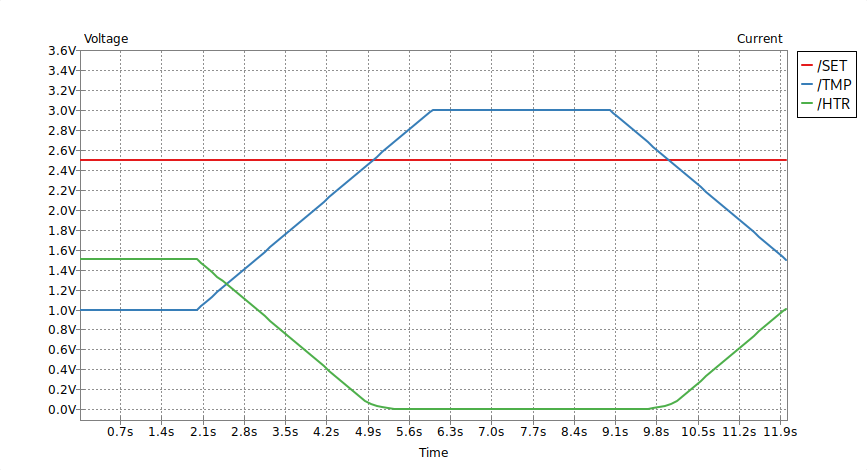
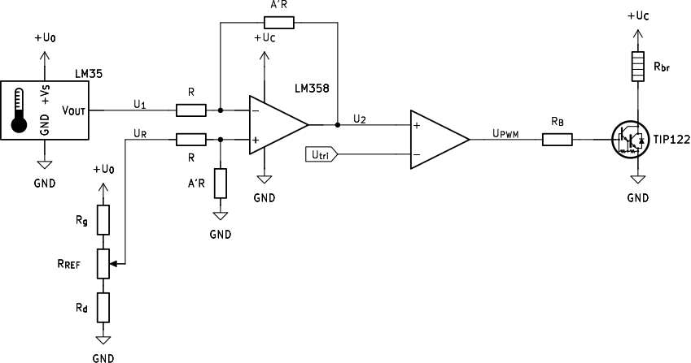

ZVEZNA REGULACIJA TEMPERATURE VODE
--------------------------------------------------------------------------------

Pri dvopoložajni regulaciji je grelec vključen s polno močjo ali izključen, zato temperatura vode niha okoli želene vrednosti. Pri zvezni regulaciji moč gretja prilagajamo odstopku od želene temperature: bliže ko smo cilju, manjša je moč. Izraz »zvezna« se torej nanaša na moč grelca. Ta se lahko spreminja res zvezno, lahko pa jo uravnavamo s hitrim preklapljanjem in povprečno moč nastavljamo z deležem vklopa. Voda je toplotno vztrajna, zato pri dovolj hitrem preklapljanju sledi povprečni moči.

V tem podpoglavju najprej opišemo sorazmerni zakon regulacije, nato dve vezji: ojačevalnik moči in PWM. Na koncu spoznamo, zakaj tudi dobro zasnovan sorazmerni regulator ne doseže povsem želene temperature.

### Sorazmerna regulacija moči

Z odstopkom $e_T=T_\mathrm{r}-T$ iz poglavja 3.0 zapišemo preprosto pravilo: moč gretja naj bo sorazmerna odstopku.

$$
P_\mathrm{g}=
\begin{cases}
0, & e_T\leq 0,\\
k_P\,e_T, & 0<e_T<\Delta T_P,\\
P_0, & e_T\geq \Delta T_P.
\end{cases}
$$

Pri negativnem odstopku (voda je prevroča) bi sorazmerni zakon zahteval ohlajanje, tega pa grelec ne zmore, zato je moč takrat enaka nič. Pri velikem odstopku grelec ne more dati več od svoje polne moči $P_0$. Območje, v katerem moč res narašča z odstopkom, imenujemo **proporcionalno območje**; njegova širina je:

$$
\Delta T_P=\frac{P_0}{k_P}.
$$

Za primer vzemimo grelec z $P_0=10\,\mathrm{W}$ in želeno proporcionalno območje $\Delta T_P=10\,\mathrm{K}$. Potem je $k_P=1\,\mathrm{W/K}$: pri odstopku $3\,\mathrm{K}$ grelec greje z močjo $3\,\mathrm{W}$. Te vrednosti uporabimo tudi v nadaljevanju. Večji $k_P$ pomeni ožje proporcionalno območje in v meji dvopoložajno delovanje.

### Merjenje temperature

Za sorazmerno regulacijo moramo odstopek pretvoriti v napetost, zato potrebujemo napetost, ki je s temperaturo čim bolj linearno povezana. Termistor NTC iz podpoglavja 3.1 tega ne omogoča: njegova upornost je eksponentna funkcija temperature, napetost v delilniku pa je še dodatno nelinearna. Regulator z NTC deluje, vendar se njegova moč ne spreminja po sorazmernem zakonu iz prvega razdelka. Zato raje uporabimo senzor z napetostnim izhodom:

- **LM35** [@TexasInstrumentsLM35] ima izhodno napetost približno $10\,\mathrm{mV/^\circ C}$; pri $41\,^\circ\mathrm{C}$ je torej približno $0,41\,\mathrm{V}$. Z enopolarnim napajanjem meri temperature nad približno $2\,^\circ\mathrm{C}$, kar za vodo zadošča.
- **[LM335](https://www.ti.com/lit/ds/symlink/lm235.pdf)** ima izhodno napetost približno $10\,\mathrm{mV/K}$, zato jo od izmerjene napetosti odštejemo $273,15\,\mathrm{K}\cdot10\,\mathrm{mV/K}$. Pri $25\,^\circ\mathrm{C}$ je približno $2,98\,\mathrm{V}$.

Če želimo meriti z mikrokrmilnikom, uporabimo digitalni senzor ali pa analogni senzor in AD-pretvornik:

- **[DS18B20](https://www.analog.com/media/en/technical-documentation/data-sheets/DS18B20.pdf)** uporablja vodilo 1-Wire (ne I2C) in je na voljo tudi v zaprti kovinski sondi, primerni za potapljanje v vodo.
- **[DHT20](https://www.mouser.com/pdfDocs/Productoverview-DFRobot-SEN0497.pdf)**, **[BME280](https://www.mouser.com/datasheet/2/783/BST-BME280-DS002-1509607.pdf)** in **[MCP9808](https://ww1.microchip.com/downloads/en/DeviceDoc/25095A.pdf)** uporabljajo vodilo I2C. Prva dva sta predvidena za merjenje zraka.

Kot pri podpoglavju 3.1 velja, da senzorja z nezaščitenimi priključki ne potapljamo neposredno v vodo. Pomembna sta tudi njegov položaj in toplotni stik z vodo; senzor ob grelcu bi meril temperaturo grelca, ne vode.

### Zvezna regulacija z ojačevalnikom moči

Pri analogni izvedbi odstopek ojačamo in z njim neposredno krmilimo napetost na grelcu. Vezje sestavljata dva dela. Prvi je odštevalnik iz poglavja 4.3: iz napetosti senzorja $U_1$ in napetosti nastavitve $U_\mathrm{R}$ ustvari

$$
U_2=A'\,(U_\mathrm{R}-U_1).
$$

Če je $U_1=k_\mathrm{s}T$ in $U_\mathrm{R}=k_\mathrm{s}T_\mathrm{r}$, kjer je $k_\mathrm{s}=10\,\mathrm{mV/K}$, je $U_2=A'k_\mathrm{s}\,e_T$. Nastavitev $U_\mathrm{R}$ dobimo na primer s potenciometrom in dvema stalnima upornostma, tako da vezje pokrije želeno območje, recimo od $20\,^\circ\mathrm{C}$ do $60\,^\circ\mathrm{C}$, torej od $0,20\,\mathrm{V}$ do $0,60\,\mathrm{V}$. Pri enopolarnem napajanju izhod odštevalnika ne more pasti pod približno $0\,\mathrm{V}$. To nam ustreza: pri prevroči vodi je $U_2\approx0$ in grelec miruje.

Drugi del je močnostni ojačevalnik z napetostnim ojačenjem $1$: operacijski ojačevalnik, tranzistor NPN in povratna zveza z emitorja na invertirajoči vhod. Tranzistor v emitorskem sledilniku daje tok, ki ga ojačevalnik ne bi zmogel, napetost na grelcu pa je enaka $U_2$. Povratna zveza obenem odpravi padec $U_\mathrm{BE}\approx0,6\,\mathrm{V}$ med bazo in emitorjem. Shemo prikazuje [slika @fig:ojacevalnik-moci].

<!-- KiCAD SHEMA: Zvezna regulacija temperature z ojačevalnikom moči. LM35 (napajanje +U_0) daje napetost U_1 na vhod odštevalnika z LM358 (enota A) z uporoma R in A'R; referenčno napetost U_R nastavi potenciometer R_REF z dvema stalnima upornostma. Izhod odštevalnika U_2 gre na neinvertirajoči vhod druge enote LM358 (enota B), katere izhod prek R_B krmili bazo močnostnega tranzistorja NPN (npr. BD135 ali TIP31). Emitor je povezan z grelcem R_br proti GND in povratno z invertirajočim vhodom enote B (napetostni sledilnik z ojačenjem 1). Kolektor je na +U_C. Označi U_1, U_R, U_2. -->
{#fig:ojacevalnik-moci width=95%}

Delovanje vezja preizkusimo v [simulaciji odštevalnika z ojačevalnikom moči (KiCad)](./circ/3.2_Zvezna_regulacija_temperature_vode/3.2.3_Ojacevalnik_moci/325_Odstevalnik_LM358/325_Odstevalnik_LM358.kicad_pro). Na voljo sta tudi neposredna povezava na [shemo s simulacijskimi modeli](./circ/3.2_Zvezna_regulacija_temperature_vode/3.2.3_Ojacevalnik_moci/325_Odstevalnik_LM358/325_Odstevalnik_LM358.kicad_sch) in [shranjeni simulacijski delovni zvezek (.wbk)](./circ/3.2_Zvezna_regulacija_temperature_vode/3.2.3_Ojacevalnik_moci/325_Odstevalnik_LM358/325_Odstevalnik_LM358.wbk). V simulaciji je $A'=1$, saj imajo vsi štirje upori odštevalnika vrednost $22\,\mathrm{k}\Omega$. Nastavitev $U_\mathrm{R}$ nadomešča napetostni vir $U_\mathrm{SET}=2,5\,\mathrm{V}$, napetost senzorja $U_1$ pa impulzni vir $U_\mathrm{TMP}$, ki naraste z $1\,\mathrm{V}$ na $3\,\mathrm{V}$ in se nato vrne. Napetosti ponazarjajo temperaturo v merilu $0,1\,\mathrm{V/^\circ C}$ ($2,5\,\mathrm{V}$ ustreza $25\,^\circ\mathrm{C}$); pri senzorju LM35 bi bila napetost desetkrat manjša. Grelec je upor $100\,\Omega$, tranzistor je BD139, napajalna napetost pa $9\,\mathrm{V}$. Časovno analizo `.tran 100m 12s` izvedemo v KiCadovem simulatorju.

Rezultate simulacije prikazuje [slika @fig:odstevalnik-simulacija]. Na začetku je $U_\mathrm{TMP}=1\,\mathrm{V}$, zato je napetost na grelcu $U_\mathrm{HTR}=U_\mathrm{SET}-U_\mathrm{TMP}=1,5\,\mathrm{V}$. Ko napetost senzorja naraste, napetost na grelcu linearno pada. Pri $U_\mathrm{TMP}\geq U_\mathrm{SET}$ je odstopek negativen in se napetost na grelcu ustavi pri $0\,\mathrm{V}$, saj izhod odštevalnika pri enopolarnem napajanju ne more biti negativen. Grelec tedaj miruje. Ko se $U_\mathrm{TMP}$ znova zmanjša, napetost na grelcu spet narašča. Simulacija prikazuje samo električni del vezja, toplotnega odziva vode ne vsebuje.

{#fig:odstevalnik-simulacija width=85%}

Modela `LM358-dual.mod` in `BD139.LIB` sta v shemi navedena z absolutno potjo do knjižnice SPICE na računalniku avtorja in nista priložena projektu. Pred zagonom na drugem računalniku preverimo obe poti. Podrobnosti so v [opisu primerov](./circ/3.2_Zvezna_regulacija_temperature_vode/README.md).

Moč grelca je $P_\mathrm{g}=U_2^2/R_\mathrm{br}$, torej:

$$
P_\mathrm{g}=\frac{(A'k_\mathrm{s})^2}{R_\mathrm{br}}\,e_T^2 .
$$

Moč zato narašča s kvadratom odstopka in ni sorazmerna z njim, kot smo želeli v prvem razdelku. Za primer vzemimo $U_\mathrm{C}=12\,\mathrm{V}$, grelec $R_\mathrm{br}=10\,\Omega$ in ojačenje $A'=100$. Ojačevalnik mora zagotoviti napetost na grelcu približno $10\,\mathrm{V}$; napetost na izhodu LM358 namreč ne doseže napajalne napetosti, za tranzistor pa moramo prišteti še $U_\mathrm{BE}$. Z $A'k_\mathrm{s}=1\,\mathrm{V/K}$ polno moč $P_0=10\,\mathrm{W}$ dobimo pri odstopku $10\,\mathrm{K}$. Pri odstopku $5\,\mathrm{K}$ pa je moč le $2,5\,\mathrm{W}$, torej $25\,\%$ polne moči in ne $50\,\%$.

Tak tranzistor deluje linearno in se zato greje. Pri toku $I$ je njegova moč izgube $P_\mathrm{Q}=(U_\mathrm{C}-U_2)\,I$. Največja je pri $U_2=U_\mathrm{C}/2$:

$$
P_\mathrm{Q,max}=\frac{U_\mathrm{C}^2}{4R_\mathrm{br}}=\frac{(12\,\mathrm{V})^2}{4\cdot10\,\Omega}=3,6\,\mathrm{W}.
$$

Tranzistor mora prenesti tok grelca (v primeru približno $1\,\mathrm{A}$) in to izgubo, zato ga postavimo na hladilno telo. Majhen tranzistor, kakršen krmili rele v podpoglavju 3.1, ne zadošča.

### Pulzno-širinska regulacija moči

Izgubi v linearnem tranzistorju se izognemo, če grelec preklapljamo med vklopom in izklopom, povprečno moč pa uravnavamo z delovnim ciklom $D$ iz podpoglavja 2.3. Tranzistor je v vklopu skoraj nasičen (majhen padec napetosti), v izklopu pa teče skozenj zanemarljiv tok; zato se v njem troši le malo moči.

Najprej odstopek ojačamo kot prej, $U_2=A'k_\mathrm{s}\,e_T$. Napetost $U_2$ nato primerjamo z žagasto ali trikotniško napetostjo $U_\mathrm{tri}$, ki se enakomerno spreminja med približno $0$ in $U_\mathrm{max}$. Primerjalnik vklopi grelec, kadar je $U_2>U_\mathrm{tri}$. Večji ko je odstopek, daljši del periode je grelec vključen. Vezje prikazuje [slika @fig:pwm-regulator].

<!-- KiCAD SHEMA: Pulzno-širinska regulacija temperature. Enaka vhodna stopnja kot pri ojačevalniku moči: LM35 (U_1), potenciometer R_REF (U_R) in odštevalnik z LM358 (enota A), izhod U_2. Enota B LM358 je primerjalnik: U_2 na neinvertirajoči vhod (+), žagasta napetost U_tri (zunanja vhodna oznaka, npr. iz generatorja z NE555) na invertirajoči vhod (-). Izhod prek R_B krmili stikalni tranzistor (NPN Darlington ali MOSFET z logičnim krmiljenjem) v nizkostranskem stikalu; grelec R_br je med +U_C in tranzistorjem. Označi U_2, U_tri in izhod U_PWM. -->
{#fig:pwm-regulator width=95%}

Če je $U_\mathrm{tri}$ med $0$ in $U_\mathrm{max}$ in je $0\leq U_2\leq U_\mathrm{max}$, je delovni cikel:

$$
D\approx\frac{U_2}{U_\mathrm{max}}=\frac{A'k_\mathrm{s}}{U_\mathrm{max}}\,e_T,
$$

povprečna moč pa $P_\mathrm{g}=DP_0$. To je ravno sorazmerni zakon iz prvega razdelka, s sorazmernostnim koeficientom in proporcionalnim območjem:

$$
k_P=\frac{A'k_\mathrm{s}}{U_\mathrm{max}}\,P_0,
\qquad
\Delta T_P=\frac{U_\mathrm{max}}{A'k_\mathrm{s}}.
$$

Za $U_\mathrm{max}=5\,\mathrm{V}$, $A'=50$ in $k_\mathrm{s}=10\,\mathrm{mV/K}$ dobimo $\Delta T_P=10\,\mathrm{K}$, kar je ravno primer iz prvega razdelka. Za razliko od ojačevalnika moči je moč tu premo sorazmerna odstopku. Proporcionalno območje spremenimo z ojačenjem $A'$.

Perioda žagaste napetosti mora biti dovolj krajša od toplotne časovne konstante vode, da temperatura ne sledi posameznim impulzom. Pri posodi vode je ta odvisna od količine vode in mešanja, običajno pa gre za več minut, zato zadošča perioda reda sekunde. Mehanski rele bi se pri takem preklapljanju hitro obrabil, zato krmilimo grelec s tranzistorjem. Pri uporovnem grelcu zaščitna dioda ni potrebna; pri induktivnem bremenu jo dodamo, kot smo pokazali v podpoglavju 3.1. Primerjalnik z LM358 je opisan v podpoglavju 2.3, kjer smo obravnavali tudi omejitve njegovega izhoda. Žagasto napetost lahko ustvarimo na primer z vezjem z NE555.

### Izvedba z mikrokrmilnikom

Isto sorazmerno pravilo lahko izvedemo programsko. Mikrokrmilnik izmeri temperaturo, izračuna odstopek, pomnoži z $k_P$ in nastavi delovni cikel PWM, kot smo videli v podpoglavju 2.3. Primer za Arduino Uno prikazuje [slika @fig:p-regulator-arduino]. Uporabimo digitalni senzor DS18B20, ki je priključen na vodilo 1-Wire na izhodu D10. Podatkovna žica senzorja ima izhod z odprtim ponorom: vodilo proti napajanju vleče navzgor upor $4,7\,\mathrm{k}\Omega$, nizko raven pa ustvarjata mikrokrmilnik ali senzor. Brez tega upora senzor ne odgovori. Grelec je prek tranzistorja priključen na izhod D3, ki podpira PWM.

{#fig:p-regulator-arduino width=95%}

Prikazano vezje odpremo v [simulaciji sorazmernega regulatorja z mikrokrmilnikom (SimulIDE)](./circ/3.2_Zvezna_regulacija_temperature_vode/3.2.5_Mikrokrmilnik/323_P_regulator.sim2). Mikrokrmilnik uporablja priloženi [prevedeni program 3.2.5_Mikrokrmilnik.hex](./circ/3.2_Zvezna_regulacija_temperature_vode/3.2.5_Mikrokrmilnik/3.2.5_Mikrokrmilnik.hex), ki naj ostane v istem imeniku kot simulacija. Če program ni naložen, ga naložimo v mikrokrmilnik pred zagonom simulacije. Temperaturo senzorja spreminjamo v simulatorju in opazujemo širino impulzov na izhodu D3.

Program je podan v [programu @lst:p-regulator-arduino] in shranjen v [datoteki 3.2.5_Mikrokrmilnik.ino](./circ/3.2_Zvezna_regulacija_temperature_vode/3.2.5_Mikrokrmilnik/3.2.5_Mikrokrmilnik.ino). Uporablja knjižnici OneWire in DallasTemperature, ki ju namestimo v Arduino IDE.

```{.cpp #lst:p-regulator-arduino caption="Sorazmerna regulacija temperature z DS18B20 in PWM."}
#include <OneWire.h>
#include <DallasTemperature.h>

const int PIN_SENZOR = 10;  // vodilo 1-Wire (z uporom 4,7 kΩ proti 5 V)
const int PIN_GRELEC = 3;   // izhod PWM

const float T_REF = 41.0;   // želena temperatura v °C
const float K_P = 25.5;     // PWM-enote na kelvin (proporcionalno območje 10 K)

OneWire oneWire(PIN_SENZOR);
DallasTemperature senzor(&oneWire);

void setup() {
  senzor.begin();
}

void loop() {
  senzor.requestTemperatures();               // meritev temperature
  float T = senzor.getTempCByIndex(0);        // temperatura v °C

  int pwm = constrain((int)(K_P * (T_REF - T)), 0, 255);  // sorazmerni zakon
  if (T == DEVICE_DISCONNECTED_C) pwm = 0;    // senzor se ni javil: grelec izklopljen

  analogWrite(PIN_GRELEC, pwm);
}
```

Funkcija `requestTemperatures()` sproži meritev in počaka nanjo; pri privzeti 12-bitni ločljivosti traja do $750\,\mathrm{ms}$, temperatura pa je določena na $0,0625\,\mathrm{K}$ natančno. Funkcija `getTempCByIndex(0)` vrne temperaturo prvega senzorja na vodilu v stopinjah Celzija. Funkcija `constrain()` omeji vrednost na območje od 0 do 255. Zato je pri $e_T\leq0$ moč enaka nič, pri $e_T\geq\Delta T_P$ pa polna, kar ustreza prvemu razdelku. Če senzor ne odgovori, knjižnica vrne vrednost `DEVICE_DISCONNECTED_C` ($-127\,^\circ\mathrm{C}$). Odstopek bi bil takrat zelo velik in grelec bi dobil polno moč, zato moč v tem primeru nastavimo na nič.

### Stacionarna napaka sorazmernega regulatorja

Sorazmerni regulator daje moč le, če je odstopek različen od nič. Ko se temperatura ustali, mora moč gretja natančno pokriti toplotne izgube posode:

$$
P_\mathrm{g}=P_\mathrm{izg}\approx G\,(T-T_\mathrm{o}),
$$

kjer je $G$ toplotna prevodnost med vodo in okolico, $T_\mathrm{o}$ pa temperatura okolice. Ker je $P_\mathrm{g}=k_P\,e_T$, mora biti tudi ob ustalitvi odstopek različen od nič:

$$
e_{T,\mathrm{st}}=\frac{P_\mathrm{izg}}{k_P}.
$$

Če so izgube pri želeni temperaturi $3\,\mathrm{W}$, je pri $k_P=1\,\mathrm{W/K}$ ustaljena temperatura za $3\,\mathrm{K}$ pod želeno. Pri ojačevalniku moči z $A'=100$ iz prejšnjega razdelka je $P_\mathrm{g}=U_2^2/R_\mathrm{br}$, torej $U_2=\sqrt{3\,\mathrm{W}\cdot10\,\Omega}\approx5,5\,\mathrm{V}$ in odstopek približno $5,5\,\mathrm{K}$. Pri majhnih močeh je kvadratna odvisnost torej slabša od linearne.

Napako zmanjšamo s povečanjem $k_P$, vendar je to omejeno: ožje proporcionalno območje pomeni bolj dvopoložajno delovanje, zaradi toplotne vztrajnosti in zakasnitve senzorja pa lahko temperatura začne nihati. Ustaljeno napako lahko odpravimo tudi z dodatnim členom, ki upošteva vsoto preteklih odstopkov (integralni člen); tega tu ne obravnavamo. Če popravimo samo nastavitev $T_\mathrm{r}$, napako izravnamo le pri eni vrednosti izgub.

### Primerjava načinov

| | Dvopoložajna (3.1) | Ojačevalnik moči | PWM |
|---|---|---|---|
| Moč grelca | $0$ ali $P_0$ | $\propto e_T^2$ | $\propto e_T$ |
| Izgube v tranzistorju | majhne (stikalo) | velike (linearno) | majhne (stikalo) |
| Preklapljanje | redko (rele) | ni | pogosto (tranzistor) |
| Nihanje temperature | histereza | brez nihanja, stacionarna napaka | brez nihanja, stacionarna napaka |
| Zahtevnost vezja | majhna | srednja | večja (generator žage) |

### Praktični preizkus in vprašanja

Za razdelka 3.2.3 in 3.2.5 sta pripravljeni simulaciji. Pri preizkusu najprej preverimo senzor: pri znani temperaturi (na primer v ledeni vodi in v topli vodi) primerjamo izmerjeno napetost z $10\,\mathrm{mV/^\circ C}$. Nato preverimo odštevalnik: pri več vrednostih $U_1$ izmerimo $U_2$. Šele nato vključimo grelec. Pri vsaki izvedbi zapišemo ustaljeno temperaturo pri različnih ojačenjih $A'$ in jo primerjamo z želeno temperaturo ter z izračunom iz zadnjega razdelka.

1. Zakaj grelec pri $e_T<0$ ne more imeti negativne moči?
2. Kaj je proporcionalno območje in kako ga spremenimo pri PWM regulatorju?
3. Zakaj je pri ojačevalniku moči moč grelca kvadratna funkcija odstopka?
4. Kje se v ojačevalniku moči troši največ moči v tranzistorju in koliko?
5. Zakaj je pri PWM regulatorju perioda žagaste napetosti krajša od toplotne časovne konstante?
6. Zakaj ima sorazmerni regulator stacionarno napako in kako jo zmanjšamo?
7. Zakaj za zvezno regulacijo raje uporabimo LM35 kot termistor NTC?

Za preverjanje znanja analizirajte še celoten temperaturni regulator na [sliki @fig:analiza-vezja]. Vezje je razdeljeno na podsklope ps 1 do ps 5, kot v izvornem študijskem gradivu [@KocijancicProjektiElektronike].

{#fig:analiza-vezja width=100%}

8. Kakšna je naloga podsklopa ps 1 in kolikšna je njegova časovna konstanta?
9. Kolikšno je napetostno ojačenje podsklopa ps 2 in kolikšna je napetost $U_1$ pri $40\,^\circ\mathrm{C}$?
10. Kako nastane napetost $U_2$ v podsklopih ps 4 in ps 5? Zakaj je v podsklopu ps 5 napetostni sledilnik?
11. Kakšno vlogo ima podsklop ps 3? Kaj določa upor $P_1$ in kdaj je izhod podsklopa visok?
12. Zakaj sta na izhod podsklopa ps 3 priključena LED in delilnik $10\,\mathrm{k}\Omega$ / $10\,\mathrm{k}\Omega$ in čemu služi dioda ob tuljavi releja?
13. Kateri element mora biti na mestu ??? in zakaj ga vklapljamo prek releja? Ali vezje izvaja zvezno ali dvopoložajno regulacijo?

V naslednjih nalogah privzemite, da sta potenciometra $P_1$ in $P_2$ nastavljena na sredino. Operacijski ojačevalniki so idealni, zato je izhod podsklopa ps 3 visok $12\,\mathrm{V}$ ali nizek $0\,\mathrm{V}$. Tuljava releja ima upornost $120\,\Omega$, na MOSFET-u pa je ob odprtem kanalu napetost med sponkama D in S zanemarljiva.

14. Kolikšna je napetost $U_2$ in kolikšna je upornost upora $P_1$, vezanega med povratno vejo in referenco?
15. Voda ima temperaturo $20\,^\circ\mathrm{C}$. Kolikšna je napetost na izhodu LM35 in kolikšna je napetost $U_1$?
16. Kolikšen tok teče skozi upor $4,7\,\mathrm{k}\Omega$, če zanemarite tok skozi $P_2$, in kolikšno moč troši Zenerjeva dioda?
17. Izračunajte zgornji in spodnji preklopni prag $U_{T+}$ in $U_{T-}$ podsklopa ps 3 ter ustrezni temperaturi vode. Kolikšna je histereza v kelvinih?
18. Ali je grelec vključen pri temperaturi vode $15\,^\circ\mathrm{C}$ in ali pri $30\,^\circ\mathrm{C}$? Utemeljite z napetostmi $U_1$ in pragovi.
19. Voda ima temperaturo $20\,^\circ\mathrm{C}$. Ali je grelec vključen, če se je voda segrevala od $15\,^\circ\mathrm{C}$, in ali, če se je ohlajala s $30\,^\circ\mathrm{C}$?
20. Kolikšna je napetost na vratih MOSFET-a, ko je izhod ps 3 visok, in kolikšen tok teče skozi tuljavo releja?
21. Breme ??? je grelnik z močjo $2,2\,\mathrm{kW}$ pri $220\,\mathrm{V}$. Kolikšna sta njegov tok in upornost? Ali ustreza rele z nazivnim tokom kontaktov $8\,\mathrm{A}$ iz podpoglavja 3.1?
