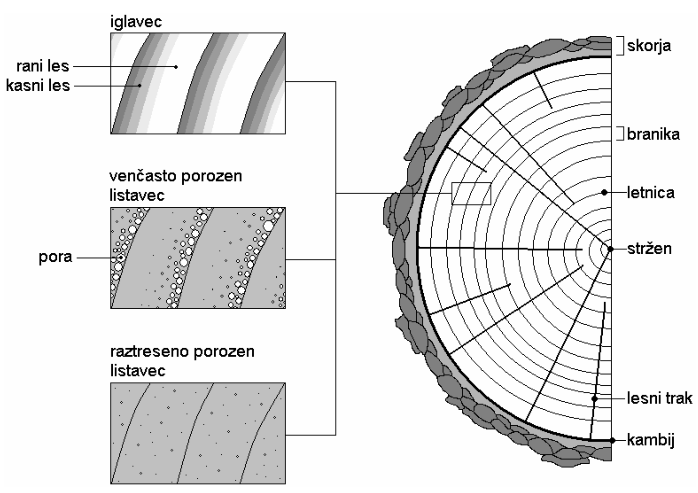
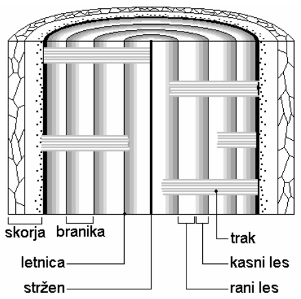
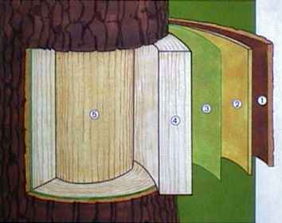
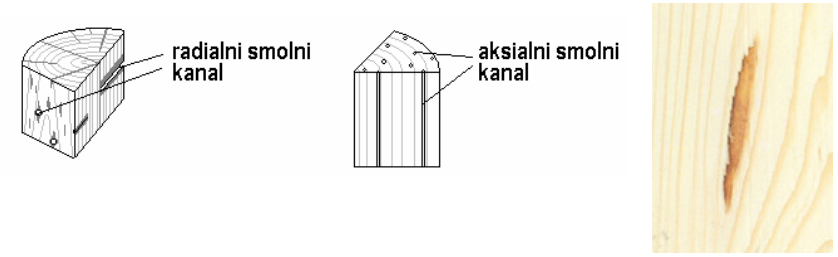
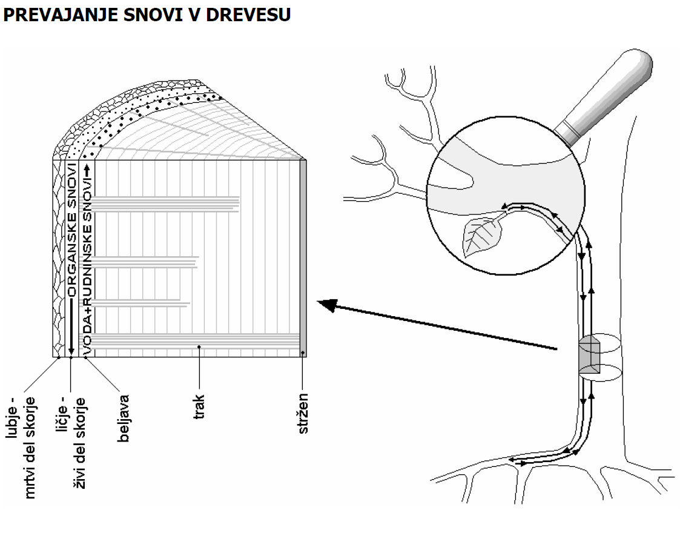
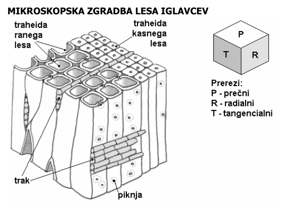
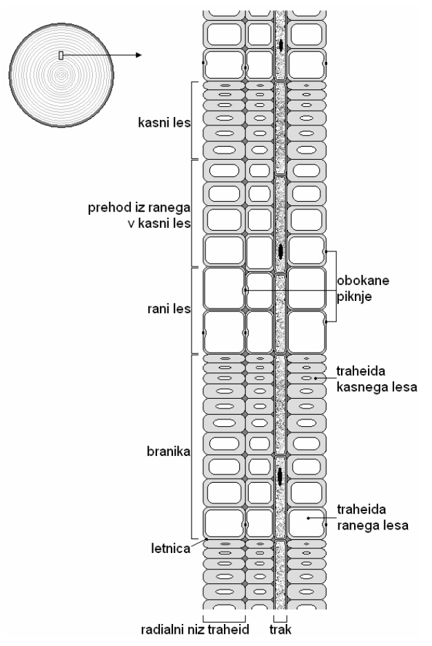
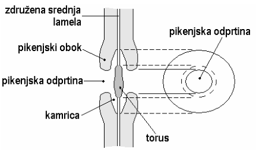

# ZGRADBA LESA

Les je naravni material, ki je nastal kot podporno in prevodno tkivo drevesa.
Njegova zgradba je hierarhična: od celotnega debla in vidnih prerezov prek
celic in celičnih sten do kemičnih sestavin. Ta zgradba vpliva na gostoto,
trdnost, krčenje, vpijanje vode, obdelovalnost in videz lesa.

### Kratek evolucijski pogled

Les je v osnovi sekundarni ksilem, torej tkivo, ki nastaja z delitvijo kambija
in omogoča rast stebla v debelino. Razvil se je skupaj s prilagajanjem rastlin
na življenje na kopnem: rastlina je potrebovala mehansko oporo, učinkovit
prevod vode od korenin do listov in način shranjevanja rezervnih snovi.

Pri starejših skupinah olesenelih rastlin, med katere uvrščamo tudi iglavce,
večino prevodne in mehanske naloge opravljajo traheide. Posamezna traheida je
zato hkrati del prevodnega sistema in podpornega tkiva. Takšna zgradba je
razmeroma enostavna in bolj homogena.

Pri kritosemenkah oziroma listavcih se je razvila večja specializacija celic.
Traheje z večjimi lumni učinkovito prevajajo vodo, vlakna predvsem mehansko
utrjujejo les, parenhimske celice in lesni trakovi pa sodelujejo pri shranjevanju
ter radialnem transportu. Zaradi ločitve nalog med več vrstami celic je zgradba
lesa listavcev pogosto bolj raznolika in heterogena.

Ta evolucijska razlaga pomaga razumeti osnovno razliko med skupinama: pri
iglavcih prevladuje ena funkcionalno dvojna vrsta celic, pri listavcih pa so
prevodna, podporna in skladiščna naloga izraziteje razdeljene. To je splošna
razlaga; med posameznimi vrstami obstajajo številne izjeme in prehodi.

V tem poglavju obravnavamo:

- makroskopsko zgradbo lesa, ki jo lahko opazujemo s prostim očesom ali lupo;
- mikroskopsko zgradbo lesa, ki jo sestavljajo celice in celične stene;
- kemijsko sestavo lesa, predvsem celulozo, hemiceluloze, lignin in ekstraktivne
  snovi.

Podrobnejše prepoznavanje posameznih slovenskih vrst lesa je obravnavano v
ločenem poglavju [Prepoznavanje vrst lesa](./300_PREPOZNAVANJE_VRST_LESA.md).

## MAKROSKOPSKA ZGRADBA LESA

Makroskopska zgradba lesa obsega strukture, ki jih vidimo s prostim očesom ali
z uporabo lupe. Pri opazovanju moramo poznati smer prereza, saj so posamezne
strukture na prečnem, radialnem in tangencialnem prerezu videti različno.

### Osnovne anatomske smeri in prerezi

Tri osnovne anatomske smeri v lesu so:

- **vzdolžna oziroma aksialna smer** – poteka vzdolž debla in večine lesnih
  celic;
- **radialna smer** – poteka od stržena proti skorji;
- **tangencialna smer** – poteka tangentno na letnice.

Tem smerem ustrezajo trije osnovni prerezi:

- **prečni prerez** – pravokoten na vzdolžno os debla; na njem opazujemo
  stržen, letnice, beljavo, jedrovino in radialne strukture;
- **radialni prerez** – poteka skozi oziroma vzporedno s polmerom debla; na
  njem so lesni trakovi vidni vzdolžno;
- **tangencialni prerez** – poteka tangentno na letnice; na njem se lesni
  trakovi pogosto kažejo kot podolgovate oziroma vretenaste oblike.

{#fig:precni_prerez-smeri}

{#fig:radialni_prerez-smeri}

Pravilno določena smer prereza je pomembna pri opisu lesa, izbiri orientacije
polizdelka in razumevanju njegovega krčenja ter mehanskih lastnosti.

### Glavni deli debla

{#fig:glavni-deli-debla}

#### Skorja

Skorja je zunanja zaščitna plast debla. Ščiti notranja tkiva pred mehanskimi
poškodbami, izsuševanjem, škodljivci in okužbami. Skorja ni del lesa v ožjem
tehnološkem pomenu.

#### Ličje oziroma floem

Ličje je prevodno tkivo na zunanji strani kambija. Po njem se organske snovi,
predvsem sladkorji, premikajo od listov proti drugim delom drevesa. Ličje ne
prevaja vode iz korenin proti krošnji; to nalogo opravlja ksilem.

#### Kambij

Kambij je plast živih delitvenih celic med ličjem in lesom. Navznoter tvori
sekundarni ksilem, navzven pa sekundarni floem. Z delovanjem kambija deblo raste
v debelino in nastajajo nove plasti lesa oziroma branike.

#### Beljava

Beljava je zunanji, mlajši del ksilema. V živem drevesu po njej poteka večina
prevajanja vode in mineralnih snovi. V beljavi so lahko shranjene tudi rezervne
snovi. Barva in širina beljave sta odvisni od drevesne vrste in rastnih pogojev.

#### Jedrovina

Jedrovina je notranji del lesa, v katerem celice praviloma ne sodelujejo več pri
prevajanju vode. V njej se lahko kopičijo ekstraktivne snovi, kot so smole,
fenoli in barvila, zato je pogosto temnejša in biološko odpornejša od beljave.
Meja med beljavo in jedrovino je lahko ostra ali postopna.

#### Stržen

Stržen je osrednji, najstarejši del debla, ki je nastal v začetnih fazah rasti
drevesa. Obdajajo ga letnice oziroma branike. Pri večini tehničnega lesa je
stržen majhen in nima pomembne prevodne funkcije.

#### Branika in letnica

**Branika** je les, ki nastane v eni rastni dobi. Pri mnogih vrstah jo
sestavljata:

- **rani les**, ki ima praviloma večje lumne in tanjše celične stene;
- **kasni les**, ki ima praviloma manjše lumne in debelejše celične stene.

Meja med dvema zaporednima branikama se imenuje **letnica**. Kontrast med
ranim in kasnim lesom določa vidnost letnic in vpliva na gostoto ter videz lesa.

{#fig:branika-letnica}

#### Lesni trakovi

Lesni trakovi so radialne strukture, sestavljene predvsem iz parenhimskih celic.
Omogočajo radialni transport in shranjevanje rezervnih snovi. Na radialnem in
tangencialnem prerezu so lahko vidni kot črte, lise ali bleščice.

#### Smolni kanali

Smolni kanali so medcelični prostori v lesu, napolnjeni s smolo. Kanal torej ni
velika parenhimska celica. Njegovo steno obdajajo specializirane epitelne
parenhimske celice, ki smolo izločajo v kanal. Pri nekaterih iglavcih so smolni
kanali normalen del zgradbe lesa, lahko pa nastanejo tudi kot odziv na poškodbo.
Na prečnem prerezu so videti kot majhne pike, na vzdolžnih prerezih pa kot
podolgovati kanali.

{#fig:smolni-kanali}

#### Grče

Grče so ostanki vej, vključeni v deblo. Zaradi drugačne smeri vlaken in
različne gostote lahko zmanjšajo mehansko homogenost lesa, vplivajo na njegovo
obdelavo in spremenijo videz izdelka.

### Prirast lesa

Les nastaja z delovanjem kambija. Pri tem drevo:

1. po ksilemu prevaja vodo in mineralne snovi;
2. v listih s fotosintezo tvori organske snovi;
3. po floemu te snovi prevaja do rastnih tkiv;
4. v kambiju tvori nove celice sekundarnega ksilema;
5. v celične stene odlaga celulozo, hemiceluloze in lignin.

Osnovna enačba fotosinteze je:

$$6CO_2 + 6H_2O \rightarrow C_6H_{12}O_6 + 6O_2$${#eq:fotosinteza}

{#fig:prirast-lesne-mase}

Hitrost rasti se med letom spreminja. V zmernem podnebju je rast običajno
intenzivnejša spomladi in poleti, jeseni se zmanjšuje, pozimi pa je kambijeva
aktivnost zelo majhna ali miruje. Širina in zgradba branik zato odražata rastne
razmere, vendar sama po sebi ne določata vedno kakovosti lesa.

### Makroskopska razlika med iglavci in listavci

Iglavci in listavci se razlikujejo po razporeditvi in nalogah lesnih celic. Pri
makroskopskem opazovanju praviloma ne vidimo posamezne celice, temveč večje
skupine celic, njihove lumne in tkiva. Kljub temu lahko iz značilnega videza
sklepamo na osnovno anatomsko zgradbo lesa.

Pri **iglavcih** prevladujejo traheide. Ista vrsta celic opravlja tako prevodno
kakor mehansko funkcijo, zato je zgradba lesa na splošno bolj enotna. Na
vzdolžnih prerezih traheid praviloma ne vidimo kot posameznih celic, temveč kot
razmeroma enakomerno vzdolžno teksturo. Bolj opazni so lahko:

- kontrast med ranim in kasnim lesom;
- ozki lesni trakovi;
- smolni kanali, ki so na radialnem prerezu vidni kot podolgovate črte ali
  lise, na prečnem prerezu pa kot pike.

Pri **listavcih** so funkcije bolj razdeljene med različne tipe celic. Traheje
oziroma vodne cevi imajo večje lumne, vlakna dajejo lesu mehansko oporo,
parenhimske celice pa sodelujejo pri shranjevanju in radialnem transportu. Na
radialnem prerezu se lumni trahej pogosto pokažejo kot vzdolžne pore oziroma
kanali. Zaradi njih je vzdolžna tekstura lahko bolj izrazita in neenakomerna
kot pri iglavcih. Vidni so lahko tudi širši lesni trakovi.

Na radialnem prerezu lahko torej opazimo predvsem posledice razporeditve celic:

- pri iglavcih bolj enakomerno vzdolžno strukturo, prekinjeno z letnicami,
  trakovi in morebitnimi smolnimi kanali;
- pri listavcih vzdolžne vrste oziroma pasove por, ki predstavljajo lumne
  trahej, ter pogosto izrazitejše radialne trakove.

Pri listavcih glede na razporeditev por ločimo venčasto porozni in raztreseno
porozni les. Pri venčasto poroznem lesu so večje traheje zbrane predvsem v
ranem lesu, pri raztreseno poroznem pa so pore bolj enakomerno razporejene po
braniki. To je makroskopsko pomembna posledica mikroskopske zgradbe, vendar za
natančno določanje vrste potrebujemo tudi druge znake.

### Povezava makroskopske zgradbe z lastnostmi lesa

Makroskopska zgradba vpliva na:

- **mehanske lastnosti** – gostota branik, smer vlaken in grče vplivajo na
  trdnost in togost;
- **prevajanje vode** – beljava, lumni in lesni trakovi vplivajo na pretok;
- **biološko odpornost** – jedrovina in ekstraktivne snovi lahko povečajo
  odpornost proti glivam in insektom;
- **obdelavo** – grče, smolni kanali, gostota in smer vlaken vplivajo na žaganje,
  skobljanje, vrtanje in lepljenje;
- **videz** – letnice, jedrovina, beljava, trakovi in grče določajo teksturo in
  barvni videz lesa.

## MIKROSKOPSKA ZGRADBA LESA

Mikroskopsko zgradbo lesa sestavljajo različni tipi celic, njihovi lumni,
celične stene in prostori med celicami. Različne celice opravljajo različne
naloge: prevajajo vodo, dajejo mehansko oporo, shranjujejo rezervne snovi ali
omogočajo radialni transport.

### Osnovni tipi celic

#### Traheide

Traheide so dolge, ozke in večinoma odmrle celice. Pri iglavcih predstavljajo
glavnino lesa, zato opravljajo tako prevodno kot mehansko funkcijo. Voda med
traheidami prehaja skozi piknje v celičnih stenah.

#### Traheje oziroma vodne cevi

Traheje so značilne predvsem za listavce. Nastanejo iz zaporednih členov, ki
tvorijo daljše vodne cevi z večjimi lumni. Omogočajo učinkovit aksialni prenos
vode, vendar so zaradi velikih odprtin lahko občutljivejše na prekinitev
vodnega stolpca.

#### Vlakna

Vlakna so podolgovate celice z debelimi celičnimi stenami in so osnovno
mehansko tkivo listavcev. Glede na zgradbo in prevodno sposobnost jih razvrščamo
na:

- **traheide** – imajo bolj razvite piknje in lahko poleg mehanske funkcije
  sodelujejo tudi pri prevajanju vode;
- **vlaknaste traheide** – predstavljajo prehod med traheidami in libriformskimi
  vlakni ter imajo omejeno prevodno sposobnost;
- **libriformska vlakna** – imajo predvsem mehansko funkcijo in praviloma zelo
  omejeno prevajanje vode.

V tem poglavju izraz *vlakna* uporabljamo kot širši izraz za to skupino celic,
ki jo pri listavcih podrobneje razvrščamo na traheide, vlaknaste traheide in
libriformska vlakna. S tem se izrazje ujema z razvrstitvijo v gradivu *Les:
zgradba* Irene Leban.

#### Parenhimske celice

Parenhimske celice so lahko žive in sodelujejo pri presnovi ter shranjevanju
rezervnih snovi. Razporejene so lahko vzdolžno ali radialno in gradijo tudi
lesne trakove. Radialno razporejene parenhimske celice tvorijo lesne trakove,
vzdolžno razporejene pa aksialni parenhim.

Pri iglavcih je aksialnega parenhima običajno manj kot pri listavcih. Pomemben
je predvsem radialni parenhim v lesnih trakovih. Posebna oblika parenhimskih
celic so epitelne celice ob smolnih kanalih; te izločajo smolo in s tem tvorijo
sekretorno oblogo kanala. Pri iglavcih so zato smolni kanali pomemben in
makroskopsko včasih dobro viden znak, vendar niso prisotni pri vseh vrstah.

Pri listavcih je parenhim pogosto bolj raznolik in ga je lahko več. Pojavlja se
v lesnih trakovih in v aksialnih skupinah, na primer ob trahejah ali v pasovih
znotraj branike. Pri listavcih so smolni kanali manj značilni kot pri iglavcih;
lahko pa se pojavljajo sorodni izločevalni kanali oziroma kanali z gumijastimi
ali drugim podobnim izločkom. Zato prisotnost smolnega kanala sama po sebi ni
dovolj za določitev drevesne vrste.

#### Lesni trakovi

Lesni trakovi so skupine predvsem radialno usmerjenih parenhimskih celic. Skozi
njih potekata radialni transport in shranjevanje rezervnih snovi.

{#fig:mikroskopska-zgradba}

{#fig:mikro-branika-iglavci}

### Celična stena

Celična stena je kompozitna struktura, sestavljena predvsem iz celuloznih
mikrofibril, hemiceluloz in lignina. Pri zrelih lesnih celicah ločimo:

- srednjo lamelo, ki povezuje sosednje celice;
- primarno steno;
- sekundarno steno z deli S1, S2 in S3.

Sloj S2 je običajno najdebelejši. Orientacija celuloznih mikrofibril v njem
močno vpliva na vzdolžno trdnost, togost in krčenje lesa.

### Piknje in tile

**Piknje** so območja v celični steni, kjer lahko voda prehaja med sosednjimi
celicami. Njihova zgradba in razporeditev se razlikujeta med skupinami lesa.

{#fig:piknja}

**Tile** so izrastki parenhimskih celic, ki lahko zaprejo lumen traheje. Zaradi
njih je prehod vode skozi nekatere dele lesa otežen. Tile vplivajo tudi na
prepustnost lesa za tekočine, sušenje, impregnacijo in lepljenje.

### Razlika med iglavci in listavci

Pri iglavcih prevladujejo traheide, ki opravljajo prevodno in mehansko
funkcijo. Pri listavcih so funkcije bolj razdeljene med traheje, vlakna in
parenhim. Ta razlika je pomembna za razumevanje gostote, prepustnosti, videza
in mehanskih lastnosti lesa, ni pa v tem poglavju namenjena določanju
posameznih drevesnih vrst.

## KEMIJSKA SESTAVA LESA

Les je naravni kompozit, sestavljen iz polimernih snovi celične stene in
manjših količin ekstraktivnih ter mineralnih snovi. Deleži se med vrstami,
delom debla in rastnimi pogoji razlikujejo. Okvirne vrednosti so:

- **celuloza**: približno 40–50 %; tvori nosilne mikrofibrile in prispeva k
  natezni trdnosti;
- **hemiceluloze**: približno 20–35 %; tvorijo povezovalno matrico in vplivajo
  na vezavo vode;
- **lignin**: približno 20–30 %; prispeva k togosti, tlačni trdnosti in
  povezovanju celične stene;
- **ekstraktivne in mineralne snovi**: običajno manj kot 10 %; vplivajo na
  barvo, vonj, zaščito in druge posebne lastnosti.

### Celuloza

Celuloza je linearni polisaharid iz β(1→4)-povezanih glukoznih enot. Molekule
celuloze se povezujejo v mikrofibrile, ki so osnovni nosilni elementi celične
stene. Celuloza je hidrofilna, zato lahko veže vodo. Njena usmerjenost in
stopnja urejenosti pomembno vplivata na natezno trdnost lesa.

### Hemiceluloze

Hemiceluloze so skupina krajših in bolj razvejanih polisaharidov. Obdajajo
celulozne mikrofibrile in jih povezujejo z ligninom. Zaradi svoje kemijske
zgradbe lahko vežejo precej vode in vplivajo na higroskopnost, krčenje,
toplotno obnašanje ter kemično predelavo lesa.

### Lignin

Lignin je tridimenzionalen amorfen polimer fenolnih gradnikov. Nahaja se med
celuloznimi mikrofibrilami in v srednji lameli. Celični steni daje togost,
omejuje nabrekanje in zmanjšuje prepustnost za vodo. Zaradi lignina je les
trdnejši v tlaku in odpornejši proti nekaterim oblikam biološke razgradnje.

Lignin je pomemben tudi pri tehnološki obdelavi, na primer pri kuhanju lesa,
izdelavi vlaknin, beljenju in termični obdelavi.

### Ekstraktivne snovi in minerali

Ekstraktivne snovi niso osnovni gradniki celične stene. Mednje spadajo smole,
maščobe, voski, tanini, barvila in druge manjše organske molekule. Vplivajo na
barvo, vonj, trajnost, gorljivost, obdelovalnost in oprijem premazov ali lepil.

V lesu so prisotne tudi majhne količine mineralnih snovi. Po sežigu ostanejo v
obliki pepela.

### Pomen kemijske sestave za obdelavo lesa

Kemijska sestava vpliva na:

- vpijanje in oddajanje vode;
- krčenje in nabrekanje;
- trdnost ter togost celičnih sten;
- obdelavo z rezili;
- sušenje in termično obdelavo;
- lepljenje, površinsko obdelavo in zaščito;
- odpornost proti glivam, insektom in vremenskim vplivom.

## VAJE IN NALOGE

1. Na vzorcu lesa določite prečni, radialni in tangencialni prerez.
2. Na prečnem prerezu označite stržen, branike, beljavo, jedrovino in lesne
   trakove, če so vidni.
3. Primerjajte videz ranega in kasnega lesa ter pojasnite, kako vplivata na
   gostoto branik.
4. S pomočjo lupe poiščite lesne trakove, grče ali smolne kanale.
5. Pojasnite razliko med traheidami, trahejami, vlakni in parenhimskimi
   celicami.
6. Izdelajte preprost diagram povezave med celulozo, hemicelulozami in
   ligninom v celični steni.
7. Pojasnite, zakaj kemična sestava lesa vpliva na njegovo vpijanje vode,
   trdnost in obdelovalnost.
