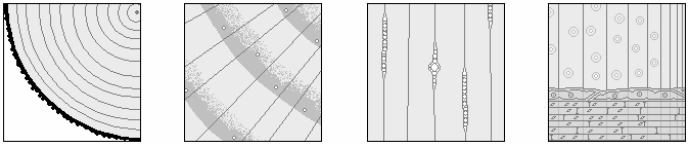
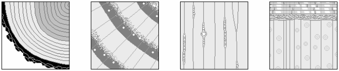
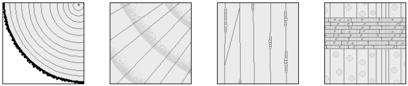
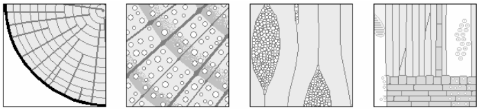
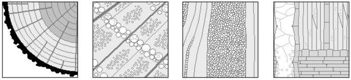

# PREPOZNAVANJE VRST LESA

Prepoznavanje lesne vrste je pomembno pri izbiri materiala za določen namen,
izbiri orodja in načinu obdelave. Pri praktičnem delu lesne vrste ne določamo
na podlagi ene same značilnosti, temveč primerjamo več znakov na različnih
prerezih.

Pri pouku naj študent zna vsaj osnovno prepoznati smreko, bukev in hrast ter
lipo. Pri zahtevnejšem določanju so potrebni dodatni znaki, lupa ali
mikroskopski prerez in primerjava z referenčnim gradivom.

## POSTOPEK PREPOZNAVANJA

Pri prepoznavanju sledimo naslednjemu zaporedju:

1. določimo, ali opazujemo prečni, radialni ali tangencialni prerez;
2. ocenimo, ali je les iglavec ali listavec;
3. opazujemo letnice, rani in kasni les ter njihovo izrazitost;
4. pri listavcih določimo razporeditev por oziroma trahej;
5. pregledamo lesne trakove, smolne kanale, grče, barvo in jedrovino;
6. primerjamo več značilnosti z referenčnim vzorcem.

Za zanesljivo določanje vedno opazujemo sveže in čiste površine. Prah, premaz,
oksidacija, umazanija ali nepravilno izbran prerez lahko zakrijejo značilne
znake.

### Kaj opazujemo na posameznih prerezih

- **Prečni prerez**: letnice, rani in kasni les, pore oziroma lumne trahej,
  smolne kanale, stržen, beljavo in jedrovino.
- **Radialni prerez**: lesne trakove, vzdolžni potek por in smolnih kanalov,
  kontrast med ranim in kasnim lesom ter morebitne bleščice.
- **Tangencialni prerez**: širino in obliko lesnih trakov, teksturo, pore,
  vzorec letnic in videz grč.

## OSNOVNA RAZLIKA MED IGLAVCI IN LISTAVCI

### Iglavci

Pri iglavcih prevladujejo aksialne traheide. Te celice opravljajo tako prevodno
kakor mehansko funkcijo, zato je zgradba lesa razmeroma enotna. Traheide ranega
lesa imajo praviloma večje lumne in tanjše stene, traheide kasnega lesa pa
manjše lumne in debelejše stene. To povzroči značilen prehod med svetlejšim
ranim in temnejšim kasnim lesom.

Pri prepoznavanju iglavcev so pomembni:

- ostrina ali postopnost prehoda med ranim in kasnim lesom;
- širina in razločnost letnic;
- prisotnost, velikost in razporeditev smolnih kanalov;
- barva in izrazitost jedrovine;
- širina in zgradba lesnih trakov.

Lesni trakovi iglavcev so pogosto ozki. Trakovno tkivo je lahko homocelularno,
če ga sestavljajo predvsem parenhimske celice, ali heterocelularno, če so v
njem poleg parenhimskih celic tudi trakovne traheide. To je pomemben
mikroskopski znak pri razlikovanju nekaterih vrst.

### Listavci

Pri listavcih so naloge med celicami bolj razdeljene. Traheje oziroma pore
prevajajo vodo, vlakna dajejo lesu mehansko oporo, parenhimske celice pa
sodelujejo pri shranjevanju in radialnem transportu. Na prečnem prerezu so
lumni trahej lahko vidni kot pore, na vzdolžnih prerezih pa kot podolgovate
strukture.

Pri prepoznavanju listavcev so pomembni:

- velikost, oblika in razporeditev por;
- razlika med porami ranega in kasnega lesa;
- širina, višina in razporeditev lesnih trakov;
- barva beljave in jedrovine;
- posebne parenhimske lise, kristali, tile ali drugi znaki.

Pri listavcih je aksialnega parenhima običajno več kot pri iglavcih. Lesni
trakovi so lahko široki in visoki ter so na radialnem prerezu vidni kot
izrazite svetleče površine oziroma bleščice.

## POROZNOST LISTAVCEV

Razporeditev por oziroma trahej znotraj branike je eden najuporabnejših
makroskopskih znakov pri listavcih.

### Venčasto porozni listavci

Velike pore so zgoščene v ranem lesu in tvorijo izrazit venec na začetku
branike. V kasnem lesu so pore praviloma manjše in lahko razporejene v
radialnih nizih.

Med značilne predstavnike spadajo:

- hrast;
- kostanj;
- brest;
- jesen.

### Polvenčasto porozni listavci

Pore so razporejene po celotni braniki, vendar so v ranem lesu običajno večje
ali številčnejše. Prehod med ranim in kasnim lesom je zato manj izrazit kot pri
venčasto poroznih vrstah.

Med značilne predstavnike uvrščamo predvsem:

- oreh;
- češnjo.

### Raztreseno porozni listavci

Pore so razmeroma enakomerno razporejene po celotni braniki in so pogosto
majhne, zato jih s prostim očesom težje opazimo. Med raztreseno porozne vrste
spadajo bukev, lipa, javor, gaber, breza, jelša ter številne sadne vrste.

Za praktično orientacijo jih lahko razvrstimo v skupine:

- **sadne vrste**: jablana, hruška, sliva;
- **mehkejši les**: lipa, topol;
- **izraziti lesni trakovi**: bukev, javor, gaber;
- **parenhimske lise**: breza, jelša.

Ta razvrstitev je le začetna pomoč. Za zanesljivo določitev vrste moramo
upoštevati tudi barvo, gostoto, teksturo, jedrovino, vonj in druge znake.

## IZBRANE SLOVENSKE VRSTE LESA

### Smreka (*Picea abies*)

Smreka je iglavec s svetlim lesom in praviloma neizrazito oziroma neobarvano
jedrovino. Letnice so dobro vidne, prehod iz ranega v kasni les pa je običajno
postopen. Smolni kanali so lahko vidni na prečnem prerezu. Trakovi so večinoma
ozki, trakovno tkivo pa je heterocelularno.

{#fig:prepoznavanje-smreka}

### Bor (*Pinus* spp.)

Bor ima pogosto izrazite letnice in ostro mejo med ranim ter kasnim lesom. V
kasnem lesu so smolni kanali pogosto vidni kot svetle pike. Jedrovina je lahko
obarvana in temnejša od beljave. Trakovno tkivo je heterocelularno.

{#fig:prepoznavanje-bor}

### Jelka (*Abies alba*)

Jelka ima svetel les in praviloma neobarvano jedrovino. Letnice so razločne,
prehod med ranim in kasnim lesom je postopen, značilnih smolnih kanalov pa
praviloma nima. Trakovno tkivo je pretežno homocelularno in enoredno.

{#fig:prepoznavanje-jelka}

### Bukev (*Fagus sylvatica*)

Bukev je raztreseno porozen listavec. Les je na prečnem prerezu pogosto
razmeroma enakomerno obarvan, letnice pa so razločne. Pore so številne in
majhne. Značilni so široki lesni trakovi, ki se na tangencialnem prerezu lahko
kažejo v vzorcu vretenc. Pri starejših drevesih se lahko pojavi rdeče srce.

{#fig:prepoznavanje-bukev}

### Hrast (*Quercus* spp.)

Hrast je venčasto porozen listavec z izrazitimi letnicami in pogosto obarvano
jedrovino. Velike pore ranega lesa so vidne s prostim očesom. Pore kasnega lesa
so manjše in pogosto razporejene v radialnih nizih. V jedrovini so v trahejah
pogosti tile, ki zmanjšujejo prepustnost lesa.

{#fig:prepoznavanje-hrast}

### Lipa in topol

Lipa in topol sta raztreseno porozna ter praviloma mehkejša listavca. Pore so
majhne in razmeroma enakomerno razporejene. Les je navadno svetel in z manj
izrazito teksturo kot pri hrastu ali bukvi.

### Javor in gaber

Javor in gaber sta raztreseno porozna listavca z vidnimi lesnimi trakovi. Pri
obeh so pomembni enakomerno razporejene majhne pore, barva lesa in izrazitost
trakov. Gaber je praviloma gostejši in trši od javorja.

### Breza in jelša

Breza in jelša sta raztreseno porozna listavca. Pri prepoznavanju pomagajo
barva, drobne pore in razporeditev parenhima. V nekaterih vzorcih so lahko
vidne parenhimske lise.

### Oreh in češnja

Oreh in češnja sta pogosto uvrščena med polvenčasto porozne vrste. Pore so
razporejene po celotni braniki, vendar so v ranem lesu lahko večje ali
številčnejše. Pri določanju sta pomembna tudi značilna barva in tekstura lesa.

### Sadne vrste

Jablana, hruška in sliva so raztreseno porozne vrste. Njihove pore so drobne,
tekstura pa je lahko zelo enakomerna. Pri razlikovanju med njimi so pomembni
barva, gostota, trdota, vonj in primerjava z referenčnimi vzorci.

## VAJA: LOČEVANJE VRST LESA

Za izbrane vzorce smreke, bukve, hrasta in lipe izdelajte primerjalni zapis.
Za vsako vrsto:

1. določite smer prereza;
2. narišite prečni in enega od vzdolžnih prerezov;
3. označite letnice, pore oziroma smolne kanale in lesne trakove;
4. opišite barvo, teksturo, gostoto in trdoto;
5. navedite, za katere izdelke oziroma namene bi bila vrsta primerna.

Pri opisu ne uporabljajte samo enega znaka. Prepoznavanje je zanesljivejše,
če se ujemajo anatomski, makroskopski in fizikalni znaki.

## VIRI IN DODATNO GRADIVO

- Irena Leban, *Les: zgradba*;
- Irena Leban, *Les: lastnosti*;
- [podatki o lesnih vrstah – Wood Database](https://www.wood-database.com/);
- [slovenske vrste lesa](http://www2.arnes.si/~evelik1/les/index.htm);
- [slikovno gradivo: Slovenske vrste lesa](./011_Les_SlovenskeVrsteLesa.pdf).
