# SPAJANJE LESNIH POLIZDELKOV

## LEPLJENJE

Lepilo je snov, ki omogoči trajno povezavo dveh površin. Med utrjevanjem tvori
lepilni film, ki se oprime površin in ima zadostno notranjo trdnost.

Pri lepljenju lesa lepilo poveže dva ali več **lepljencev**. Lepljenca morata biti
ustrezno pripravljena, da se lepilo z njima dobro omoči in da med površinama
nastane čim bolj enakomeren lepilni spoj.

Lepila se med seboj razlikujejo po sestavi in načinu utrjevanja. Nekatera so
vodne disperzije ali raztopine, druga pa se utrjujejo s kemijsko reakcijo. Zato
ni pravilno vseh lepil opisati kot disperzijska sredstva.

V lepilnem spoju sta pomembni dve vrsti sil:

- **adhezijske sile** med lepilom in lesom;
- **kohezijske sile** znotraj lepilnega filma.

Kakovost spoja ni odvisna samo od lepila. Pomembni so tudi vrsta in vlažnost
lesa, stanje površin, naleganje, količina lepila, temperatura, tlak in čas
stiskanja.

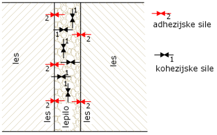{#fig:lepilo_adhezija_kohezija}

### UTRJEVANJE LEPILA:

Utrjevanje je proces, pri katerem lepilo iz tekočega ali pastoznega stanja
preide v trdnejši lepilni film. Pri tem ločimo:

- **sušenje** – odstranjevanje vode ali topila z izhlapevanjem in vpijanjem;
- **fizikalno utrjevanje** – utrjevanje zaradi sušenja, ohlajanja ali druge
  fizikalne spremembe;
- **kemijsko utrjevanje** – povezovanje oziroma zamreženje molekul s kemijsko
  reakcijo;
- **fizikalno-kemijsko utrjevanje** – kombinacija fizikalnega in kemijskega
  utrjevanja.

Pomembnejši časi pri lepljenju so:

- **odprti čas** – čas od nanosa lepila do stika lepljencev;
- **zaprti čas** – čas od stika lepljencev do začetka stiskanja;
- **čas sestavljanja** – odprti in zaprti čas skupaj;
- **čas stiskanja** – čas, ko mora biti spoj pod predpisanim tlakom;
- **čas do končne trdnosti** – čas, potreben, da lepilo doseže predvidene
  lastnosti.

Čas stiskanja zato ni nujno enak času, ko je lepilo popolnoma utrjeno. Vsi
navedeni časi so odvisni od vrste lepila, temperature, vlažnosti lesa, količine
lepila in drugih pogojev lepljenja.

### POMEMBNEJŠE LASTNOSTI LEPIL:

- **vodna odpornost** – odpornost lepilnega spoja proti vlagi in vodi;
- **trdota in elastičnost** – vplivata na obnašanje spoja pri krčenju in
  raztezanju lesa;
- **viskoznost** – vpliva na nanos, omočenje in prodiranje lepila v površino;
- **odprti čas in čas stiskanja** – določata čas za sestavo in stiskanje spoja;
- **zapolnjevanje rež** – sposobnost lepila, da poveže tudi manj popolnoma
  nalegajoče se površine;
- **barva lepilnega filma** – pomembna pri vidnih spojih;
- **pH in kemična sestava** – lahko vplivata na obarvanje lesa, korozijo
  kovinskih delov in varnost pri delu.

Lepljenje je lahko samostojen način spajanja, pogosto pa ga kombiniramo z
drugimi načini, na primer z mozniki, lamelami, čepi ali vijačenjem. Pri
širinskem lepljenju lesa je lepilna površina običajno velika in poteka vzdolž
vlaken, zato je tak spoj lahko zelo učinkovit.

Čelno lepljenje je praviloma manj ugodno kot lepljenje vzdolž vlaken. Čelne
površine močno vpijajo lepilo, prenos sil na čelni ploskvi je neugoden, spoj pa
je občutljiv tudi na cepljenje. Čelni spoj zato pogosto izboljšamo z zobatim
spojem, peresom, lamelo, moznikom ali drugim oblikovanjem spoja.

## TEHNOLOŠKI POSTOPEK LEPLJENJA

Kakovosten lepilni spoj izdelamo po naslednjem zaporedju:

1. izberemo in pripravimo lepljence;
2. pripravimo in očistimo spojne površine;
3. pripravimo lepilo;
4. nanesemo ustrezno količino lepila;
5. sestavimo lepljence;
6. spoj stisnemo s predpisanim tlakom;
7. počakamo, da lepilo doseže zadostno trdnost;
8. spoj razbremenimo, očistimo in pregledamo.

### PRIPRAVA LEPLJENCEV

Pred lepljenjem preverimo:

- vrsto in kakovost lesa;
- smer lesnih vlaken;
- vlažnost lesa;
- ravnost in prileganje spojnih površin;
- pravilnost mer in obliko spoja;
- ali so na površinah smola, olje, maščoba, prah ali druga umazanija.

Les mora imeti vlažnost, ki ustreza namenu izdelka, vrsti lepila in navodilom
proizvajalca. Preveč moker les lahko upočasni sušenje vodnih lepil, preveč suh
les pa lahko iz lepila prehitro vpije vodo. Zaradi krčenja in nabrekanja lahko
neustrezna vlažnost povzroči tudi napetosti v lepilnem spoju.

Lepljence pred lepljenjem aklimatiziramo v prostoru, kjer bo potekalo delo.
Temperatura lesa, lepila in prostora mora biti primerna za izbrano lepilo.

Pred lepljenjem preverimo tudi prileganje površin s suhim sestavljanjem. Pri
sestavljanju se morata lepljenca brez večjih sil pravilno prilegati in se ne
smeta zibati. Lepilo ne more nadomestiti velikih napak pri obdelavi površin.

### PRIPRAVA SPOJNIH POVRŠIN

Spojne površine morajo biti:

- ravne in med seboj vzporedne;
- dovolj gladke, vendar ne spolirane;
- brez ožganin, natrganih vlaken in večjih iztrganin;
- brez prahu, olja, maščob in drugih nečistoč.

Površine praviloma pripravimo z ostrim skobeljnikom ali ustreznim rezkalnim
orodjem. Brušene površine morajo biti enakomerno obdelane in brez ostankov
brusnega prahu. Pri nekaterih lesnih vrstah je treba posebno pozornost nameniti
smoli in drugim snovem, ki lahko zmanjšajo omočenje površine.

Tik pred nanosom lepila površin ne prijemamo z mastnimi rokami in jih ne močimo
brez navodila proizvajalca. Pri nekaterih poliuretanskih lepilih je rahla
navlažitev priporočena, pri drugih lepilih pa lahko dodatna voda poslabša
utrjevanje.

### PRIPRAVA LEPILA

Pred uporabo preverimo:

- ime in vrsto lepila;
- rok uporabnosti in pogoje skladiščenja;
- ali je lepilo enokomponentno ali dvokomponentno;
- priporočeno temperaturo, količino nanosa, čas sestavljanja in čas stiskanja;
- varnostna navodila.

Dvokomponentno lepilo pripravimo z natančnim odmerjanjem in mešanjem obeh
komponent v razmerju, ki ga določi proizvajalec. Napačno razmerje lahko povzroči
slabše ali nepopolno utrjevanje. Pripravljene mešanice ne uporabljamo po
preteku uporabnega časa mešanice.

Pred nanosom lepilo po potrebi premešamo, vendar ga ne redčimo in mu ne
dodajamo drugih snovi, če tega izrecno ne dovoljujejo navodila proizvajalca.

### NANOS LEPILA

Pri nanosu lepila moramo zagotoviti, da je ustrezno velika in dobro pripravljena
spojna površina enakomerno prekrita **po celotni ploskvi**. Površini morata biti čisti, suhi oziroma ustrezno vlažni glede na navodila proizvajalca ter brez prahu, olja in maščob.

Lepilo lahko nanašamo:

- s čopičem;
- z nanašalnim glavnikom ali lopatico;
- z nanašalnim valjčkom;
- iz tlačne posode ali z dozirnim nastavkom;
- strojno z nanašalnimi valji.

Količina nanosa in način nanosa sta odvisna od vrste lepila, vrste lesa,
poroznosti površine in oblike spoja. Zato debeline mokrega nanosa ne smemo
obravnavati kot splošno pravilo. Pri tehničnih podatkih se količina pogosto
navaja v gramih na kvadratni meter, čeprav ga v praksi kontroliramo z debelino nanosa (0,1 - 0,2 mm). V ta namen lahko uporabljamo zobati glavnik za nanos lepila (če tega nimamo lahko uporabimo vijak M4). Po stiskanju mora nastati čim bolj enakomeren in tanek lepilni film.

Pri enostavnih ploskovnih spojih je pogosto dovolj enostranski nanos. Pri
poroznem ali težje lepljivem lesu, pri slepih spojih in pri zahtevnejših spojih
je lahko potreben dvostranski nanos. Pri čepih, moznikih in lamelah je treba
lepilo nanesti tudi v utor oziroma izvrtino, če to zahteva oblika spoja in vrsta
lepila.

Pri slepih spojih moramo predvideti prostor za iztis odvečnega lepila. Lepljence
stisnemo šele v času, ki ga določa tehnologija izbranega lepila. Če je čas
predolg, se lahko lepilo na površini posuši ali začne utrjevati, zato se ne more
več pravilno omočiti in razporediti.

### SESTAVLJANJE LEPLJENCEV

Lepljence sestavimo mirno in natančno, da lepila ne odstranimo s spojne
površine. Pri spojih, ki se sestavljajo z drsnim gibom, moramo paziti, da se
lepilo enakomerno razporedi in da se lepljenca po sestavljanju ne premakneta.
Da preprečimo premikanje lepljencev med stiskanjem, lahko v spoj dodamo nekaj zrn soli.

Pri sestavljanju preverimo:

- pravilno lego lepljencev;
- poravnanost robov in površin;
- enakomeren iztis lepila po dolžini spoja;
- ali je v slepem spoju dovolj prostora za odvečno lepilo.

Odvečno lepilo, ki se iztisne na površino, odstranimo na način, ki je primeren
za izbrano lepilo. Pri vodnih lepilih moramo paziti, da ga z mokro krpo ne
razmažemo po lesu, saj lahko prodre v pore in pozneje oteži površinsko obdelavo.

### STISKANJE SPOJA

Spoj stisnemo s sponami, vijačnimi napravami, stiskalnico ali drugim ustreznim
pripomočkom. Tlak mora biti dovolj velik, da se površini tesno prilegata, ne
sme pa biti tako velik, da iz spoja iztisne skoraj vse lepilo.

Pri stiskanju preverimo:

- da je tlak enakomeren po celotni dolžini oziroma površini spoja;
- da so spone in pritisne letve pravilno nameščene;
- da s pritiskanjem ne poškodujemo površine lesa;
- da se lepljenci med stiskanjem ne premaknejo;
- da je čas stiskanja prilagojen vrsti lepila, temperaturi in vlažnosti.

Pri večjih ploskovnih spojih mora biti pritisk razporejen tako, da se spoj ne
odpira na sredini ali na koncih. Pritisne letve in robove spojev po potrebi zaščitimo s folijo,
trakom ali papirjem, da se ne prilepijo na iztisnjeno lepilo.

### UTRJEVANJE IN RAZBREMENITEV SPOJA

Med utrjevanjem mora spoj ostati miren in pod ustreznim tlakom. Lepljencev ne
smemo obremenjevati, premikati ali obdelovati, dokler lepilo ne doseže zadostne
začetne trdnosti.

Po preteku predpisanega časa stiskanja spoj previdno razbremenimo. Če se
lepljenca takoj po odstranitvi spon odpirata ali premikata, je bil čas stiskanja
prekratek oziroma pogoji lepljenja niso bili ustrezni.

Končna trdnost se lahko razvija še po odstranitvi spon. Zato je treba pri
zahtevnejših izdelkih upoštevati tudi čas do končnega utrjevanja, ki ga določa
proizvajalec lepila.

### KONTROLA LEPILNEGA SPOJA

Po utrjevanju pregledamo:

- ali je spoj sklenjen po celotni površini;
- ali so vidne reže, prazni deli ali razpoke;
- ali je iztis lepila približno enakomeren;
- ali sta lepljenca pravilno poravnana;
- ali se je les zaradi stiskanja ali vlaženja poškodoval.

Pri preskušanju vzorca je dober znak, če se pri obremenitvi poškoduje les ob
spoju, ne pa če se površini enostavno ločita po lepilnem filmu. Način
preskušanja mora biti prilagojen vrsti spoja in namenu izdelka.

- [LEPILA IN MATERIALI ZA POVRŠINSKO OBDELAVO IN ZAŠČITO LESA, M. Čermak](https://cpi.si/wp-content/uploads/2020/08/LepilainMaterialiZaPovrsinskoObdelavo.pdf)

## VRSTE LEPIL

V splošnem ločimo:

- naravna in
- sintetična lepila

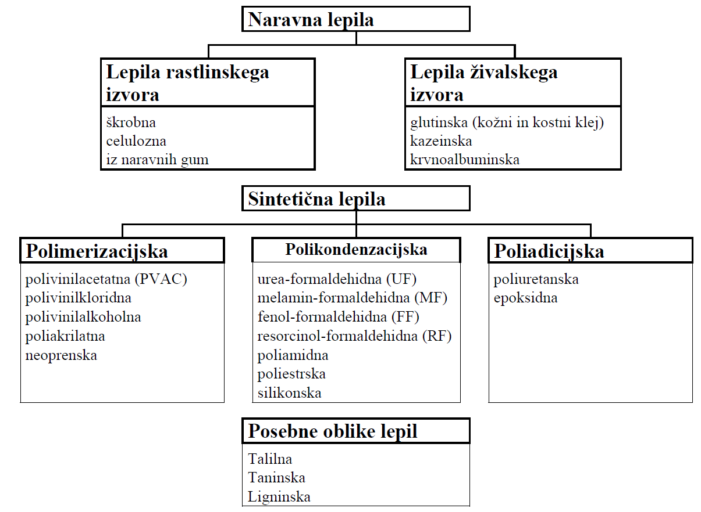{#fig:lepila_razvrstitev}

### Naravna lepila

Primer uporabe lepila naravnega izvora v lesarstvu je uporaba rastlinskih lepil. Na primer, lepila, pridobljena iz rastlin, kot so škrob, lignin ali rastlinske smole, se pogosto uporabljajo za lepljenje lesa. Ta lepila so lahko naravno obstojna, okolju prijazna in neškodljiva za zdravje ljudi. Uporabljajo se lahko za lepljenje različnih lesnih materialov, kot so iglavci, trdega lesa ali vezanega lesa.

Primer uporabe lepila živalskega izvora v lesarstvu je uporaba kostnega ali živalskega lepila. Kostno lepilo se pridobiva iz kosti živali in je tradicionalno lepilo, ki se uporablja v lesarstvu. Ta vrsta lepila je pogosto uporabljena za lepljenje furnirja na leseno podlago ali za popravilo lesnih stvari, kot so pohištvo ali glasbila. Kostno lepilo je znano po svoji moči in obstojnosti, pa tudi po naravnem izvoru. Živalsko lepilo, kot je ribje lepilo, se lahko uporablja tudi za lepljenje lesnih materialov, vendar se ta vrsta lepila manj pogosto uporablja kot kostno lepilo."

### Sintetična lepila

Pri sintetičnih lepilih izkoriščamo kemične lastnosti molekul s **funkcionalnimi
skupinami**. Glede na način nastanka oziroma utrjevanja polimerne strukture jih
lahko razdelimo na polimerizacijska, polikondenzacijska in poliadicijska lepila.

Ta razdelitev je uporabna predvsem za razumevanje lastnosti lepila. V praksi
moramo vedno upoštevati tudi konkretno sestavo izdelka in navodila proizvajalca.
Ime kemijske skupine samo po sebi še ne pove, ali je lepilo primerno za določen
spoj.

#### Polimerizacijska lepila

Pri polimerizaciji se manjše molekule – monomeri – povezujejo v dolge polimerne
molekule. Primer je **polivinilacetatno lepilo (PVAc)**. Polivinilacetat nastane
iz vinilacetatnih monomerov, lepilo pa je običajno pripravljeno kot vodna
disperzija. Pri lepljenju se voda večinoma odstrani z izhlapevanjem in vpijanjem
v les, polimer pa tvori lepilni film.

Pri PVAc je polimerizacija večinoma opravljena že pri izdelavi lepila. Pri
uporabi se lepilo zato ne utrjuje predvsem z novo polimerizacijo, temveč z
odstranjevanjem vode in oblikovanjem lepilnega filma. To je pomemben primer
razlike med kemijsko razvrstitvijo lepila in dejanskim postopkom njegovega
utrjevanja v spoju.

Drug primer je **cianoakrilatno oziroma sekundno lepilo**, pri katerem se
monomeri zelo hitro povežejo že zaradi majhne količine vlage na površini.

V praksi moramo biti pozorni predvsem na:

- odprti čas in hitrost sušenja oziroma utrjevanja;
- dobro prileganje površin, saj ta lepila praviloma slabo zapolnjujejo velike
  reže;
- vlažnost in poroznost lesa;
- odpornost konkretnega PVAc-lepila proti vodi, saj vsi PVAc-izdelki nimajo
  enakega razreda odpornosti;
- krhkost in majhno odpornost sekundnih lepil proti udarcem.

Pri običajnem lesenem spoju je zato PVAc pogosto praktična izbira, sekundno
lepilo pa predvsem za majhne, natančne in hitro izvedene spoje.

#### Polikondenzacijska lepila

Pri polikondenzaciji se molekule povezujejo v večje strukture, pri tem pa se
lahko izločijo manjše molekule, na primer voda. Pomemben primer je
**urea-formaldehidno lepilo (UF)**. Takšna lepila se pogosto uporabljajo pri
izdelavi ivernih in vlaknenih plošč ter pri furniranju. Sorodne so melamin-
formaldehidne in fenol-formaldehidne smole.

Polikondenzacijska lepila so praviloma **duroplastična**: po utrditvi tvorijo
trdo, zamreženo strukturo, ki je ni mogoče ponovno staliti. Zato imajo lahko
dobro trdnost in temperaturno odpornost, vendar so manj elastična.

V praksi moramo biti pozorni predvsem na:

- potrebo po povišani temperaturi, tlaku ali dodanem utrjevalcu;
- natančno določeno razmerje sestavin in čas uporabnosti pripravljene mešanice;
- to, da po utrditvi lepila ni mogoče preprosto ponovno zmehčati;
- emisije formaldehida in zahteve glede prezračevanja ter varnosti;
- temnejšo barvo nekaterih fenolnih lepil in njeno vidnost v spoju.

Ta lepila se v šolski delavnici običajno ne uporabljajo tako kot PVAc, so pa
pomembna za razumevanje izdelave lesnih plošč in industrijskega lepljenja.

#### Poliadicijska lepila

Pri poliadiciji se reaktivne skupine molekul povežejo v polimer brez izločanja
majhne molekule, kot je voda. Pomembna primera sta **poliuretansko (PUR)
lepilo** in **epoksidno lepilo**.

Enokomponentna PUR-lepila se utrjujejo z vlago iz lesa ali zraka, dvokomponentna
pa z reakcijo med osnovno komponento in utrjevalcem. Pri reakciji se lahko lepilo
speni in zapolni manjše nepravilnosti, vendar pena ne nadomesti dobro
prilegajočih se spojnih površin. Pri izdelku MITOPUR E20 proizvajalec na primer
zahteva čiste površine, priporoča dobro prileganje in za les navaja tlak glede na
trdoto lesa. [Tehnični list MITOPUR E20](https://www.mitol.si/wp-content/uploads/2018/12/MITOPUR-E20_EN.pdf)

V praksi moramo biti pozorni predvsem na:

- prisotnost vlage, ki je potrebna za utrjevanje enokomponentnega PUR-lepila;
- to, da prevelika količina lepila lahko povzroči prekomerno penjenje in iztis;
- zadostno stiskanje spoja do začetnega utrjevanja;
- odprti čas in uporabni čas dvokomponentne mešanice;
- zaščito kože in dihal v skladu z varnostnim listom.

Pri izbiri lepila je zato pomembnejše vprašanje »kako se lepilo utrjuje in kaj
zahteva ta spoj« kot pa samo kemijsko ime skupine.

## POGOSTA LEPILA

<!--
To poglavje moram spremeniti in dopolniti. Poglavje naj bo napisano tako, 
da obravnava lepila, ki so pogosto uporabljena v šoli in v lesarstvu.
Predvsem naj odgovarja na vprašanje "zakaj uporabljamo neko lepilo", v čem
je njegova prednost. Na primer manjka mi:

- UHU lepilo v stiku (seatava, zakaj, kje kako...)
- FF (mislim, da so s tem lepljene iverne plošče, ker je lepilo trdo, je velika obraba rezil)
- Neostik (neoprensko lepilo, zakaj mora biti odprti čas, katera sestavina je uporabljena)
- Sekundno lepilo (imam)
    - [o sekundnem lepilu, Vertasium](https://www.youtube.com/watch?v=Ni82f1-cAXg)
- PVAc (nekako imam)
- PUR (imam)

-->

### Etil-cianoakrilat (sekundno lepilo)

Etil-cianoakrilat je monomer [strultura molekule](https://www.chemspider.com/Chemical-Structure.73564.html) v katerem je en ogljik z dvojno vezjo željan vezave z drugimi elementi, ki lahko oddajo elektron (npr. voda, kjer ima kisik tako tandenco). Ta sprožilec prične verižno reakcijo, v kateri se več monomerov etil-cianoakrilata poveže v polimer. Te dolge molekule zagotovijo trd spoj med dvema površinama (skoraj katerikoli-dvema). Tak spoj ima visoko natezno trdnost, tudi do 25 MPa.

Zaradi hitre reakcije lahko spoj vsebuje notranje napetosti in zato nima visoke udarne trdnosti, niti ne visoke strižne trdnosti. 

To lepilo ne veže dobro snovi, ki so kemijsko inertne (nimajo dvojnih vezi, ali so ne-polarne, ali nimajo prostih ionov...). Na primer plastike, kot so [poli-etilen](https://www.chemspider.com/Chemical-Structure.6085.html), [poli-stiren](https://www.chemspider.com/Chemical-Structure.7220.html), [teflon](https://www.chemspider.com/Chemical-Structure.8000.html) itd. Te snovi so hidrofobne in odbijajo vodo in tudi tako lahko ocenimo, ali jih bo etil-cianoakrilat lepil med seboj.

Za še hitrejšo reakcijo lahko lepilu dodamo pospeševalec [npr.: AC11](https://www.3m.com/3M/sl_SI/p/d/v000197711/) ali [SN 7452](https://www.henkel-adhesives.com/ee/en/product/adhesive-accelerators/loctite_sf_74520.html) s prisotnimi negativnimi ioni, kot je to pri [disulfidu](https://www.chemspider.com/Chemical-Structure.154763.html) in s tem zelo pospeši reakcijo. Vendar s tem nastanejo krajši polimeri in zato bolj trd spoj z manjšo upogibno trdnostjo. Za domačo rabo lahko uporabimo tudi [natrijev bikarbonat](https://www.chemspider.com/Chemical-Structure.8609.html) oz. sodo bikarbono. Le-ta se veže z vodo iz zraka in tvori hidroksidne ione ($OH^-$). Tako se sekundno lepilo strdi še hitreje in tvori trdo zmes. Na ta način lahko uporabimo sekundno lepilo za ojačitev spoja ali kot polnilo lukenj. V nasprotnem primeru, da želimo čas lepljenja podaljšati lahko lepilu dodamo topilo, kot je na primer aceton in tedaj se bojo tvorili daljši polimeri in spoj bo imel večjo upogibno trdnost. Taki pripravki lepila so komercialno dostopni v gel obliki, čeprav v nekaterih primerih podarjanje časa dosežejo tako, da so molekule daljše, kot na primer 2-oktil-cianoakrilat.

Polimerizirane molekule etil-cianoakrilata pri temperaturi $210 ^\circ C$ zopet razpadejo na prvotne monomere. Zato to lepilo ni primerno za visoke temperature. S postopkom destilacije, je proces celo v celoti reverzibilen. To lastnost izkoriščajo v namen poizkusa proizvodnje plastike, ki bi imela boljše reciklirne lastnosti[@Allison2023_plastic_ethyl-cyanoacrylate].

Variacija molekule etil-cianoakrilata z daljšo ogljikovo vrsto: [2-oktil-cianoakrilat](https://www.chemspider.com/Chemical-Structure.7991439.html) omogoča daljši čas utrjevanja lepilnega spoja in s tem manj intenzivnejšo eksotermno reakcijo ter tvorijo se daljši polimeri, ki zagotavljajo nekoliko večjo (upogibno) trdnost. To spojino uporabljamo v pripravku [DERMABOND](https://www.jnjmedtech.com/en-US/product/dermabond-advanced-mini-topical-skin-adhesives), ki se uporablja za brez-šivno celjenje ran (oz. lepljenje ran).

### Polivinilacetatno lepilo

Polivinilacetatno lepilo je vrsta lepila, ki se uporablja za površinsko obdelavo materialov. To lepilo je sestavljeno iz polivinilacetata, ki je polimer, pridobljen iz [vinilacetatnih](https://www.chemspider.com/Chemical-Structure.7616.html) monomerov. Polivinilacetatno lepilo se pogosto uporablja v različnih panogah, kot so lesna industrija, gradbeništvo, embalaža itd.

Prednosti uporabe polivinilacetatnega lepila so številne. To **lepilo je enostavno** za uporabo, saj se nanese s ščetko, valjčkom ali ročnim razpršilcem. Poleg tega se hitro suši in zagotavlja močno vez med materiali. Polivinilacetatno lepilo tudi omogoča fleksibilnost, ki je pomembna pri obdelavi materialov, ki se lahko krčijo ali širijo.

Pomembno je omeniti tudi, da polivinilacetatno lepilo **ni vodoodporno**. Zato ni priporočljivo za uporabo na predmetih, ki bodo izpostavljeni vodi ali vlažnim pogojem. Poleg tega se lahko polivinilacetatno lepilo v določenih pogojih razgradi, kar ga naredi manj primeren za trajne vezave.

V skupnosti površinske obdelave materialov je polivinilacetatno lepilo zelo priljubljeno zaradi svoje enostavne uporabe, močne vezave in prilagodljivosti. Kljub nekaterim omejitvam se pogosto uporablja za številne aplikacije, ki zahtevajo lepljenje materialov, kot so les, tkanine, papir itd."

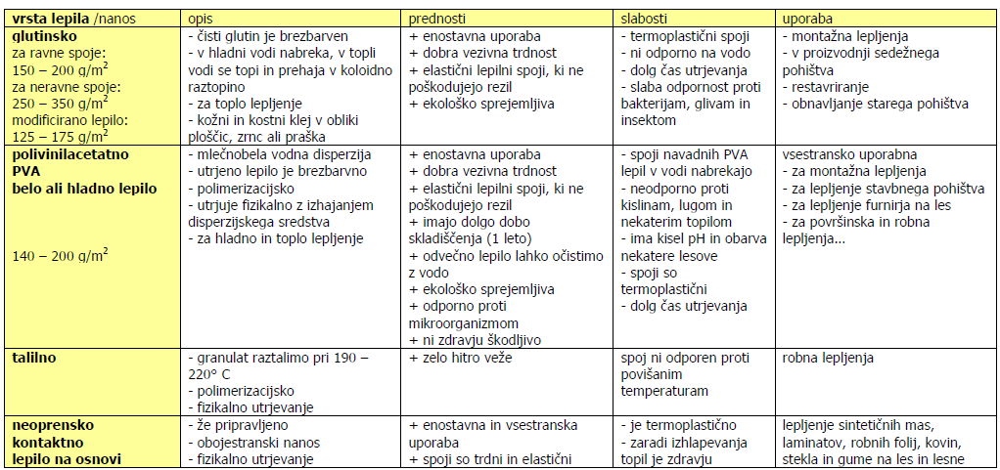{#fig:lepila-PVAC}

**PVAc - MEKOL D3**

- najpogosteje lepimo lesne spoje z eno-komponentnim polivinil-acetatnim (PVAc) lepilom. V Sloveniji ga proizvaja tovarna lepil MITOL in ga vodijo pod imenom MEKOL D3.

- [tehnični podatki lepila](https://www.mitol.si/wp-content/uploads/2018/12/MEKOL-D3_SLO.pdf)

- nanos 120-180 $g/m^2$ ali 0.12-0.18 mm 
- stiskanje:  min 0.5 $N/mm^2$
- stiskanje:  30-60min
- ~~čiščenje: operemo z vodo, obrišemo z vlažno krpo~~ (premisli!)
    - počakamo, da se posuši in odbrusimo
    - z brisanjem lahko lepilo nanesemo na lesno površino, ki se vpije v pore in oteži površinsko zaščito
    - najbolje je, da rob spoja zaščitimo s krep lepilnim trakom tako, da ko se ob stisku lepljencev lepilo izteče na lepilni trak (vedno pa te tehnike ni mogoče uporabiti, npr.: rogličenje).

**PVAc - MEKOL D4**

- podobno lepilo kot D3, le da je dvo-komponentno in bolj odporno na vlago in vodo. Primerno za notranjo uporabo, kot tudi za uporabo lesnnih spojev, ki so izpostavljeni vremenskim vplivom.

- [tehnični podatki](https://www.mitol.si/wp-content/uploads/2018/12/MEKOL-D4_SLO.pdf)

### Poliuretanska lepila

Poliuretansko lepilo je vrsta lepila, ki se uporablja za površinsko obdelavo materialov. Gre za sestavljeno mešanico poliuretanske smole, ki se uporablja za lepljenje in spojene različnih materialov, kot so les, kovina, plastika, steklo in keramika. Poliuretansko lepilo se zaradi svoje visoke trdnosti, fleksibilnosti in obstojnosti uporablja v številnih industrijskih in gradbenih aplikacijah. Ima odlične adhezijske lastnosti, ki omogočajo močno in trajno vez med materiali. Poleg tega poliuretansko lepilo zagotavlja tudi odpornost na vlago, temperaturne spremembe in kemijske vplive, kar ga naredi primernega za uporabo v različnih okoljih. Poliuretansko lepilo je na voljo v različnih oblikah, od tekočine do trdnega stanja, in se lahko nanese s ščetkanjem, valjanjem ali brizganjem. Zaradi svojih lastnosti in enostavne uporabe je poliuretansko lepilo vse bolj priljubljena izbira pri površinski obdelavi materialov."

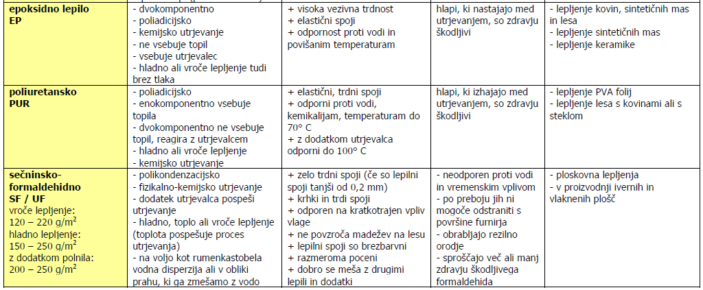{#fig:lepila-PUR}

**MITOPUR - E20**

- Mitopur E20 je enokomponentno, poliuretansko vodoodporno lepilo brez topil, ki veže na osnovi reakcije z
vodo. Spoj je temperaturno obstojen v območju od –40°C do +90°C in vodoodporen ter ustreza zahtevam
standarda EN 204-D4.

- [tehnični podatki](https://www.mitol.si/wp-content/uploads/2018/12/MITOPUR-E20_SLO.pdf)

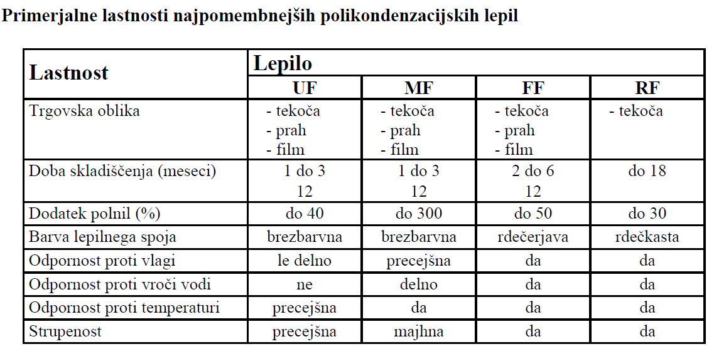{#fig:lepila_polikondenzacijska}

## VIJAČENJE

### SESTAVNI DELI VIJAKA

1. Glava
2. Telo
3. Navoj
4. Konica

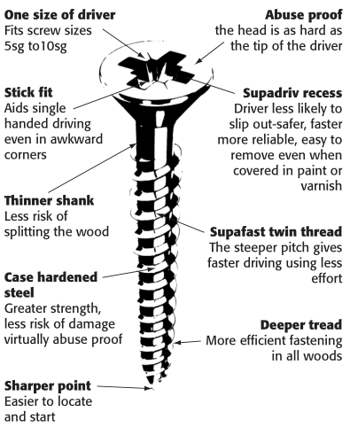{#fig:vijak_sestava}

#### Glava vijaka

#### Telo vijaka

1. Z vijačnico do konca glave:
    Taki vijaki se za spajanje lesa skoraj ne uporabljajo, ker ne zagotavljajo drsenja zunanjega pritrjevanega elementa. Ko pritrdite dva kosa lesa med seboj in se vijačnica vreže v lesna vlakna obeh elementov in je njuna medsebojna lega določena z vijačnico. Če ta dva elementa ne nalegata in želimo še nekoliko priviti vijak, da bosta elementa nalegala, bomo uničili vijačnico v zgornjem elementu. Tedaj bodo nastali odrezki, ki dodatno povzročijo radialne sile v tem delu lesa. Tedaj se poveča možnost za cepljenje in trenje med lesom in vijakom. To je zlasti očitno pri daljših vijakih.
    Če s takim vijakom spajamo dva lesna polizdelka, pa v zunanji polizdelek predhodno izvrtamo dovolj široko luknjo, ki omogoča nekaj zračnosti okoli navoja vijaka.
2. Z gladkim steblom:
    Omogoča drsenje zunanjega pritrjevanega elementa.

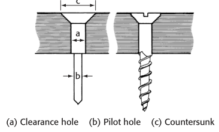{#fig:predvrtanje}

#### Navojnica

#### Konica vijaka

### Predpriprava vijačnega spoja

Da zmanjšamo verjetnost cepljenja lesnih vlaken velja upoštevati naslednja priporočila razporeditve vijakov.

|       Min razdalja       | brez predvrtanja | s pred-vrtanjem |
|:------------------------:|:----------------:|:---------------:|
|    od čela polizdelka    |        20d       |       10d       |
|    od roba polizdelka    |        5d        |        5d       |
|   med linijama vijakov   |        10d       |        3d       |
| med vijaki vzdolž vlaken |        20d       |       10d       |
Table: Priporočljive minimalne razdalje pri vijačenju(d = premer vijaka brez vijačnice). {#tbl:minRazdaljaVijacenja}

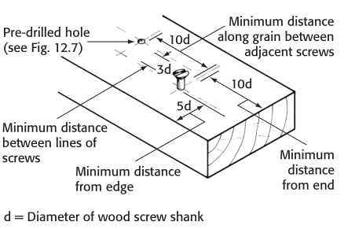{#fig:necepljenje_vijaki}

#### Pred-vrtanje

Pred-vrtanje je postopek pri vijačenju, pri katera na mesto kamor bomo privili vijak najprej izvrtamo manjšo luknjo. To preprečuje, da bi se vlakna preveč stlačila in zaradi teh napetosti povzročila cepljenje lesnih vlaken.
Premer pred-vrtanja naj bo v večini primerih enak premeru stebla vijaka. Če bomo vijak pritrdili v trši les (Hrast, Bukev) je lahko premer luknje nekoliko povečamo (do 0.5 mm), ali ga zmanjšamo, v kolikor vijačimo v mehkejši les.

Pogosto moramo v polizdelek, ki je na zunaji strani vijačnega spoja (pri glavi vijaka) pred-vrtati z nekoliko širšo luknjo, da omogoča drsenje vijaka in stisk obeh polizdelkov skupaj.

#### Pogrezovanje

Namen izdelave pogreza je oblikovanje stožčaste vdolbine na ustju izvrtine, v katero se pogrezne glava vijaka. Tako je glava poravnana s površino obdelovanca ali nekoliko pod njo. Pogrez omogoča pravilno naleganje glave vijaka, izboljša videz spoja in zmanjšuje možnost poškodb površine pri privijanju.

Pogrez izdelamo s posebnim rezalnim orodjem imenovanim grezilo. Kot njegovih med rezili je običajno 90°, ki ustreza kotu stožčaste glave vijakov. Prav zato običajni svedri niso primerni, saj je ta kot pri svedrih običajno 120°.

### Konstrukcijske značilnosti sodobnega lesnega vijaka

Na sliki je prikazan sodoben samorezni lesni vijak s posebej oblikovanimi konstrukcijskimi elementi, ki omogočajo učinkovitejše privijanje in zanesljivo spajanje lesenih elementov.

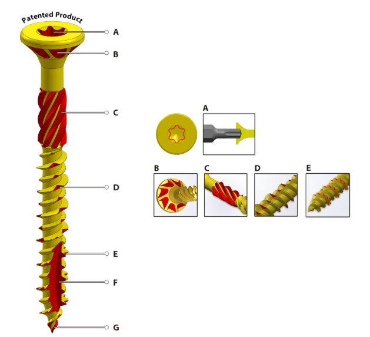{#fig:vijak_predpriprava}

Njegova geometrija je zasnovana tako, da zmanjšuje potreben vrtilni moment, trenje med vijakom in lesom ter nevarnost cepljenja lesa. Posamezni deli vijaka opravljajo različne naloge, od začetnega prodiranja v les in rezanja lesnih vlaken do zagotavljanja nosilnosti spoja ter pogrezanja glave.

**A – Zvezdasti utor (TX)**

Šestkraki zvezdasti utor omogoča učinkovit prenos vrtilnega momenta z vijačnega nastavka na vijak. Zaradi svoje oblike zmanjšuje možnost zdrsa nastavka iz glave vijaka in omogoča privijanje z večjim vrtilnim momentom, ne da bi pri tem poškodovali utor.

**B – Rezkalna rebra pod glavo**

Posebej oblikovana rezkalna rebra na spodnji strani glave med privijanjem režejo oziroma odstranjujejo lesna vlakna in oblikujejo stožčasto poglobitev. Tako omogočajo lažje pogrezanje glave vijaka v les, brez predhodne izdelave pogreza. Zmanjšujejo tudi možnost dvigovanja in trganja lesnih vlaken na površini obdelovanca.

**C – Spiralna rezkalna rebra na steblu**

Spiralna rebra med privijanjem razširjajo odprtino v lesu, skozi katero potuje gladko steblo vijaka. S tem zmanjšujejo trenje med steblom in lesom ter potreben vrtilni moment, kar je posebej pomembno pri daljših vijakih. Zmanjšujejo lahko tudi notranje napetosti v lesu in nevarnost njegovega cepljenja.

**D – Glavni navoj vijaka**

Navoj omogoča pretvarjanje vrtilnega gibanja vijaka v vzdolžno pomikanje in njegovo prodiranje v les. Njegovi zavoji se oprimejo lesnih vlaken ter zagotavljajo prenos aksialnih sil med vijakom in lesom. Geometrija, premer in dolžina navoja pomembno vplivajo na izvlečno nosilnost vijaka in trdnost vijačnega spoja.

**E – Rezalni zobci na navojih**

Posebej oblikovani zobci na robovih navoja med privijanjem zarezujejo v lesna vlakna in olajšajo oblikovanje odprtine. Tako zmanjšujejo odpor lesa proti prodiranju vijaka in potreben vrtilni moment. Zaradi lokalnega rezanja vlaken lahko zmanjšajo tudi radialne napetosti, ki povzročajo cepljenje lesa.

**F – Vzdolžni rezalni utor**

Vzdolžni utor prekinja del navoja in ustvarja dodatne rezalne robove, ki med vrtenjem vijaka režejo lesna vlakna. Hkrati zagotavlja prostor za odrezani oziroma izpodrinjeni material in olajša njegovo premikanje ob vijaku. S tem zmanjšuje odpor pri privijanju in nevarnost cepljenja lesa.

**G – Samorezna konica vijaka**

Ostra konica omogoča natančno namestitev vijaka na predvideno mesto in preprečuje njegovo zdrsavanje pri začetku privijanja. Posebej oblikovani rezalni robovi omogočajo začetno prodiranje v les in olajšajo vrezovanje prvih zavojev navoja. Pri ustreznih pogojih omogoča privijanje brez predhodnega vrtanja izvrtine.

### VPLIV SMERI VLAKEN NA VIJAČENJE

Smer vlaken v lesu ima pomemben vpliv na trdnost vijačnega spoja. Ko vijak privijemo pravokotno na smer lesnih vlaken, se vijačnica uspešno ugrizne med vlakna in jih skorajda ne poškoduje. To omogoča stabilno in močno povezavo, saj vlakna okoli vijačnice pomagajo trdno držati vijak na mestu.

V nasprotju pa privijanje vijaka vzporedno z vlakni povzroči rezanje ali poškodovanje vlaken, kar oslabi celovitost povezave. V tem primeru so vlakna lahko presekana, kar poveča tveganje, da se vijak izvleče ali iztrga iz lesa, saj ni več celovite strukture, ki bi ga podpirala.

Če je potrebno povezati dve letvi pod kotom 90 stopinj, npr. eno desko na čelo druge, lahko težavo omilimo z vstavljanjem moznika kake 2 cm od čela letve. Izvrtane luknje pravokotno na vlakna v deski omogočajo mozniku, da deluje kot stabilizator. Ko nato vijak zavrtamo v čelo letve, ga dejansko zavrtamo tudi v moznik, ki ima lesna vlakna pod pravim kotom glede na vijak, kar zagotavlja močnejšo in bolj zanesljivo spojitev.

<!--
Seminarska naloga:
Preskus kako smr vlaken vpliva na vijačenje
-->

### VIJAČNI NASTAVEK

#### PLOŠČATI
vijačni nastavek je namenjen vijakom, ki imajo eno vodoravno vdolbino (režo) v glavi vijaka. Ta oblika je bila prva vrsta razvitega vijačnega pogona, ki je bila več desetletij najpreprostejša in najcenejša za izdelavo. Vendar ta zasnova ni primerna za vijačenje z električnim orodjem, saj pogonski vijač pogosto zdrsne iz reže; to pogosto povzroči poškodbe vijaka in okoliškega materiala.

#### FEARSON
vijačni nastavek je križni z nekoliko bolj ostro konico izvijača. Prednost te oblike je, da en nastavek ustreza več različno velikim glavam vijaka. Od vijakov s Philips vijačnim nastavkom se razlikuje predvsem po tem, da imajo zareze ostre navpične robove in tako omogočajo večji navor vijačenja.

#### PHILIPS
vijačni nastavek je križne oblike. Zareze v glavi vijaka imajo nekoliko poševne robove in  tako nekoliko posebno obliko.  Oblika zareze je bila zasnovana kot neposredna rešitev na več težav z vijačenjem: ne omogoča večjih navorov vijačenja, saj zaradi poševnih robov zareze izvijač izvrže iz zareze, enostavna natančna poravnava izvijača z vijakom, ki preprečuje izmet izvijača na površino elementa ter enostavna uporaba z električnimi orodji. Označujemo ga z oznako **PH** in pripadajočo številko velikosti (#0 - #5).

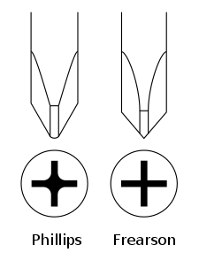{#fig:Frearson_vs_Phillips}

#### POZIDRIV
vijačni nastavek je križne oblike, zopet z ravnimi vzporednimi kraki. Med glavnimi kraki so še majhna rebra, ki oklepajo 45° z glavnimi kraki. Zasnovan je bil tako, da omogoča več navora, saj je tedaj električno orodje že omogočalo nastavitev maksimlnaega navora. Zareza v glavi vijaka in konica izvijača se točno prilegata in je tako je manj verjetno, da bo izvijač izskočil iz glave vijaka. Izvijači pozidriv so pogosto označeni z oznako **PZ**, ki jim sledi številka velikosti (#0 - #5). Na glavi vijaka pa so med zarezami ozke črtice, ki pomagajo razločevati pozidriv vijake od philips vijakov.

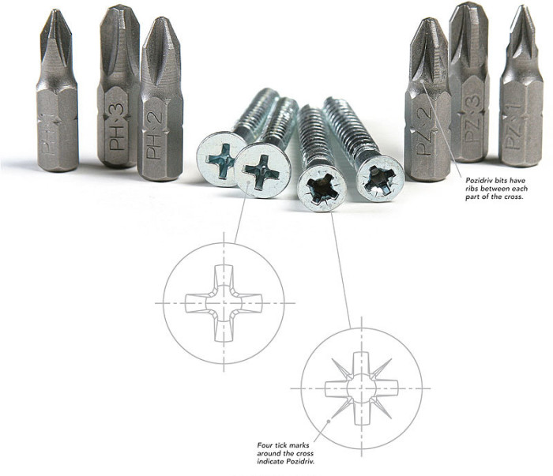{#fig:PHvsPZ}

#### ŠESTKOTNI UTOR
vijačni nastavek, zaradi poobčnoimenovanja znan inbus (ime podjetja: Innensechskantschraube Bauer und Schaurte), ima obliko pravilne šest-strane prizme. Nastavek izvijača in ugrezno zarezo vijačne glave je izredno enostavno izdelati in je tako cenovno ugodnejša. Zaradi vzporednih robov v zarezi omogoča vijačenje z večjimi navori. V primerjavi s  philips vijakom je v oprijem vijak - izvijač vključenih več stičnih površin, kar manj deformira zarezo vijačne glave. Zahteva pa nekoliko več pozornosti pri poravnavanju izvijača z glavo vijaka.

#### ZVEZDASTI UTOR
oblika vijačnega nastavka je 6-strana zvezda. Konica izvijača je rahlo konusne oblike, le toliko, da omogoča lažje poravavanje vijača z galvo vijaka. Čeprav je bil prvotno načrtovan, da bi otežil dostopnost vijakov slehernemu uporabniku, je s časom postal zelo priljubljen zaradi same uporabnosti in priročnosti. Torks blika omogoča zadovoljiv prenos navora, enostavno poravnavaje vijaka in vijača ter nudi relativno visoko odpornost proti deformaciji. Označujemo ga z oznako **T** in pripadajočo števiko velikosti.

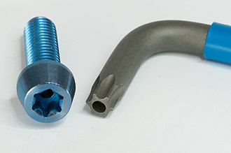{#fig:Torx_sample}

## KONSTRUKCIJSKE VEZI

Konstrukcijska vez je oblikovan spoj dveh ali več lesenih elementov, pri
katerem oblika spoja sama omogoča prenos sil in preprečuje premikanje elementov.
Konstrukcijsko vez lahko dodatno utrdimo z lepilom, moznikom, lamelo, vijakom,
zagozdo ali drugim veznim sredstvom.

Konstrukcijske vezi uporabljamo zato, da:

- povečamo naležno oziroma oprijemno površino;
- izboljšamo prenos nateznih, tlačnih in strižnih sil;
- preprečimo premikanje elementov v določeni smeri;
- zmanjšamo obremenitev lepilnega spoja;
- izdelamo trden in trajen kotni, vzdolžni ali ploskovni spoj.

Pri načrtovanju moramo upoštevati tudi krčenje in nabrekanje lesa. Konstrukcijska
vez ne sme lesa po nepotrebnem utesniti v smeri, v kateri se mora zaradi
sprememb vlažnosti dimenzijsko spreminjati.

### PREGLED OSNOVNIH KONSTRUKCIJSKIH VEZI

Osnovne oblike vezi so prikazane v učnem dokumentu:

[Konstrukcijske vezi – osnovne (PDF)](./slike/Konstrukcijske_vezi_osnovne.pdf)

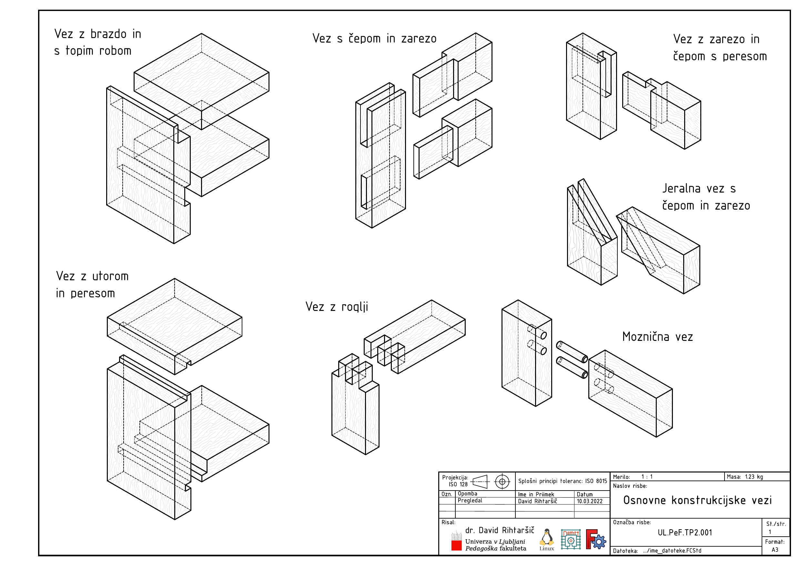{#fig:konstrukcijske-vezi-osnovne}

Na pregledni risbi so prikazane:

- vez z brazdo in topim robom;
- vez s čepom in zarezo;
- vez z zarezo in čepom s peresom;
- jeralna vez s čepom in zarezo;
- vez z utorom in peresom;
- vez z roglji;
- moznična vez.

Vezi lahko glede na smer in namen spajanja razdelimo na:

- **širinske vezi**, s katerimi iz več ožjih kosov izdelamo širšo ploskev;
- **dolžinske vezi**, s katerimi lesene elemente podaljšamo;
- **kotne vezi**, s katerimi povežemo elementa pod kotom, najpogosteje pod 90°;
- **obodne vezi**, s katerimi povežemo elemente v okvir, omaro ali drugo
  prostorsko obliko.

Pri vsaki vezi moramo preveriti smer obremenitve, smer lesnih vlaken, možnost
izdelave z razpoložljivim orodjem, potrebo po lepljenju ter možnost krčenja in
nabrekanja lesa.

### ŠIRINSKO SPAJANJE LESA S SPAHANIM ROBOM

- namen: iz manjših polizdelkov dobimo širše
- tangencialni raztezek lesa je $\beta_t = 6-12\%$
    - pravilna razporeditev polizdelkov

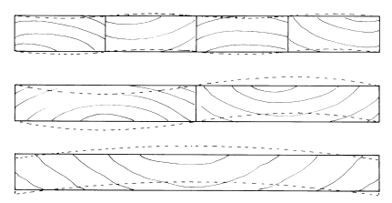{#fig:sirinsko}

- Pri pripravi lesa za širinsko spajanje na poravnalnem skobeljnem stroju uporabljajte tehniko skladnih kotov vzporednih stranic, ki jo prikazuje [@fig:skladni_koti_vzporednih]. To lahko zagotovimo tako:
    - da polizdeleku najprej poravnamo širšo stranico na poravnalnem skobeljnem stroju,
    - nato nasprotno stranico poravnamo vzporedno s prvo na debelinskem skobeljnem stroju,
    - šele nato poravnamo v pravi kot eno od ožjih stranic,
    - polizdelek obrnemo okoli vzdolžne osi in
    - v pravi kot poravnamo obe nasprotni stranici.

- Ko polizdelke širinsko spajamo, moramo paziti, da se izmenjujejo priležne in nasprotne ploskve poravnanih kotov.

- To isto tehniko lahko uporabljamo pri dolžinskem razrezu na mizarski krožni žagi.

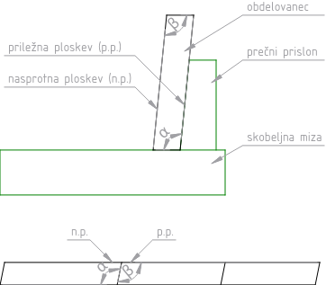{#fig:skladni_koti_vzporednih}

#### TOPA VEZ

- sosednje robove spahamo (poskobljamo) v paru
    - tehnika izničuje napako v naklonu roba

#### VEZ BRAZDO IN TOPIM ROBOM

- dimenzije peresa in brazde d/2 x d/2
- lepilo po vseh površinah

#### VEZ S PERESOM IN UTOR

- dimenzije peresa d/2 x d/3
- utor je 1mm globji za iztek lepila
- pogosto je čelo utora na skriti stran spoja celo 2 mm nižje, zato da vidna stran zagotavlja tesni ujem (ladijski pod)

#### LASTOVIČJA VEZ

- last. čep d/3 x d/3 (10°-12°) 
- utor d/3 x d/3 (1 mm globji)

#### KLINASTA VEZ

- utor in čep d/3 x d/3

#### ZOBATA VEZ

- glede na orodje
- pogosto oblika zob sovpada z zagozdo 1:20

{#fig:sirinsko_spajanje}

### DOLŽINSKO SPAJANJE LESA

- ~~problem: slab spoj lepljenja v smeri prečno na vlakna~~ 
- nujna tehnološka obdelava, s katero povečamo površino oprijema
- morda celo prehod na fizično vez
- pogosta mehanska obdelava z zobatimi vezmi (rezkalna glava z zobatimi noži)

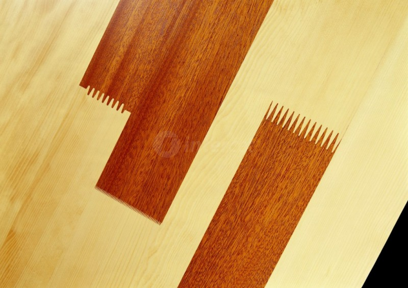{#fig:dolzinsko-spajanje-lesa}

### KOTNE VEZI

#### RAVNA PREPLOŠČITEV

- vogalna
- vmesna
- križna

#### ČEP IN ZAREZA

- vogalna
    - enojna
    - dvojna
    - čep s peresom (povečana trdnosti v smeri kota) 
        - dim. čepa 1š x 2/3š
        - dim. peresa 1/3d x 1/3d x 1/3š
    - jeralna (45° rama)

- vmesna
    - ravna
    - razširjena z zagozdama
        - zagozda 1:20 (to razmerje je max, da se ne cepi)
    - slepa z zagozdama

{#fig:kotno_spajanje}

#### Zagozde

Zagozdene konstrukcijske vezi so prikazane v ločenem učnem dokumentu:

[Konstrukcijske vezi z zagozdo (PDF)](./slike/Konstrukcijske_vezi_z_zagozdo.pdf)

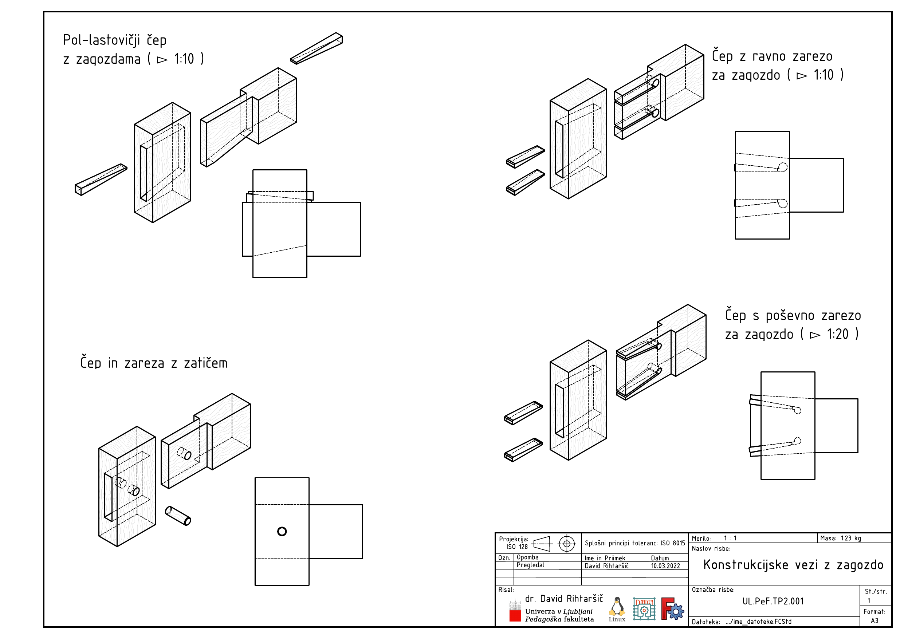{#fig:konstrukcijske-vezi-z-zagozdo}

Zagozde sodijo med najstarejše in najučinkovitejše mehanske načine spajanja lesenih elementov. Njihova uporaba temelji na preprostem, a zanesljivem principu trenja med zagozdo in lesom, ki nastane zaradi vkleščenja zagozde v pripravljeno odprtino ali režo. Pogosto se uporabljajo takrat, ko želimo izdelati konstrukcijsko vez brez uporabe lepil, bodisi zaradi zahtev po razstavljivosti spoja, bodisi zaradi tehnoloških ali estetskih razlogov. Leseni spoji z zagozdami so še posebej priljubljeni v tradicionalnem mizarstvu in restavratorskih delih, kjer se zahteva naravni, reverzibilen pristop brez kemičnih dodatkov.

Na dokumentu so prikazane različne izvedbe zagozdenih čepnih vezi:

- pol-lastovičji čep z zagozdama;
- čep z ravno zarezo za zagozdo;
- čep s poševno zarezo za zagozdo;
- čep in zareza z zatičem.

Učinkovitost zagozde je odvisna od njene oblike, smeri vstavljanja, prileganja in
razmerja med dolžino ter širino. Na risbi sta prikazani tudi približni razmerji
naklona **1 : 10** in **1 : 20**. Pri praktični izdelavi vedno upoštevamo
načrt, vrsto lesa in zahtevano trdnost spoja; razmerja ne smemo razumeti kot
univerzalno pravilo za vse zagozde.

Kljub temu imajo spoji z zagozdami tudi svoje pasti. Pri vstavljanju zagozde
nastanejo velike prečne sile, ki lahko razprejo čep ali povzročijo cepljenje lesa.
Cepljenje oslabi vez in lahko privede do propada spoja, zlasti pri obremenjenih
konstrukcijah. Zato zagozde ne zabijamo na silo, temveč preverimo njeno obliko,
prileganje, smer vstavljanja in stanje lesa.

Da bi se izognili cepljenju, je pomembno **ustrezno oblikovanje in vstavljanje
zagozde**. Konica zagozde naj bo poševna ali rahlo posneta, da les razširja
postopoma. Uporabljamo nadzorovane udarce in preverjamo, ali zagozda vstopa v
predvideni smeri. Pri zahtevnejših spojih lahko uporabimo razbremenilno režo ali
drugo konstrukcijsko rešitev, ki zmanjša prečne sile. Pazduho čepa naj tesno
stiska rob zareze, zagozda pa mora biti izdelana tako, da se sile porazdelijo
po lesu in ne povzročijo lokalnega cepljenja.

Zagozde tako ostajajo pomemben del mizarske prakse — združujejo preprostost, zanesljivost in estetsko vrednost lesenega spoja. Pravilno načrtovana in vstavljena zagozda omogoča trdno, trajno in po potrebi tudi razstavljivo povezavo, ki ohranja naravni značaj in mehanske lastnosti lesa.

#### JERALNE ČEPNE VEZI

- lice in odlice sta spojena skotom 45° (nariši - kolokvij)

#### MOZNIČENJE

- mozniki so navadno premerov fi = [6, 8 10] mm
- dolžina je l = (5±)x fi
- moznik velikosti za spoj naj bo dim. fi= 1/2d
- luknja naj bo globja za 1mm za iztek lepila

#### VEZI Z LAMELAMI

- jeralna z lamelo

### OBODNE VEZI

#### BRAZDA IN PERO

- kotna
    - brazdna vez in topi rob
        - dim peresa 1d x 1/4d (estetski namen)
- namen: pri omari se tako ne vidi čelo police

#### PERO in UTOR

- kotna
    - dim. peresa 1/3d x 1/3d
    - pokončna peresna vez
    - ležeča peresna vez (pero spodaj preprečuje cepljenje)
- vmesna
    - dim. peresa max 1/2d x 1/3d
    - dno omare
    - ni namenjena za police
        - velike strižne napetosti na peresu

#### RAVNA ROGLJIČNA VEZ

- kotna
    - tehnika ročnega rezanja rogljev obeh spojnih polizdelkov hkrati
        - sprednjega zamaknemo za debelino reza v levo in
        - odrežemo vse dezne robove čepov
        - zamaknemo v desno in
        - odrežemo levi rob čepa
- vmesna

#### LASTOVIČJI ROGLI

- kotna

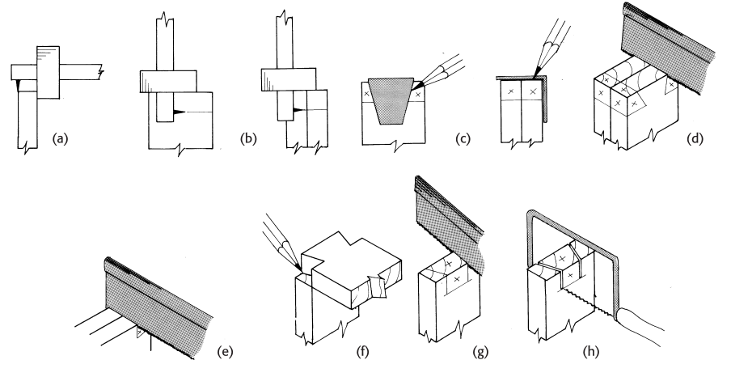{#fig:dovetails_making}

- vmesna:
    - le z enim lastovičnim peresom
    - drsni spoj

---

